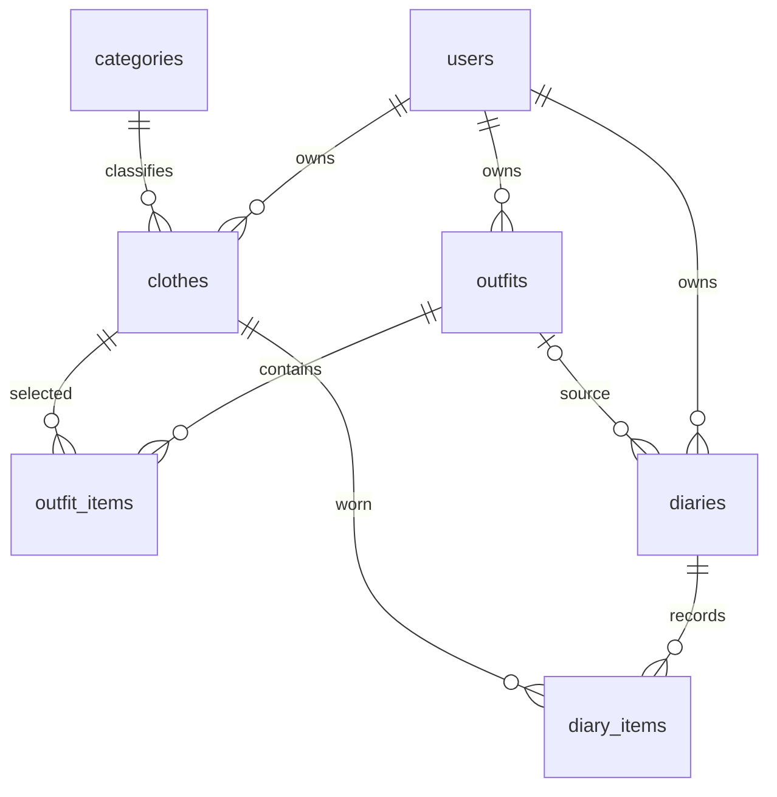

# 第二章 数据库设计

编撰日期：2026年11月18日。实现依据：提交`316cb19`及此前实际记录。本轮仅阅读和编写文档，没有重新连接数据库、启动服务或运行业务测试。

## 2.1 目标与物理约定

数据库承担用户归属、衣物资料、搭配方案、独立日记与有序明细的持久化。模型采用7表，避免给统计再建缓存表。数据库名wardrobe_demo，InnoDB、utf8mb4、utf8mb4_0900_as_cs；P2/P6/P7历史连接记录确认MySQL 8.0.28。本轮没有登录数据库，以下字段和约束按当前schema.sql静态核对，不表示再次执行了DDL。

四张实体表users/clothes/outfits/diaries采用INT UNSIGNED自增主键；categories采用固定字符串ID；明细采用复合主键。created_at、updated_at及令牌到期用DATETIME(3)保存UTC，均由程序显式写入，没有CURRENT_TIMESTAMP默认或ON UPDATE。wear_date为DATE，按Asia/Shanghai解释；连接dateStrings避免DATE经JS转换偏移一天。

## 2.2 逻辑关系

数据库只限定外键存在及每行结构，不用外键表达“每篇1～20件”。应用事务保证正常保存至少一件、最多20件、顺序连续。图中明细允许零行表达物理关系；业务成功提交的正常搭配/日记应有1～20行。

## 2.3 实际字段字典

以下47字段逐表来自[正式DDL](../../database/schema.sql)。无默认值表示省略该列不能依赖数据库自动填入；AUTO_INCREMENT是ID生成规则，不是普通DEFAULT。

### users

| 字段 | SQL类型 | 可空 | 默认值/生成 | 业务含义 |
| --- | --- | --- | --- | --- |
| id | INT UNSIGNED | 否 | AUTO_INCREMENT | 主键标识 |
| username | VARCHAR(20) | 否 | 无默认值 | 规范化账号 |
| password_hash | VARCHAR(255) | 否 | 无默认值 | 带盐scrypt编码 |
| nickname | VARCHAR(20) | 否 | 无默认值 | 昵称 |
| avatar_path | VARCHAR(255) | 是 | NULL | 头像稳定路径 |
| auth_token_hash | CHAR(64) | 是 | NULL | 当前令牌SHA-256摘要 |
| auth_expires_at | DATETIME(3) | 是 | NULL | 登录到期UTC时间 |
| created_at | DATETIME(3) | 否 | 无默认值 | 服务端写入的创建UTC时间 |
| updated_at | DATETIME(3) | 否 | 无默认值 | 服务端写入的更新UTC时间 |

### categories

| 字段 | SQL类型 | 可空 | 默认值/生成 | 业务含义 |
| --- | --- | --- | --- | --- |
| id | VARCHAR(16) | 否 | 无默认值 | 主键标识 |
| name | VARCHAR(20) | 否 | 无默认值 | 名称 |
| sort_order | SMALLINT UNSIGNED | 否 | 无默认值 | 固定分类序号或父项内展示顺序 |

### clothes

| 字段 | SQL类型 | 可空 | 默认值/生成 | 业务含义 |
| --- | --- | --- | --- | --- |
| id | INT UNSIGNED | 否 | AUTO_INCREMENT | 主键标识 |
| user_id | INT UNSIGNED | 否 | 无默认值 | 所属用户 |
| category_id | VARCHAR(16) | 否 | 无默认值 | 固定分类ID |
| name | VARCHAR(40) | 否 | 无默认值 | 名称 |
| image_path | VARCHAR(255) | 否 | 无默认值 | 单品稳定图片路径 |
| color | VARCHAR(20) | 否 | 无默认值 | 完整颜色文字 |
| season | VARCHAR(8) | 否 | 无默认值 | 适用季节枚举 |
| note | VARCHAR(500) | 否 | 空字符串 '' | 文字备注 |
| is_archived | TINYINT UNSIGNED | 否 | 0 | 归档标记0/1 |
| created_at | DATETIME(3) | 否 | 无默认值 | 服务端写入的创建UTC时间 |
| updated_at | DATETIME(3) | 否 | 无默认值 | 服务端写入的更新UTC时间 |

### outfits

| 字段 | SQL类型 | 可空 | 默认值/生成 | 业务含义 |
| --- | --- | --- | --- | --- |
| id | INT UNSIGNED | 否 | AUTO_INCREMENT | 主键标识 |
| user_id | INT UNSIGNED | 否 | 无默认值 | 所属用户 |
| name | VARCHAR(40) | 否 | 无默认值 | 名称 |
| occasion | VARCHAR(20) | 否 | 无默认值 | 使用场景 |
| note | VARCHAR(500) | 否 | 空字符串 '' | 文字备注 |
| is_archived | TINYINT UNSIGNED | 否 | 0 | 归档标记0/1 |
| created_at | DATETIME(3) | 否 | 无默认值 | 服务端写入的创建UTC时间 |
| updated_at | DATETIME(3) | 否 | 无默认值 | 服务端写入的更新UTC时间 |

### outfit_items

| 字段 | SQL类型 | 可空 | 默认值/生成 | 业务含义 |
| --- | --- | --- | --- | --- |
| outfit_id | INT UNSIGNED | 否 | 无默认值 | 所属搭配 |
| clothing_id | INT UNSIGNED | 否 | 无默认值 | 关联衣物 |
| sort_order | SMALLINT UNSIGNED | 否 | 无默认值 | 固定分类序号或父项内展示顺序 |

### diaries

| 字段 | SQL类型 | 可空 | 默认值/生成 | 业务含义 |
| --- | --- | --- | --- | --- |
| id | INT UNSIGNED | 否 | AUTO_INCREMENT | 主键标识 |
| user_id | INT UNSIGNED | 否 | 无默认值 | 所属用户 |
| wear_date | DATE | 否 | 无默认值 | 上海本地穿着日期 |
| source_outfit_id | INT UNSIGNED | 是 | NULL | 可空来源搭配 |
| occasion | VARCHAR(20) | 否 | 无默认值 | 使用场景 |
| mood | VARCHAR(12) | 是 | NULL | 可空心情文字 |
| photo_path | VARCHAR(255) | 是 | NULL | 可空日记稳定照片路径 |
| note | VARCHAR(1000) | 否 | 空字符串 '' | 文字备注 |
| created_at | DATETIME(3) | 否 | 无默认值 | 服务端写入的创建UTC时间 |
| updated_at | DATETIME(3) | 否 | 无默认值 | 服务端写入的更新UTC时间 |

### diary_items

| 字段 | SQL类型 | 可空 | 默认值/生成 | 业务含义 |
| --- | --- | --- | --- | --- |
| diary_id | INT UNSIGNED | 否 | 无默认值 | 所属日记 |
| clothing_id | INT UNSIGNED | 否 | 无默认值 | 关联衣物 |
| sort_order | SMALLINT UNSIGNED | 否 | 无默认值 | 固定分类序号或父项内展示顺序 |

## 2.4 主键、唯一约束及索引

共19个索引（含7主键、6个唯一索引及6个普通索引）。索引列顺序决定用途，不为所有字段机械建索引。

| 表 | DDL中的索引定义 | 用途 |
| --- | --- | --- |
| users | `PRIMARY KEY (id)` | 实体或关系唯一定位 |
| users | `UNIQUE KEY uq_users_username (username)` | 防止账号/摘要/分类名称或父项顺序/用户日期重复 |
| users | `UNIQUE KEY uq_users_auth_token_hash (auth_token_hash)` | 防止账号/摘要/分类名称或父项顺序/用户日期重复 |
| categories | `PRIMARY KEY (id)` | 实体或关系唯一定位 |
| categories | `UNIQUE KEY uq_categories_name (name)` | 防止账号/摘要/分类名称或父项顺序/用户日期重复 |
| clothes | `PRIMARY KEY (id)` | 实体或关系唯一定位 |
| clothes | `KEY idx_clothes_user_archived_id (user_id, is_archived, id)` | 用户归档范围列表 |
| clothes | `KEY idx_clothes_category (category_id)` | 外键支撑及按关联对象反向查询 |
| outfits | `PRIMARY KEY (id)` | 实体或关系唯一定位 |
| outfits | `KEY idx_outfits_user_archived_id (user_id, is_archived, id)` | 用户归档范围列表 |
| outfit_items | `PRIMARY KEY (outfit_id, clothing_id)` | 实体或关系唯一定位 |
| outfit_items | `UNIQUE KEY uq_outfit_items_order (outfit_id, sort_order)` | 防止账号/摘要/分类名称或父项顺序/用户日期重复 |
| outfit_items | `KEY idx_outfit_items_clothing (clothing_id, outfit_id)` | 外键支撑及按关联对象反向查询 |
| diaries | `PRIMARY KEY (id)` | 实体或关系唯一定位 |
| diaries | `UNIQUE KEY uq_diaries_user_date (user_id, wear_date)` | 防止账号/摘要/分类名称或父项顺序/用户日期重复 |
| diaries | `KEY idx_diaries_source_outfit (source_outfit_id)` | 外键支撑及按关联对象反向查询 |
| diary_items | `PRIMARY KEY (diary_id, clothing_id)` | 实体或关系唯一定位 |
| diary_items | `UNIQUE KEY uq_diary_items_order (diary_id, sort_order)` | 防止账号/摘要/分类名称或父项顺序/用户日期重复 |
| diary_items | `KEY idx_diary_items_clothing (clothing_id, diary_id)` | 外键支撑及按关联对象反向查询 |

## 2.5 外键、CHECK与删除行为

| 表/外键名 | 引用关系 | ON UPDATE | ON DELETE |
| --- | --- | --- | --- |
| clothes.fk_clothes_user | user_id → users.id | RESTRICT | RESTRICT |
| clothes.fk_clothes_category | category_id → categories.id | RESTRICT | RESTRICT |
| outfits.fk_outfits_user | user_id → users.id | RESTRICT | RESTRICT |
| outfit_items.fk_outfit_items_outfit | outfit_id → outfits.id | RESTRICT | RESTRICT |
| outfit_items.fk_outfit_items_clothing | clothing_id → clothes.id | RESTRICT | RESTRICT |
| diaries.fk_diaries_user | user_id → users.id | RESTRICT | RESTRICT |
| diaries.fk_diaries_source | source_outfit_id → outfits.id | RESTRICT | RESTRICT |
| diary_items.fk_diary_items_diary | diary_id → diaries.id | RESTRICT | CASCADE |
| diary_items.fk_diary_items_clothing | clothing_id → clothes.id | RESTRICT | RESTRICT |

7个CHECK均显式ENFORCED：ck_users_auth_pair要求令牌摘要与到期时间同时空或同时非空；ck_categories_sort限制1～7；ck_clothes_archived和ck_outfits_archived限制0/1；ck_clothes_season允许春、夏、秋、冬、春夏、春秋、秋冬、四季（DDL以UTF-8十六进制字面量表达）；ck_outfit_items_sort与ck_diary_items_sort要求sort_order≥1。

只有diary_items随diaries删除级联。其余外键ON DELETE RESTRICT；所有ON UPDATE RESTRICT。应用没有衣物/搭配物理删除接口，归档仅更改标记；删除日记不删除衣物、来源搭配或上传文件。特别注意outfit_items不配置CASCADE，不能在文档中写成删除搭配自动清理明细。

## 2.6 一致性职责与独立清单

| 规则 | 数据库保证 | 服务/请求入口保证 |
| --- | --- | --- |
| 日期唯一 | uq_diaries_user_date(user_id,wear_date) | 真实日期、不晚于上海当天；识别具体约束返回409，编辑排除自身语义 |
| 衣物不重复/位置不重复 | 两明细复合主键与order唯一索引 | 1～20件、整数ID、连续1～n，按数组顺序写入 |
| 引用存在 | 9个外键 | 目标/来源/所选衣物均属当前用户；FK不自动校验同一user_id |
| 归档及季节值域 | CHECK | 格式长度及允许范围、UI标记 |
| 图片稳定有效 | VARCHAR存路径 | 目录归属/存在/普通文件/签名；上传入口完整解码 |
| 主表与集合整体保存 | InnoDB事务 | 同连接提交/回滚，失败不留下半套组合 |

搭配明细存“方案”，日记明细存“当次事实”。source_outfit_id只是可空来历，不是当前日记衣物集合的计算来源。日记实际衣物允许不同于来源；修改outfit_items不写diary_items，才能保持旧记录独立。属性历史版本未实现，clothes改名/换图会影响所有引用处的当前展示。

## 2.7 导入映射、空值和路径

原data中的DEMO001、CLO001等是逻辑键，导入时逐条读取insertId，映射再插入明细。回滚不保证自增值复原，不能假设主键从1连续。样例对应1用户、7分类、24衣物、8搭配/37明细、12日记/53明细，图片为24主图加1附图，其他风格参考不建为衣物。

无头像/照片/来源/心情用NULL，空备注用合法空字符串，缺失字段仍为请求错误。稳定路径形如users/<本人ID>/<UUID>.jpg，不含主机；imageUrl由PUBLIC_BASE_URL派生，微信下载临时路径不进数据库。图片上传与业务保存是两个操作，数据库回滚不等于删除已成功上传的文件。

账号zyyuan实际用户ID21的展示导入另有独立映射，不能套原演示用户11的主键。复核依据为[原始正式映射](../evidence/P2-03/2026-11-06T16-42-33-726Z-apply-5b84797b/id-map.json)及[账号导入说明](../账号展示数据说明.md)，不是本轮实时查询。现有数据库包含多轮专用测试账号，本轮不重新导入、不导出私有全库。

| 相同逻辑键 | 原演示账号11的实际ID | zyyuan账号21的实际ID |
| --- | --- | --- |
| CLO001 | 34 | 242 |
| OUT001 | 18 | 87 |
| DIA001 | 31 | 73 |

以上来自两份已提交映射，不是按编号公式推算，新增记录之后也不应重新编号。

设计与真实结构历史核对见[P2-02记录](../P2-02执行与验收记录.md)，建表版本能力来自当时服务端验证；本轮字段字典只读取DDL。更完整的设计决策见[数据库设计依据](../数据库设计.md)。
