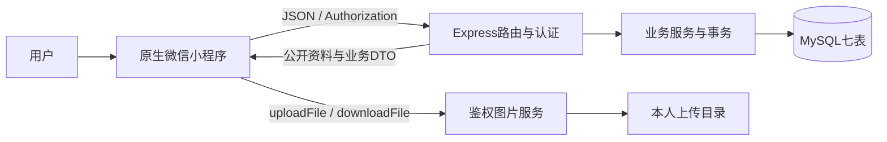
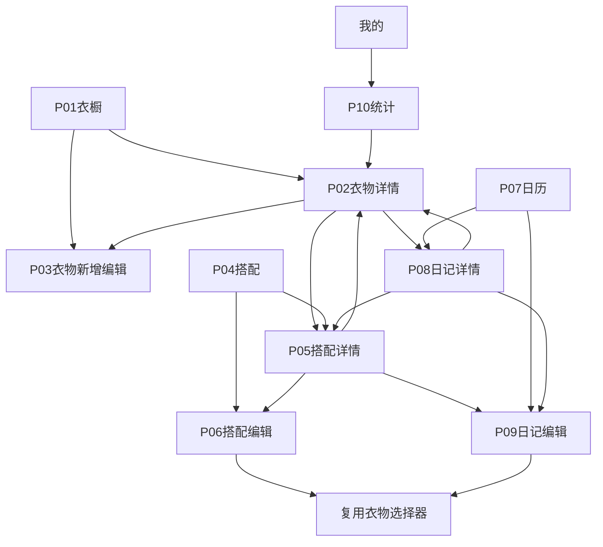
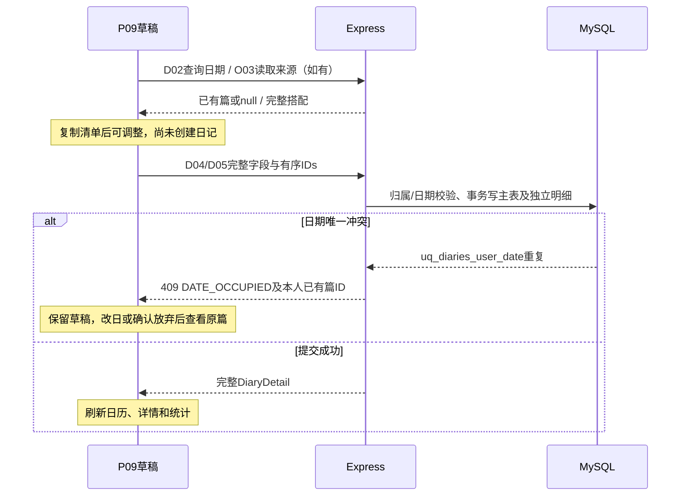

# 第三章 功能设计

编撰日期：2026年11月18日。实现依据：提交`316cb19`及此前实际记录。本轮仅阅读和编写文档，没有重新连接数据库、启动服务或运行业务测试。

## 3.1 总体结构与交互边界

原生小程序负责输入、展示、页面状态与本地登录信息；Express负责身份识别、入口校验、所有权、业务规则、事务和文件访问；MySQL保存七表结构和业务关系，上传目录保存实际图片。原始JSON是教学样例来源，不是原生运行时的数据接口。静态prototype独立用于早期设计说明，不承担正式持久保存。

HTTP前缀/api，普通成功响应data，错误响应error及对应状态码；图片读取成功直接返回二进制，不套data。前端只传相对路径，不重复添加/api。所有业务数据按当前认证用户查询，注册/登录/health是匿名入口，分类和图片也要求登录。

## 3.2 页面地图与模块输入输出

| 页号 | 实际pages路由 | 输入与显示 | 操作、输出及异常 |
| --- | --- | --- | --- |
| P01 | wardrobe/index | 名称/分类/颜色/单季/归档范围；两列单品、数量与分页 | 新增/详情、条件确认与重置；真正空态和筛选无结果分开，追加失败保留旧页 |
| P02 | clothes/detail/index | ID；属性、主图、备注、次数/最近日、C07/C08关联 | 编辑、归档恢复、关联详情；404统一不可访问，图失败可单独重试 |
| P03 | clothes/edit/index | 无ID新增或ID编辑；完整衣物表单 | 上传后保存稳定路径；非法字段定位，失败保留资料，取消确认 |
| P04 | outfits/index | keyword/occasion/archived；前4件真实预览与总件数 | 搜索、筛选、分页、新增/详情；查询代次隔离迟到响应 |
| P05 | outfits/detail/index | 搭配ID；全部单品、场景、备注、归档 | 单品→P02、编辑→P06、记录→P09；归档仍可访问 |
| P06 | outfits/edit/index | name/occasion/note及有序clothingIds | 面板选择、移除、排序、事务保存；取消面板不改父草稿 |
| P07 | diary/index | month/date；周一至周日网格、记录标记、选日摘要 | 上下月/今日、有篇→P08、过去空日→P09；未来只能浏览 |
| P08 | diary/detail/index | 日记ID；实际集合、可选照片/心情/文字、来源 | 编辑、确认删除、衣物/来源往返；无图/无来源合法，失败不补无关内容 |
| P09 | diary/edit/index | id或date或sourceOutfitId；完整日记草稿 | 两种创建、日期/实际衣物/照片维护；409保留草稿并提供已有篇入口 |
| P10 | statistics/index | month/未穿page；基准日、在用/七类/月度/累计/30天 | 切月、分页、点衣物；失败提示，真实0态，不把月天数当总日记数 |

登录auth/login/index、注册auth/register/index、profile/index及me/index辅助页不计入上述10页。统计从“我的”进入；归档按钮在衣物/搭配详情，不能把P03误写成单独提供归档接口。

## 3.3 认证、身份恢复和图片协作

注册规范化账号并保存密码派生值，成功后仍需登录；登录返回原令牌、到期时间和公开User。服务端只存摘要。小程序只保存令牌和到期时间，启动调用A04恢复User；401清会话并返回登录，不做静默刷新。再次登录使同账号旧令牌失效，退出按当前摘要条件撤销，不清掉之后更新的新登录态。

头像、衣物图、日记照片共用A07/A08。上传字段file，JPEG/PNG最大5MiB，认证先于上传解析，实际内容完整解码后保存本人目录。A05/C04/C05/D04/D05分别保存稳定路径。imageUrl只是派生读取地址，image组件使用带认证下载得到的tempFilePath，不能直接src=imageUrl期待自动附令牌。成功上传后即使草稿取消或换图也不删除文件。

## 3.4 衣物与搭配流程

衣物列表将已确认条件传C01，颜色辅助选项由C02按用户和归档范围返回。季节只传春夏秋冬单季，后端映射到该季与混合季/四季；不是字符串包含或颜色猜测。keyword为忽略大小写的字面子串，颜色完整值精确匹配，多条件AND。默认12条、pageSize上限50，条件变化回第1页。

P03保存完整表单，imagePath必填，空备注为''。P02归档/恢复只改标记且保留关系，返回时列表按原范围刷新。相关搭配含已归档标记，日记历史按日期排序，两部分独立分页。

P06的选择面板打开时复制父已选清单；筛选/翻页不清已选，以真实整数ID去重，按首次加入顺序追加；20件上限仍可反选。面板确认只改父草稿，取消、关闭不改；父页面可移除/上下移动，首尾相应操作不可用。保存传完整name/occasion/note/clothingIds，O04/O05同连接写主表和顺序明细，成功后读详情而不是用旧卡片覆盖响应。O01只预览前4件，O03/P06必须读取全部。

## 3.5 日记创建、冲突、改期及删除

从P05进入P09重新O03读取，而不是信任过期列表预览；复制来源ID和当前衣物、场景，照片/心情/文字从新草稿开始。直接从日历空日进入时source=null。编辑从D03读取原篇完整items。前端D02只提前提示，不提供并发保证；服务器唯一约束处理同时提交。编辑保留自身日期成功，改到另一篇占用日返回409，不合并。

当收到409，RequestError保留details.wearDate/existingDiaryId；页面保留所有字段，用户可改日期重试。跳转已有篇前确认放弃草稿，取消仍留原表单。修改实际衣物仍保留来源字段，不把来源误当实时同步规则。

D06先确认本人再删除，数据库只级联该篇明细。页面成功后switchTab回P07并定位被删日期为空摘要，不能留已删详情。改期保存后日历重新查询，旧日标记消失、新日出现；不维护本地独立日记数据库。原生返回提示虽调用相关API，真实表现已跳过验收，不保证所有工具/平台上的拦截效果。

## 3.6 统计、联动与界面规范

| 指标 | 计算设计 |
| --- | --- |
| 在用衣物/分类 | 本人is_archived=0；七类含0、sort_order排序 |
| 月度记录天数 | 所选月日记行数，不按单品数或照片数 |
| 单品累计次数/最近日 | 截至服务器asOf的关联日记数/MAX；无记录0/null |
| 常穿Top5 | 未归档且次数>0；次数降序、ID升序；不随month改累计范围 |
| 近期未穿 | [asOf-29天,asOf]内无本人日记关联，含从未穿；ID升序分页 |

S01在同连接一致性只读快照中形成数据。当前代码查询本人全部在用衣物的聚合结果，再在Node中筛选、排序和slice生成Top5及未穿页；这里没有把所有分页写成SQL LIMIT。此实现适用于本地实训规模，不宣称大数据性能实测。

日记写入后diary-state记录revision及选中日期，P02计数/历史与日历/统计重新查询；衣物/搭配revision驱动当前属性和关联刷新。页面请求代次、可见状态与session epoch共同拒收旧结果，不让账号A的旧响应覆盖B。无写返回尽量保留条件/位置，需重新查的数据不以旧页拼新页。

视觉沿用背景#FAF8F5、强调#A34F69、系统字体、两列完整单品图、搭配2×2实际预览、独立归档文字及底部安全区。原型截图与HTML内存刷新恢复不等于原生MySQL效果；当前文件经过WXML运算符修复，尚未新增工具编译证据。

## 3.7 接口与设计差异说明

| 分组 | 数量 | 核心职责 |
| --- | --- | --- |
| A01～A09 | 9 | 注册/登录/退出/当前用户/资料/分类/上传/媒体/health |
| C01～C08 | 8 | 衣物列表/选项/详情/新增/编辑/归档及两类关联 |
| O01～O06 | 6 | 搭配列表/选项/详情/新增/编辑/归档 |
| D01～D06 | 6 | 月历/按日/详情/新增/编辑/删除 |
| S01 | 1 | 所选月和服务器当天口径的统计 |

合计30接口，完整字段参见[接口说明](../接口说明.md)，实际路由以server/src/routes为准。当前D03额外返回sourceOutfitArchived以显示来源归档；我的页不展示无接口支撑的全库样例总量，不用monthDiaryDays冒充本人累计日记总数。D01现逐篇读取详情再截前三预览，未宣称已做月历批量聚合优化。早期文档“来源只弹窗”“D/S未实现”已由阶段6代码替代；这些历史句子不应作为当前流程。
