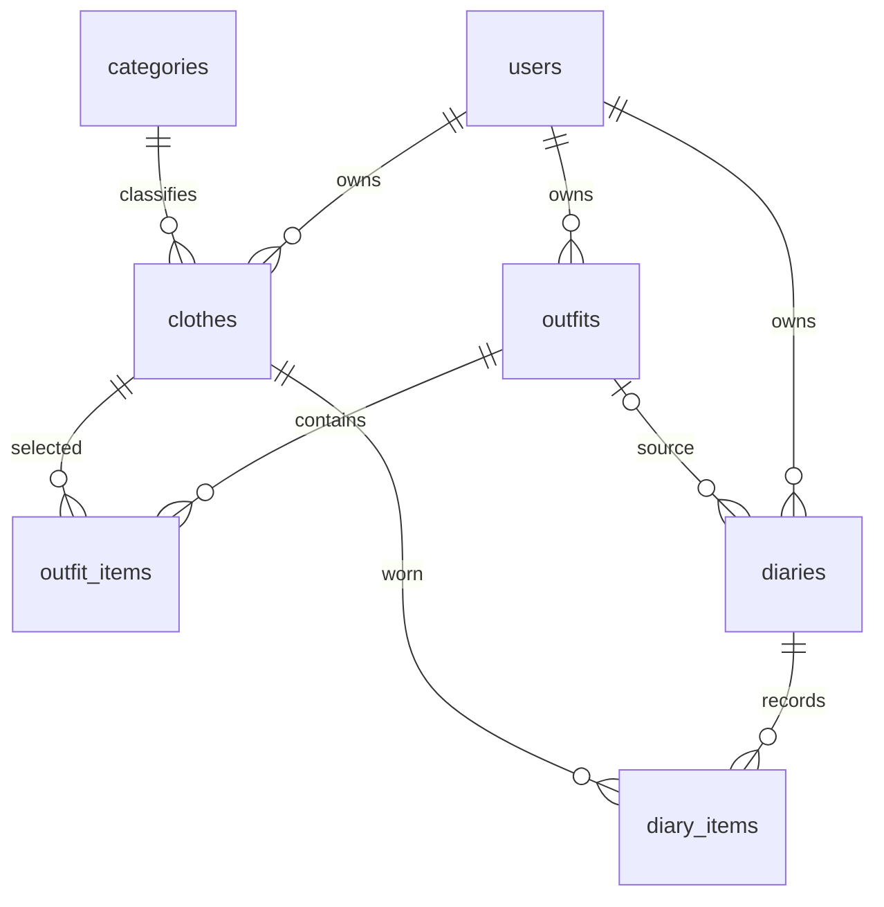
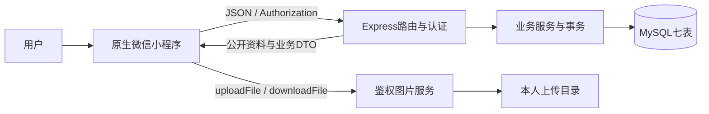
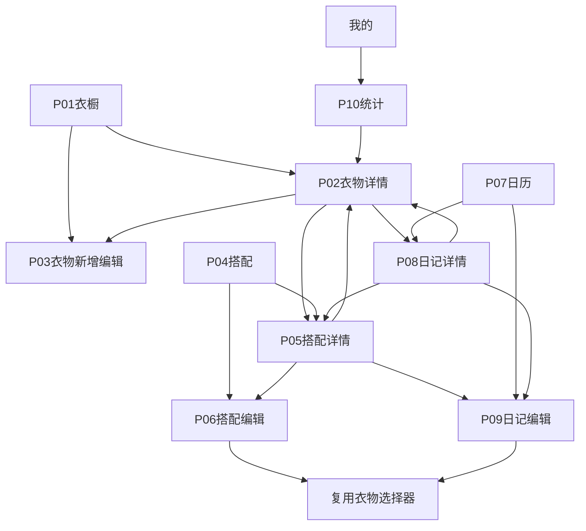
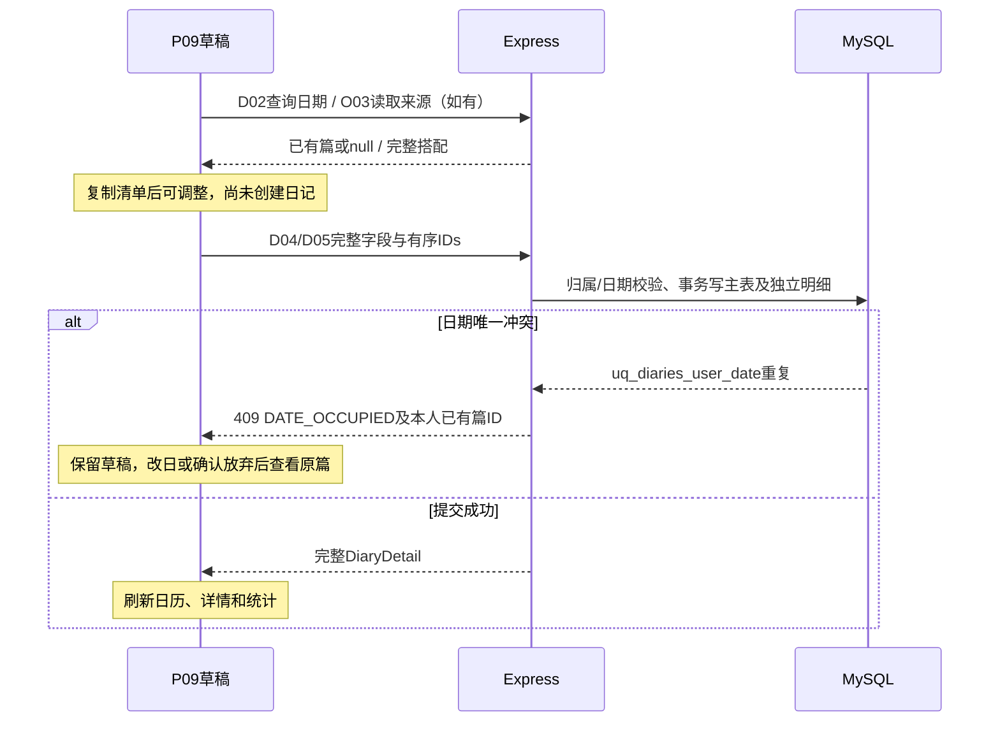

# 个人衣橱与穿搭日记全过程项目文档

项目类型：原生微信小程序、Node.js Express与MySQL的本地实训系统。
编撰日期：2026年11月18日。
姓名、学号、真实小组成员及开发贡献：待填写。

本文按需求分析→数据库设计→功能设计→系统编码→系统调试→系统测试组织全过程，正文与六份单篇一致。实现阅读基线316cb19，历史执行结果按各自版本引用；本轮未运行服务、数据库或业务测试，不添加新验收。项目已带明确例外完成行政交付，用户跳过的原生/剩余验收不写成通过，历史过程记录不回填。

## 目录

1. [需求分析](#第一章-需求分析)
2. [数据库设计](#第二章-数据库设计)
3. [功能设计](#第三章-功能设计)
4. [系统编码](#第四章-系统编码)
5. [系统调试](#第五章-系统调试)
6. [系统测试](#第六章-系统测试)

对应拆分稿和附属依据见[实训文档索引](实训文档索引.md)。现有源码zip不包含本轮扩写，不在本轮自动重打。


# 第一章 需求分析

## 1.1 选题背景与问题界定

个人衣物的数量增加后，用户不仅需要记住“有什么”，还需要把衣物组织成可重复使用的组合，并回顾实际穿过的日期。只保留照片容易缺少分类和检索；只保存搭配图又难以区分计划与实际穿着。本项目以“个人衣橱与穿搭日记”为题，将衣物、搭配方案和按日期保存的穿着记录连接起来，形成整理、组合、记录和回顾的使用闭环。

项目面向韩系日常女装的演示场景，视觉采用暖白与玫瑰色，单品图完整展示。样例包含不同服装类别、重复穿搭、跨月记录、有图与无图日记以及未穿单品，用于解释业务关系。图片和日记属于教学展示资料，不能将虚构穿搭记录描述为图片人物的真实生活。

教学任务书要求使用微信小程序、JavaScript、Node Express和MySQL，完成至少8个数据库功能页并提交六类全过程材料。本项目确定10个业务页面；登录、注册、资料和“我的”入口另计。任务书中的备选题目不扩展为本系统功能，2至3人的教学分组要求也不授权虚构实际成员。

## 1.2 用户、目标及范围

主要参与者为注册用户。不同账号管理各自的衣物、搭配、日记和上传图片；分类为全局只读数据。系统没有管理员页面、角色分配、支付或社交关系。演示和答辩人员是同一套功能的使用者，不单独设管理员账户。

目标一是让用户快速找到衣物并维护属性；目标二是保存可编辑、有顺序的搭配；目标三是记录某天实际衣物而非永久绑定搭配当前状态；目标四是用真实日记计算穿着次数、月度天数及近期未穿，帮助回顾使用情况。

| 需求编号 | 功能需求 | 交付页面/结果 |
| --- | --- | --- |
| R01 | 注册、登录、退出、恢复身份、维护昵称头像 | 辅助页及当前用户资料 |
| R02 | 名称检索与分类/颜色/季节/归档范围组合筛选、分页 | P01衣橱列表 |
| R03 | 读取单品属性、次数、最近日期和相关搭配/日记 | P02衣物详情 |
| R04 | 上传图片、创建和完整编辑衣物资料 | P03衣物新增/编辑 |
| R05 | 名称/场景/归档范围筛选搭配并分页 | P04搭配列表 |
| R06 | 读取全部有序单品、进入衣物/编辑/记录穿着，归档恢复 | P05搭配详情 |
| R07 | 多选去重、移除、排序、保存组合 | P06搭配新增/编辑 |
| R08 | 跨月查看日历、选日摘要、进入详情或空日补记 | P07穿搭日历 |
| R09 | 实际衣物清单、照片/文字/心情和来源，编辑与确认删除 | P08日记详情 |
| R10 | 从搭配预填或直接选衣，新增、改期、改记和日期冲突反馈 | P09日记新增/编辑 |
| R11 | 分类分布、月天数、累计Top5和最近30天未穿 | P10衣橱统计 |

本地演示使用原生小程序、Express后端及MySQL。既有配置限定本机127.0.0.1、wardrobe_demo和server/uploads；没有实现公网部署、手机真机发布或云存储。AI推荐、自动抠图、虚拟试衣、商城、天气及额外账号体系不在范围内。使用AI协助开发不等于产品具备AI推荐功能。

## 1.3 业务规则与非功能需求

用户身份取自认证上下文，不接受body.userId指定所有者。衣物和搭配归档只改变标记，默认列表隐藏但详情、历史关联仍可读取。归档不是物理删除，也不清除旧日记。搭配和日记均为1～20件本人衣物，去重且有序，可选本人归档衣物并标记。

同一用户每天至多一篇日记，日期为真实日历日期，不能晚于服务器上海当天。来源搭配可为空或已归档；日记保存独立衣物ID及顺序，修改来源搭配不能改变旧日记。衣物名称和图片仍取当前属性，系统没有属性历史快照，因此“清单独立”不等于“过去显示的名称图片永远冻结”。

统计来自日记关系：一次日记对某件衣物贡献一次穿着；保存搭配不增加次数；改期、改清单、删除和归档后重新查询。月份只控制月度天数，累计榜单和截至当天的30天窗口不随月份回退。图片使用本人目录的稳定路径持久保存，临时显示路径和派生URL不存入业务表。

| 非功能要求 | 实现约束及判断边界 |
| --- | --- |
| 可用性 | 筛选无结果、真正空态、加载、请求失败及单图失败有明确反馈；不使用假数据填补失败 |
| 数据一致性 | 主表/明细同一事务，日期唯一由数据库约束兜底；不维护重复计数字段 |
| 账号安全 | 密码采用带盐scrypt，令牌只持久化摘要；业务查询限定本人，图片读取需认证 |
| 可维护性 | 路由处理输入、服务执行业务，复用request/session/media，避免复制密码算法 |
| 数据持久性 | 业务保存在MySQL和本地上传目录，页面重新打开从接口读；未保存草稿不恢复 |
| 可追溯性 | 素材、逻辑ID映射、实际修复与历史测试有记录；跳过的验收不写成通过 |

上述是需求与实现约束，不是本轮重新实测的结论。原生布局、键盘和部分完整交互验收已由用户决定跳过，不能据设计直接宣称全部可用性验收通过。

## 1.4 典型用例

| 用例 | 参与者/前置条件 | 主流程 | 异常流程 | 结果 |
| --- | --- | --- | --- | --- |
| UC01新增衣物 | 已登录，持有本人可上传图片 | P01进入P03→选图上传→填名称分类颜色季节→保存→P02 | 上传失败保留待处理状态；无效字段就地提示，保存失败不丢已填资料 | 新衣物及稳定图片引用持久化 |
| UC02保存搭配 | 已登录，至少一件本人衣物 | P06打开选择面板→筛选多选→确认→排序→填名称场景→保存 | 取消面板不改父草稿；重复/超20拒绝；事务失败回滚 | 一套完整有序组合 |
| UC03从搭配记录 | 已登录，本人来源搭配可读 | P05→P09重新读来源→复制清单场景→改实际内容→选合法日期保存 | 日期已占返回已有篇ID，保留草稿，查看旧篇前确认放弃 | 日记来源与实际清单分别保存 |
| UC04直接补记 | 日历选择今日或过去空日 | P07→P09→直接选择衣物→填场景/可选内容→保存 | D02预查不能代替唯一约束；提交冲突时不覆盖既有篇 | 来源为null的日记 |
| UC05改期或删除 | 本人日记已存在 | P08编辑至空日期；或确认删除后回日历 | 编辑保留自身日期允许，改到另一占用日409；取消删除零业务写入 | 日历和统计按数据库重新计算 |
| UC06回顾统计 | 已登录 | 我的→P10→选月→看月度/累计/未穿→衣物详情 | 空月显示0，列表失败可重试；不使用旧月结果冒充新月 | 各指标口径明确且不泄露其他账号 |

## 1.5 需求来源与演示边界

原始数据是24件衣物、8套搭配、12篇日记（10月9篇、11月3篇），不是全部用户合计。2026年11月18日为zyyuan账号21补充同套展示数据的实际映射另有记录，未修改密码/昵称，不把其他账号图片路径直接挂给该账号。现场数量可能因后来操作变化，本文不宣称当前全库实时数量。

来源：[数据与页面约定](../数据与页面约定.md)、[总方案](../详细设计与实施方案.md)、[账号展示数据](../账号展示数据说明.md)、[素材来源](../../assets/SOURCES.md)。早期文档中的“只有JSON”“尚未实现”是历史状态，当前能力以代码及后期执行记录为准。成员姓名、学号、真实开发贡献均待填写，展示分工不能代替开发履历。


# 第二章 数据库设计

## 2.1 目标与物理约定

数据库承担用户归属、衣物资料、搭配方案、独立日记与有序明细的持久化。模型采用7表，避免给统计再建缓存表。数据库名wardrobe_demo，InnoDB、utf8mb4、utf8mb4_0900_as_cs；P2/P6/P7历史连接记录确认MySQL 8.0.28。本轮没有登录数据库，以下字段和约束按当前schema.sql静态核对，不表示再次执行了DDL。

四张实体表users/clothes/outfits/diaries采用INT UNSIGNED自增主键；categories采用固定字符串ID；明细采用复合主键。created_at、updated_at及令牌到期用DATETIME(3)保存UTC，均由程序显式写入，没有CURRENT_TIMESTAMP默认或ON UPDATE。wear_date为DATE，按Asia/Shanghai解释；连接dateStrings避免DATE经JS转换偏移一天。

## 2.2 逻辑关系



数据库只限定外键存在及每行结构，不用外键表达“每篇1～20件”。应用事务保证正常保存至少一件、最多20件、顺序连续。图中明细允许零行表达物理关系；业务成功提交的正常搭配/日记应有1～20行。

## 2.3 实际字段字典

以下47字段逐表来自[正式DDL](../../database/schema.sql)。无默认值表示省略该列不能依赖数据库自动填入；AUTO_INCREMENT是ID生成规则，不是普通DEFAULT。

### users

| 字段 | SQL类型 | 可空 | 默认值/生成 | 业务含义 |
| --- | --- | --- | --- | --- |
| id | INT UNSIGNED | 否 | AUTO_INCREMENT | 主键标识 |
| username | VARCHAR(20) | 否 | 无默认值 | 规范化账号 |
| password_hash | VARCHAR(255) | 否 | 无默认值 | 带盐scrypt编码 |
| nickname | VARCHAR(20) | 否 | 无默认值 | 昵称 |
| avatar_path | VARCHAR(255) | 是 | NULL | 头像稳定路径 |
| auth_token_hash | CHAR(64) | 是 | NULL | 当前令牌SHA-256摘要 |
| auth_expires_at | DATETIME(3) | 是 | NULL | 登录到期UTC时间 |
| created_at | DATETIME(3) | 否 | 无默认值 | 服务端写入的创建UTC时间 |
| updated_at | DATETIME(3) | 否 | 无默认值 | 服务端写入的更新UTC时间 |

### categories

| 字段 | SQL类型 | 可空 | 默认值/生成 | 业务含义 |
| --- | --- | --- | --- | --- |
| id | VARCHAR(16) | 否 | 无默认值 | 主键标识 |
| name | VARCHAR(20) | 否 | 无默认值 | 名称 |
| sort_order | SMALLINT UNSIGNED | 否 | 无默认值 | 固定分类序号或父项内展示顺序 |

### clothes

| 字段 | SQL类型 | 可空 | 默认值/生成 | 业务含义 |
| --- | --- | --- | --- | --- |
| id | INT UNSIGNED | 否 | AUTO_INCREMENT | 主键标识 |
| user_id | INT UNSIGNED | 否 | 无默认值 | 所属用户 |
| category_id | VARCHAR(16) | 否 | 无默认值 | 固定分类ID |
| name | VARCHAR(40) | 否 | 无默认值 | 名称 |
| image_path | VARCHAR(255) | 否 | 无默认值 | 单品稳定图片路径 |
| color | VARCHAR(20) | 否 | 无默认值 | 完整颜色文字 |
| season | VARCHAR(8) | 否 | 无默认值 | 适用季节枚举 |
| note | VARCHAR(500) | 否 | 空字符串 '' | 文字备注 |
| is_archived | TINYINT UNSIGNED | 否 | 0 | 归档标记0/1 |
| created_at | DATETIME(3) | 否 | 无默认值 | 服务端写入的创建UTC时间 |
| updated_at | DATETIME(3) | 否 | 无默认值 | 服务端写入的更新UTC时间 |

### outfits

| 字段 | SQL类型 | 可空 | 默认值/生成 | 业务含义 |
| --- | --- | --- | --- | --- |
| id | INT UNSIGNED | 否 | AUTO_INCREMENT | 主键标识 |
| user_id | INT UNSIGNED | 否 | 无默认值 | 所属用户 |
| name | VARCHAR(40) | 否 | 无默认值 | 名称 |
| occasion | VARCHAR(20) | 否 | 无默认值 | 使用场景 |
| note | VARCHAR(500) | 否 | 空字符串 '' | 文字备注 |
| is_archived | TINYINT UNSIGNED | 否 | 0 | 归档标记0/1 |
| created_at | DATETIME(3) | 否 | 无默认值 | 服务端写入的创建UTC时间 |
| updated_at | DATETIME(3) | 否 | 无默认值 | 服务端写入的更新UTC时间 |

### outfit_items

| 字段 | SQL类型 | 可空 | 默认值/生成 | 业务含义 |
| --- | --- | --- | --- | --- |
| outfit_id | INT UNSIGNED | 否 | 无默认值 | 所属搭配 |
| clothing_id | INT UNSIGNED | 否 | 无默认值 | 关联衣物 |
| sort_order | SMALLINT UNSIGNED | 否 | 无默认值 | 固定分类序号或父项内展示顺序 |

### diaries

| 字段 | SQL类型 | 可空 | 默认值/生成 | 业务含义 |
| --- | --- | --- | --- | --- |
| id | INT UNSIGNED | 否 | AUTO_INCREMENT | 主键标识 |
| user_id | INT UNSIGNED | 否 | 无默认值 | 所属用户 |
| wear_date | DATE | 否 | 无默认值 | 上海本地穿着日期 |
| source_outfit_id | INT UNSIGNED | 是 | NULL | 可空来源搭配 |
| occasion | VARCHAR(20) | 否 | 无默认值 | 使用场景 |
| mood | VARCHAR(12) | 是 | NULL | 可空心情文字 |
| photo_path | VARCHAR(255) | 是 | NULL | 可空日记稳定照片路径 |
| note | VARCHAR(1000) | 否 | 空字符串 '' | 文字备注 |
| created_at | DATETIME(3) | 否 | 无默认值 | 服务端写入的创建UTC时间 |
| updated_at | DATETIME(3) | 否 | 无默认值 | 服务端写入的更新UTC时间 |

### diary_items

| 字段 | SQL类型 | 可空 | 默认值/生成 | 业务含义 |
| --- | --- | --- | --- | --- |
| diary_id | INT UNSIGNED | 否 | 无默认值 | 所属日记 |
| clothing_id | INT UNSIGNED | 否 | 无默认值 | 关联衣物 |
| sort_order | SMALLINT UNSIGNED | 否 | 无默认值 | 固定分类序号或父项内展示顺序 |

## 2.4 主键、唯一约束及索引

共19个索引（含7主键、6个唯一索引及6个普通索引）。索引列顺序决定用途，不为所有字段机械建索引。

| 表 | DDL中的索引定义 | 用途 |
| --- | --- | --- |
| users | `PRIMARY KEY (id)` | 实体或关系唯一定位 |
| users | `UNIQUE KEY uq_users_username (username)` | 防止账号/摘要/分类名称或父项顺序/用户日期重复 |
| users | `UNIQUE KEY uq_users_auth_token_hash (auth_token_hash)` | 防止账号/摘要/分类名称或父项顺序/用户日期重复 |
| categories | `PRIMARY KEY (id)` | 实体或关系唯一定位 |
| categories | `UNIQUE KEY uq_categories_name (name)` | 防止账号/摘要/分类名称或父项顺序/用户日期重复 |
| clothes | `PRIMARY KEY (id)` | 实体或关系唯一定位 |
| clothes | `KEY idx_clothes_user_archived_id (user_id, is_archived, id)` | 用户归档范围列表 |
| clothes | `KEY idx_clothes_category (category_id)` | 外键支撑及按关联对象反向查询 |
| outfits | `PRIMARY KEY (id)` | 实体或关系唯一定位 |
| outfits | `KEY idx_outfits_user_archived_id (user_id, is_archived, id)` | 用户归档范围列表 |
| outfit_items | `PRIMARY KEY (outfit_id, clothing_id)` | 实体或关系唯一定位 |
| outfit_items | `UNIQUE KEY uq_outfit_items_order (outfit_id, sort_order)` | 防止账号/摘要/分类名称或父项顺序/用户日期重复 |
| outfit_items | `KEY idx_outfit_items_clothing (clothing_id, outfit_id)` | 外键支撑及按关联对象反向查询 |
| diaries | `PRIMARY KEY (id)` | 实体或关系唯一定位 |
| diaries | `UNIQUE KEY uq_diaries_user_date (user_id, wear_date)` | 防止账号/摘要/分类名称或父项顺序/用户日期重复 |
| diaries | `KEY idx_diaries_source_outfit (source_outfit_id)` | 外键支撑及按关联对象反向查询 |
| diary_items | `PRIMARY KEY (diary_id, clothing_id)` | 实体或关系唯一定位 |
| diary_items | `UNIQUE KEY uq_diary_items_order (diary_id, sort_order)` | 防止账号/摘要/分类名称或父项顺序/用户日期重复 |
| diary_items | `KEY idx_diary_items_clothing (clothing_id, diary_id)` | 外键支撑及按关联对象反向查询 |

## 2.5 外键、CHECK与删除行为

| 表/外键名 | 引用关系 | ON UPDATE | ON DELETE |
| --- | --- | --- | --- |
| clothes.fk_clothes_user | user_id → users.id | RESTRICT | RESTRICT |
| clothes.fk_clothes_category | category_id → categories.id | RESTRICT | RESTRICT |
| outfits.fk_outfits_user | user_id → users.id | RESTRICT | RESTRICT |
| outfit_items.fk_outfit_items_outfit | outfit_id → outfits.id | RESTRICT | RESTRICT |
| outfit_items.fk_outfit_items_clothing | clothing_id → clothes.id | RESTRICT | RESTRICT |
| diaries.fk_diaries_user | user_id → users.id | RESTRICT | RESTRICT |
| diaries.fk_diaries_source | source_outfit_id → outfits.id | RESTRICT | RESTRICT |
| diary_items.fk_diary_items_diary | diary_id → diaries.id | RESTRICT | CASCADE |
| diary_items.fk_diary_items_clothing | clothing_id → clothes.id | RESTRICT | RESTRICT |

7个CHECK均显式ENFORCED：ck_users_auth_pair要求令牌摘要与到期时间同时空或同时非空；ck_categories_sort限制1～7；ck_clothes_archived和ck_outfits_archived限制0/1；ck_clothes_season允许春、夏、秋、冬、春夏、春秋、秋冬、四季（DDL以UTF-8十六进制字面量表达）；ck_outfit_items_sort与ck_diary_items_sort要求sort_order≥1。

只有diary_items随diaries删除级联。其余外键ON DELETE RESTRICT；所有ON UPDATE RESTRICT。应用没有衣物/搭配物理删除接口，归档仅更改标记；删除日记不删除衣物、来源搭配或上传文件。特别注意outfit_items不配置CASCADE，不能在文档中写成删除搭配自动清理明细。

## 2.6 一致性职责与独立清单

| 规则 | 数据库保证 | 服务/请求入口保证 |
| --- | --- | --- |
| 日期唯一 | uq_diaries_user_date(user_id,wear_date) | 真实日期、不晚于上海当天；识别具体约束返回409，编辑排除自身语义 |
| 衣物不重复/位置不重复 | 两明细复合主键与order唯一索引 | 1～20件、整数ID、连续1～n，按数组顺序写入 |
| 引用存在 | 9个外键 | 目标/来源/所选衣物均属当前用户；FK不自动校验同一user_id |
| 归档及季节值域 | CHECK | 格式长度及允许范围、UI标记 |
| 图片稳定有效 | VARCHAR存路径 | 目录归属/存在/普通文件/签名；上传入口完整解码 |
| 主表与集合整体保存 | InnoDB事务 | 同连接提交/回滚，失败不留下半套组合 |

搭配明细存“方案”，日记明细存“当次事实”。source_outfit_id只是可空来历，不是当前日记衣物集合的计算来源。日记实际衣物允许不同于来源；修改outfit_items不写diary_items，才能保持旧记录独立。属性历史版本未实现，clothes改名/换图会影响所有引用处的当前展示。

## 2.7 导入映射、空值和路径

原data中的DEMO001、CLO001等是逻辑键，导入时逐条读取insertId，映射再插入明细。回滚不保证自增值复原，不能假设主键从1连续。样例对应1用户、7分类、24衣物、8搭配/37明细、12日记/53明细，图片为24主图加1附图，其他风格参考不建为衣物。

无头像/照片/来源/心情用NULL，空备注用合法空字符串，缺失字段仍为请求错误。稳定路径形如users/<本人ID>/<UUID>.jpg，不含主机；imageUrl由PUBLIC_BASE_URL派生，微信下载临时路径不进数据库。图片上传与业务保存是两个操作，数据库回滚不等于删除已成功上传的文件。

账号zyyuan实际用户ID21的展示导入另有独立映射，不能套原演示用户11的主键。复核依据为[原始正式映射](../evidence/P2-03/2026-11-06T16-42-33-726Z-apply-5b84797b/id-map.json)及[账号导入说明](../账号展示数据说明.md)，不是本轮实时查询。现有数据库包含多轮专用测试账号，本轮不重新导入、不导出私有全库。

| 相同逻辑键 | 原演示账号11的实际ID | zyyuan账号21的实际ID |
| --- | --- | --- |
| CLO001 | 34 | 242 |
| OUT001 | 18 | 87 |
| DIA001 | 31 | 73 |

以上来自两份已提交映射，不是按编号公式推算，新增记录之后也不应重新编号。

设计与真实结构历史核对见[P2-02记录](../P2-02执行与验收记录.md)，建表版本能力来自当时服务端验证；本轮字段字典只读取DDL。更完整的设计决策见[数据库设计依据](../数据库设计.md)。


# 第三章 功能设计

## 3.1 总体结构与交互边界

原生小程序负责输入、展示、页面状态与本地登录信息；Express负责身份识别、入口校验、所有权、业务规则、事务和文件访问；MySQL保存七表结构和业务关系，上传目录保存实际图片。原始JSON是教学样例来源，不是原生运行时的数据接口。静态prototype独立用于早期设计说明，不承担正式持久保存。



HTTP前缀/api，普通成功响应data，错误响应error及对应状态码；图片读取成功直接返回二进制，不套data。前端只传相对路径，不重复添加/api。所有业务数据按当前认证用户查询，注册/登录/health是匿名入口，分类和图片也要求登录。

## 3.2 页面地图与模块输入输出

| 页号 | 实际pages路由 | 输入与显示 | 操作、输出及异常 |
| --- | --- | --- | --- |
| P01 | wardrobe/index | 名称/分类/颜色/单季/归档范围；两列单品、数量与分页 | 新增/详情、条件确认与重置；真正空态和筛选无结果分开，追加失败保留旧页 |
| P02 | clothes/detail/index | ID；属性、主图、备注、次数/最近日、C07/C08关联 | 编辑、归档恢复、关联详情；404统一不可访问，图失败可单独重试 |
| P03 | clothes/edit/index | 无ID新增或ID编辑；完整衣物表单 | 上传后保存稳定路径；非法字段定位，失败保留资料，取消确认 |
| P04 | outfits/index | keyword/occasion/archived；前4件真实预览与总件数 | 搜索、筛选、分页、新增/详情；查询代次隔离迟到响应 |
| P05 | outfits/detail/index | 搭配ID；全部单品、场景、备注、归档 | 单品→P02、编辑→P06、记录→P09；归档仍可访问 |
| P06 | outfits/edit/index | name/occasion/note及有序clothingIds | 面板选择、移除、排序、事务保存；取消面板不改父草稿 |
| P07 | diary/index | month/date；周一至周日网格、记录标记、选日摘要 | 上下月/今日、有篇→P08、过去空日→P09；未来只能浏览 |
| P08 | diary/detail/index | 日记ID；实际集合、可选照片/心情/文字、来源 | 编辑、确认删除、衣物/来源往返；无图/无来源合法，失败不补无关内容 |
| P09 | diary/edit/index | id或date或sourceOutfitId；完整日记草稿 | 两种创建、日期/实际衣物/照片维护；409保留草稿并提供已有篇入口 |
| P10 | statistics/index | month/未穿page；基准日、在用/七类/月度/累计/30天 | 切月、分页、点衣物；失败提示，真实0态，不把月天数当总日记数 |

登录auth/login/index、注册auth/register/index、profile/index及me/index辅助页不计入上述10页。统计从“我的”进入；归档按钮在衣物/搭配详情，不能把P03误写成单独提供归档接口。



## 3.3 认证、身份恢复和图片协作

注册规范化账号并保存密码派生值，成功后仍需登录；登录返回原令牌、到期时间和公开User。服务端只存摘要。小程序只保存令牌和到期时间，启动调用A04恢复User；401清会话并返回登录，不做静默刷新。再次登录使同账号旧令牌失效，退出按当前摘要条件撤销，不清掉之后更新的新登录态。

头像、衣物图、日记照片共用A07/A08。上传字段file，JPEG/PNG最大5MiB，认证先于上传解析，实际内容完整解码后保存本人目录。A05/C04/C05/D04/D05分别保存稳定路径。imageUrl只是派生读取地址，image组件使用带认证下载得到的tempFilePath，不能直接src=imageUrl期待自动附令牌。成功上传后即使草稿取消或换图也不删除文件。

## 3.4 衣物与搭配流程

衣物列表将已确认条件传C01，颜色辅助选项由C02按用户和归档范围返回。季节只传春夏秋冬单季，后端映射到该季与混合季/四季；不是字符串包含或颜色猜测。keyword为忽略大小写的字面子串，颜色完整值精确匹配，多条件AND。默认12条、pageSize上限50，条件变化回第1页。

P03保存完整表单，imagePath必填，空备注为''。P02归档/恢复只改标记且保留关系，返回时列表按原范围刷新。相关搭配含已归档标记，日记历史按日期排序，两部分独立分页。

P06的选择面板打开时复制父已选清单；筛选/翻页不清已选，以真实整数ID去重，按首次加入顺序追加；20件上限仍可反选。面板确认只改父草稿，取消、关闭不改；父页面可移除/上下移动，首尾相应操作不可用。保存传完整name/occasion/note/clothingIds，O04/O05同连接写主表和顺序明细，成功后读详情而不是用旧卡片覆盖响应。O01只预览前4件，O03/P06必须读取全部。

## 3.5 日记创建、冲突、改期及删除



从P05进入P09重新O03读取，而不是信任过期列表预览；复制来源ID和当前衣物、场景，照片/心情/文字从新草稿开始。直接从日历空日进入时source=null。编辑从D03读取原篇完整items。前端D02只提前提示，不提供并发保证；服务器唯一约束处理同时提交。编辑保留自身日期成功，改到另一篇占用日返回409，不合并。

当收到409，RequestError保留details.wearDate/existingDiaryId；页面保留所有字段，用户可改日期重试。跳转已有篇前确认放弃草稿，取消仍留原表单。修改实际衣物仍保留来源字段，不把来源误当实时同步规则。

D06先确认本人再删除，数据库只级联该篇明细。页面成功后switchTab回P07并定位被删日期为空摘要，不能留已删详情。改期保存后日历重新查询，旧日标记消失、新日出现；不维护本地独立日记数据库。原生返回提示虽调用相关API，真实表现已跳过验收，不保证所有工具/平台上的拦截效果。

## 3.6 统计、联动与界面规范

| 指标 | 计算设计 |
| --- | --- |
| 在用衣物/分类 | 本人is_archived=0；七类含0、sort_order排序 |
| 月度记录天数 | 所选月日记行数，不按单品数或照片数 |
| 单品累计次数/最近日 | 截至服务器asOf的关联日记数/MAX；无记录0/null |
| 常穿Top5 | 未归档且次数>0；次数降序、ID升序；不随month改累计范围 |
| 近期未穿 | [asOf-29天,asOf]内无本人日记关联，含从未穿；ID升序分页 |

S01在同连接一致性只读快照中形成数据。当前代码查询本人全部在用衣物的聚合结果，再在Node中筛选、排序和slice生成Top5及未穿页；这里没有把所有分页写成SQL LIMIT。此实现适用于本地实训规模，不宣称大数据性能实测。

日记写入后diary-state记录revision及选中日期，P02计数/历史与日历/统计重新查询；衣物/搭配revision驱动当前属性和关联刷新。页面请求代次、可见状态与session epoch共同拒收旧结果，不让账号A的旧响应覆盖B。无写返回尽量保留条件/位置，需重新查的数据不以旧页拼新页。

视觉沿用背景#FAF8F5、强调#A34F69、系统字体、两列完整单品图、搭配2×2实际预览、独立归档文字及底部安全区。原型截图与HTML内存刷新恢复不等于原生MySQL效果；当前文件经过WXML运算符修复，尚未新增工具编译证据。

## 3.7 接口与设计差异说明

| 分组 | 数量 | 核心职责 |
| --- | --- | --- |
| A01～A09 | 9 | 注册/登录/退出/当前用户/资料/分类/上传/媒体/health |
| C01～C08 | 8 | 衣物列表/选项/详情/新增/编辑/归档及两类关联 |
| O01～O06 | 6 | 搭配列表/选项/详情/新增/编辑/归档 |
| D01～D06 | 6 | 月历/按日/详情/新增/编辑/删除 |
| S01 | 1 | 所选月和服务器当天口径的统计 |

合计30接口，完整字段参见[接口说明](../接口说明.md)，实际路由以server/src/routes为准。当前D03额外返回sourceOutfitArchived以显示来源归档；我的页不展示无接口支撑的全库样例总量，不用monthDiaryDays冒充本人累计日记总数。D01现逐篇读取详情再截前三预览，未宣称已做月历批量聚合优化。早期文档“来源只弹窗”“D/S未实现”已由阶段6代码替代；这些历史句子不应作为当前流程。


# 第四章 系统编码

## 4.1 实际目录与技术环境

前端采用原生Page/Component及CommonJS工具文件，后端采用Node ES模块与Express，mysql2 Promise API直接访问MySQL，没有ORM/TypeScript/额外前端框架。Node要求24.x；启动记录为Node24.16.0/npm11.14.1/MySQL8.0.28，属于历史本机环境，不是本轮新探测。server/package.json和锁文件固定Express5.3.0、mysql2 3.24.6、Multer2.5.0、Sharp0.35.5，database离线工具独立管理依赖。

| 路径 | 当前职责 |
| --- | --- |
| miniprogram/app.js、app.json | 启动恢复身份、页面注册和四个tab |
| miniprogram/pages | 10业务页及登录/注册/资料/我的 |
| miniprogram/components/clothes-picker | 隔离选择草稿、筛选分页、去重排序 |
| miniprogram/utils/request.js、session.js、media.js | JSON请求、登录态、带鉴权上传下载 |
| miniprogram/utils/*-state.js、diary-calendar.js | 会话revision、选日及纯日期网格 |
| server/src/index.js、config.js、db.js、app.js | 配置校验、连接池/目标探针、装配与监听 |
| server/src/routes、middleware | 外部输入校验、认证和HTTP映射 |
| server/src/services、utils | account/media/clothes/outfits/diaries/statistics及校验工具 |
| shared/password.mjs | 共享scrypt编码和校验 |
| database | schema、空库导入/核对、指定空账号样例补充 |
| server/test、server/scripts | 历史测试和独立验证工具，不是运行时接口 |
| assets/data/prototype/docs | 来源素材、样例、静态原型与过程记录 |

环境键为PORT、PUBLIC_BASE_URL、DB_HOST、DB_PORT、DB_NAME、DB_USER、DB_PASSWORD、UPLOAD_ROOT，实际值只在私有.env/进程环境。PORT默认3000，其余必需项由入口readConfig校验；DB_HOST/DB_NAME固定本项目本机目标，PUBLIC_BASE_URL端口须匹配，UPLOAD_ROOT必须解析到server/uploads。db.js配置utf8mb4、UTC、dateStrings，连接池复用；index先探测目标实例及7表再监听，health只代表HTTP响应。

## 4.2 请求入口、认证及账号

路由认证使用唯一Authorization头，提取Bearer原令牌，再查摘要和UTC有效期。业务userId取自req.auth，客户端不能替换所属用户。createAccountService.authenticate的关键行如下：

来源：[server/src/services/account.js](../../server/src/services/account.js)，第41行起。

```javascript
    async authenticate(token) {
      const hash = tokenHash(token);
      const rows = await query('SELECT id,username,nickname,avatar_path FROM users WHERE auth_token_hash=? AND auth_expires_at>?', [hash, utcSql(now())]);
      if (!rows.length) throw unauthenticated();
      return { userId: rows[0].id, tokenHash: hash, user: publicUser(rows[0], config.publicBaseUrl) };
    },
```

用户密码通过shared/password.mjs的异步scrypt派生，随机16字节盐、64字节结果，N=16384/r=8/p=1，编码携参数；验证重新派生并timingSafeEqual。注册账号由入口转小写，密码不trim。登录生成32字节随机token，以base64url返回，数据库仅存SHA-256摘要，固定7天到期。不是JWT，也没有refresh token。logout更新条件同时包含userId和当前摘要，避免旧退出清除后来的登录态。

input-validation统一检查完整body、未知字段、单值query、正整数和分页安全offset；text按Array.from计Unicode码点，名称/颜色等trim并禁换行，备注保留原文。服务层继续做需要数据库/文件系统的归属检查，不依赖外键判断同用户。对外JSON写入限制8KiB，衣物/搭配/日记路由在解析前认证。BusinessError映射状态/业务码/fields或details；未知异常500且响应不带SQL、密码或绝对目录。

## 4.3 鉴权图片的两次边界

mediaRoutes先认证再局部Multer.memoryStorage解析单file，最大5242880字节。createMediaService.upload不仅看扩展名或文件头，而是Sharp.metadata识别JPEG/PNG并raw解码验证完整内容：

来源：[server/src/services/media.js](../../server/src/services/media.js)，第21行起。

```javascript
      const image = sharp(buffer, { failOn: 'warning' });
      let format;
      try {
        ({ format } = await image.metadata());
        if (format !== 'jpeg' && format !== 'png') throw unsupported();
        await image.raw().toBuffer();
      } catch (error) {
        if (error instanceof BusinessError || error instanceof TypeError || error instanceof RangeError || error.code) throw error;
        throw unsupported();
      }
```

上传成功以UUID及实际jpg/png保存本人目录，独占创建避免覆盖；只清理本次独占打开但写失败的文件，不清理成功上传文件。返回imagePath/imageUrl/mimeType/size。后续表单validateImageReference再校验路径格式、当前用户、普通文件和签名，**不是每次保存表单重新完整解码**。这两层职责不能混写。

A08根据认证用户目录和单段UUID文件名读图，成功二进制和Content-Type，失败JSON。miniprogram/utils/media.js的upload解析wx.uploadFile字符串响应并检查201和本人路径；download带Authorization，检查200才接受临时路径，401复用session.expire。头像/衣物/日记保存稳定路径，不保存临时路径或URL，不公开静态挂载uploads。

## 4.4 搭配与日记事务

createOutfitsService.update先锁定本人父记录，校验所选衣物，再更新名称/场景/备注、删除仅本搭配明细、重新有序插入，事务提交后返回详情。没有写diary_items。关键片段如下：

来源：[server/src/services/outfits.js](../../server/src/services/outfits.js)，第82行起。

```javascript
    update(userId, id, input) {
      return transaction(async connection => {
        await owned(connection, userId, id, true);
        await selection(connection, userId, input.clothingIds);
        await connection.execute('UPDATE outfits SET name=?,occasion=?,note=?,updated_at=? WHERE id=? AND user_id=?', [input.name, input.occasion, input.note, utcSql(now()), id, userId]);
        await connection.execute('DELETE FROM outfit_items WHERE outfit_id=?', [id]);
        await insertItems(connection, id, input.clothingIds);
        return detailOn(connection, userId, id);
      });
    },
```

createDiaryService.transaction负责同连接begin/commit/rollback和release。create/update分别保存主表与children；children按数组序号写sort_order。update对目标日记FOR UPDATE，重新核对本人来源与衣物及照片；remove删除本人日记，级联只删其明细。日期唯一冲突必须来自确切约束，不能把任意重复键都转成DATE_OCCUPIED：

来源：[server/src/services/diaries.js](../../server/src/services/diaries.js)，第7行起。

```javascript
export const dateConflict=e=>e.code==='ER_DUP_ENTRY'&&e.errno===1062&&/for key '(?:diaries\.)?uq_diaries_user_date'/.test(e.sqlMessage??'');
```

事务回滚后按本人wearDate查已有ID，抛409并带wearDate/existingDiaryId。request.settleJson保留details，P09保存失败回调将其放入conflict，保留form和items。existing()先弹放弃草稿确认再进入旧篇。D02预查只是体验优化，最终唯一约束处理真实竞争。

日记来源只取来历，children写本篇实际衣物；不从sourceOutfitId推导日记明细。D03同时读来源当前名称/归档和衣物当前属性，因此不承诺属性历史版本。

## 4.5 日期和统计

dateInput严格检验YYYY-MM-DD和真实日历，1000～9999年；monthRange采用月首闭/下月首开，9999-12使用月末闭界。shanghaiDate从服务器时间取Asia/Shanghai，自然日与UTC事件时间分开。P07/P09通过S01.asOf校准当天，跨午夜再次显示重新取值，公共接口不接受asOf。

createStatisticsService.get在同连接REPEATABLE READ只读一致性快照中计算。聚合仅连接diary_items和本人截止日记，不连接outfit_items；MAX(CASE WHEN日期≥窗口首日 THEN 1 ELSE 0 END)标近期，统计月单独COUNT。生成累计榜单和未穿分页的短片段为：

来源：[server/src/services/statistics.js](../../server/src/services/statistics.js)，第11行起。

```javascript
      const all=rows.map(r=>({id:r.id,name:r.name,wearCount:Number(r.wearCount),lastWornDate:r.lastWornDate})),unworn=rows.filter(r=>!r.recent).map(r=>({id:r.id,name:r.name,lastWornDate:r.lastWornDate}));
      const result={asOf,month,activeClothesCount:rows.length,categoryDistribution:categories.map(r=>({...r,count:Number(r.count)})),monthDiaryDays:Number(days.count),mostWorn:all.filter(r=>r.wearCount>0).sort((a,b)=>b.wearCount-a.wearCount||a.id-b.id).slice(0,5),notWornRecently:{page,pageSize,total:unworn.length,items:unworn.slice((page-1)*pageSize,page*pageSize)}};
```

该代码在Node对聚合结果排序、筛选和slice，不是数据库端对所有统计指标做分页。COUNT转换Number、归档转boolean，空最近日期null；变更后重新查询，不增减重复缓存字段。

## 4.6 前端状态、会话和迟到响应

session.restore仅从storage取token/expiresAt，app.restoreIdentity调用/me补公开资料。adopt/clear递增epoch，request发送时保存snapshot，响应时currentError拒绝旧epoch；401进入统一登录导航，不能旧账号401把新账号退出。

来源：[miniprogram/utils/session.js](../../miniprogram/utils/session.js)，第9行起。

```javascript
function adopt(login) { epoch++; token = login.token; expiresAt = login.expiresAt; user = login.user; wx.setStorageSync(key, { token, expiresAt }); }
function setUser(value) { user = value; }
function clear() { epoch++; token = null; expiresAt = null; user = null; wx.removeStorageSync(key); }
function isCurrent(sent) { return sent.epoch === epoch; }
function expire(redirect = true) { clear(); if (redirect) showLogin(); }
```

页面另检查_visible/_alive/_sequence及图片attempt。epoch判断账号归属，sequence区分同账号不同查询，attempt与路径区分同一图槽位的不同下载。onHide隐藏图片并失效旧回调；保存/删除在后台完成时记录结果，onShow等待pending并正确导航，不盲目重新发写入。以上是逻辑实现和历史回调证据，不是当前工具实际验证声明。

wardrobe/outfit/diary状态只在本次会话内保存revision，写成功后相关页面重查，diary-state同时记录选日。P06/P09父草稿与选择器草稿复制隔离；页面取消不写业务，上传成功但取消只遗留已登记成功文件。没有持久业务缓存、自动重试或离线编辑系统。

## 4.7 导入、运行和协作说明

seed-demo.mjs要求专用空库，不可用于现有库重导；从JSON逻辑键映射insertId后写有序明细和复制图片。后补工具import-account-demo.mjs只填已存在且衣物/搭配/日记全空的账号，保持用户行不变；zyyuan已补充后不能重复运行以避免覆盖。源码包不含运行库或uploads，其他机器需按说明准备，不是解压即带有该账号样例。

AI工具使用可确认的Codex协助方案、代码、素材整理、自动验证与文档，用户负责需求取舍、授权及曾执行的本机交互。未保留可靠的全程模型清单，因此不写固定模型版本、生成比例或“全部独立手写”。两人建议展示模块见[展示稿](双人展示稿与模块分工.md)，真实姓名/学号/开发贡献待填写。

本章代码片段取自编撰时当前源文件，仅为解释已实现逻辑；本轮未执行这些函数、未安装依赖或运行测试。运行操作参见[启动说明](../本地启动与演示说明.md)，完整输入/响应参见[接口约定](../接口说明.md)。


# 第五章 系统调试

## 5.1 调试环境与定位过程

系统从静态原型逐步接入真实接口和数据库。调试应先区分故障发生在模板解析、页面回调、HTTP认证、业务校验、SQL事务还是本机启动，不能只凭“页面没数据显示”认定数据库出错。项目既有记录使用Windows本机Node24.16.0/MySQL8.0.28；工具历史版本2.02.2609250 Stable、基础库3.18.0。本轮未重新探测这些版本或启动工具。

HTTP返回状态和业务码用于区分输入/身份/归属/日期占用；数据库独立连接用于检查提交和回滚；回调测试用于稳定重现账号切换、隐藏页面和迟到响应。测试工具自身出错与业务源码缺陷分别记录。以下问题均有代码、提交或历史记录依据，没有在本轮重新制造故障。

## 5.2 实际问题与修复

### D01：未登录的衣物坏JSON先被解析（接口顺序问题）

**现象与触发：** 对衣物写接口发送匿名损坏或超限JSON，解析可能先于认证返回400/413，与“未知身份先401”的约定不一致。**原因：** 衣物路由在全局JSON解析后装配，业务处理器内部认证不能阻止上游解析。**修改位置：** server/src/app.js和routes/clothes.js。**处理：** 提前挂载衣物路由，路径内先requireAuth再8KiB json；正常已登录业务不变。**已有复查：** P4新增真实应用HTTP用例，最终149项测试通过；P4早先HTTP结果保留原版本，最后顺序差异由新增用例覆盖，不能称旧报告重新运行。见[P4记录](../P4执行与验收记录.md)。

### D02：所谓“新连接SQL”不足以证明独立物理连接（测试证据问题）

**现象与触发：** P5集成脚本中的中间SQL证据被最终汇总覆盖，池中再次取连接也不保证不同物理连接。**原因：** 报告文件复用及连接表述不精确，容易把间接检查描述成独立持久化验证。**修改位置：** P5核对脚本、SQL输出及review记录。**处理：** 分离证据文件，对已有16套组合各用独立物理连接读取顺序；不重新创建账号或改原数据。**已有复查：** 16个独立连接只读通过，原被覆盖中间证据不声称恢复，最终313项测试记录与阶段汇总保留。见[P5批次6汇总](../evidence/P5/run-20261117-b6-validation/batch6-summary.json)及[审查记录](../evidence/P5/run-20261117-b6-validation/review-results.json)。这是验证工具修正，不虚写为用户搭配丢失。

### D03：PNG夹具无法完整解码（测试输入问题）

**现象与触发：** P6 integration1/2向实际上传接口发送测试PNG，得到415。**原因：** 测试夹具不能满足真实解码校验，第二轮修正又受命令路径问题影响，不能据此放宽上传规则。**修改位置：** 测试图片准备与执行路径，保持生产解码校验。**处理：** 更新有效测试夹具并用新runId重跑，不覆盖失败目录、不清理已注册账号。**已有复查：** integration3完成94次HTTP、13组独立SQL、竞争/回滚/重启；前两轮失败和退出记录保留。见[P6执行记录](../P6执行与验收记录.md)和[integration3结果](../evidence/P6/run-20261117-integration3/results.json)。

### D04：旧照片失败回调污染新状态（前端异步问题）

**现象与触发：** 下载旧照片尚未返回时用户移除/替换照片或再次重试，旧失败可能覆盖新草稿状态。**原因：** 只检查页面或会话不足以区分同一照片槽位的不同请求。**修改位置：** miniprogram/pages/diary/edit/index.js的readPhoto、photoFailed、removePhoto。**处理：** 加独立attempt对象和路径比较，binderror核对当前src；离开时使旧读取失效。**已有复查：** removed photo/older retry failure回调用例通过。依据[P6最终审查](../evidence/P6/final-review.json)；这是Node回调环境复查，没有伪称原生照片交互本轮通过。

### D05：后台删除成功后回到已删详情（生命周期问题）

**现象与触发：** 用户发出删除后页面隐藏，请求在后台完成，返回时可能仍显示旧篇。**原因：** 成功结果只在当前可见回调处理，隐藏期间未被页面正确消费。**修改位置：** miniprogram/pages/diary/detail/index.js的remove/onShow/finishDelete。**处理：** 保存pending/epoch/deleted，onShow等待结算，同账号成功后清详情并回日历选日；旧账号结果不能导航。**已有复查：** hidden delete callback通过；[P6最终审查](../evidence/P6/final-review.json)记录该修复。

### D06：跨午夜后今天仍是旧日期（日期校准问题）

**现象与触发：** 页面持续打开跨过上海午夜，再进入日历，缓存today可能未更新。**原因：** 页面只使用首次本机或上次服务端日期，没有在重新显示时校准。**修改位置：** diary/index.js的onShow，配合S01.asOf。**处理：** 每次显示重取服务端当天，已有选中月/日保留，写入口仍服务器校验。**已有复查：** midnight server calibration回调通过；不增加公共时钟接口，不允许客户端改asOf。依据[P6最终审查](../evidence/P6/final-review.json)。

### D07：保护摘要未覆盖全部历史本机文件（证据范围问题）

**现象与触发：** P6起点用git ls-files采集，未跟踪/已忽略的历史报告不在起点集合内。**原因：** 跟踪文件集合与“全部本机历史文件”不是同一范围。**处理：** 从补充快照的真实时间开始递归记录608文件（含23未跟踪/忽略），收尾逐一相等，并核对既存P5六份本机报告摘要。**已有复查：** history-start/history-final相等；不回填起点、不声称最初就覆盖全部。见[P6记录](../P6执行与验收记录.md)。这不是恢复了丢失文件，而是纠正证明边界。

### D08：小程序WXML第13行条件解析失败（模板问题）

**现象与触发：** 衣物选择器index.wxml第13行的wx:if在编译时被用户报告解析错误。**原因：** {{...}}内使用HTML实体`&amp;&amp;`、`&lt;`等表示运算符，而不是表达式里的原始&&、<，导致解析无法按预期识别。**修改位置：** components/clothes-picker/index.wxml、pages/diary/index.wxml、pages/statistics/index.wxml。**处理：** 提交d9a1bb8将3模板的6处同类表达式替换成原始运算符，不改业务逻辑。

```xml
<view wx:if="{{!busy && !error && !items.length}}">没有匹配衣物，可重置条件。</view>
```

**已有复查边界：** 当时对修改模板内表达式做了JavaScript语法解析及diff检查；没有运行微信开发者工具编译。提交差异和用户问题构成修复依据，但仓库没有新的原生编译通过截图，文档不补造。这一修复晚于P6的364项发布验证，不能拿364项报告证明该模板已被工具编译。

### D09：交付包和账号样例没有自动随源码变化（交付/环境问题）

**现象：** WXML修复和账号导入后，用户询问final.zip是否更新，原包仍对应494e23d。**原因：** Git提交、本机运行数据和外部zip是三个独立产物，不会自动相互复制。**处理：** 源码包随后按0d99fa8重建，SHA/manifest/release同步更新；账号zyyuan通过专用工具复制25图并以事务写24/8/12，保留密码昵称。**已有复查：** 导入记录、新连接月分布/图片引用数及包版本记录，不是新全量验收。[账号说明](../账号展示数据说明.md)。

## 5.3 启动与联调经验

P7已有启动/冒烟记录确认MySQL8.0.28目标库和7表，自有3017响应health并能认证读衣橱。原3000进程未停止；临时端口须与PUBLIC_BASE_URL和客户端一致。账号67创建衣物240/241、搭配86、日记72，修改来源后日记仍含两件，删新篇后统计回基线，最终退出。依据[真实主链](../evidence/P7/run-20261117-delivery/smoke.json)，本轮没有再次启动。

定位顺序应是：先看当前配置/进程，再看HTTP状态与错误码，最后看本人记录及事务证据。health200不能替代数据库业务读；恢复说明不能替代净机安装实测。原生自动操作曾受工具输入/服务端口条件限制，后续采用用户人工记录，最终剩余操作由用户跳过；不能在调试章节把这些条件隐藏成全部自动完成。

## 5.4 已知限制与处理结论

原生布局/键盘/返回完整实测、后期截图、净机复现、手机真机及公网未形成完整通过证据，按用户授权保留例外而不补测。历史P5未闭合的验收在最终行政收尾说明中取消待办，不等于追认通过。姓名、学号、真实分工待填。临时发布工作树曾因自动审批拒绝junction删除而保留在本机，未混进源码包，不把清理拒绝解释成运行业务故障。

本轮只整理已发生事实，不修源码、不制造新故障，不要求用户恢复已经跳过的操作。当前代码具备的行为与实际验证程度分别在第三章和第六章描述。


# 第六章 系统测试

## 6.1 目标、对象和本报告性质

测试目标是验证账号隔离、稳定图片路径、搭配/日记有序事务、日期唯一、历史独立及统计一致性，同时检查客户端取消、迟到响应和错误反馈。报告汇编已有执行证据，不是2026年11月18日重新运行的测试结论。本轮未启动服务、安装依赖、登录数据库、运行测试或写业务数据。

编撰依据代码提交316cb19；P6发布验证针对当时隔离发布内容（实施提交cea3167、里程碑4ea0f4e/p6），不是当前HEAD整包新测试。后续final-delivery收尾、WXML修复d9a1bb8、账号导入0d99fa8、展示稿316cb19分别有各自范围，不能合并声称“当前版本所有验收通过”。

## 6.2 环境、方法和证据强度

历史环境为Windows本机、Node24.16.0/npm11.14.1、MySQL8.0.28，服务使用不同专用端口避免干扰常用3000。数据库连接UTC/dateStrings，业务当天Asia/Shanghai。工具历史版本2.02.2609250 Stable/基础库3.18.0，服务端口保持关闭。没有当前净机或手机真机完整验证。

| 方法 | 可证明内容 | 不可替代内容 |
| --- | --- | --- |
| 单元/输入测试 | 格式、日期边界、错误映射、纯逻辑 | 不证明数据库真实约束或原生编译 |
| Node页面回调测试 | epoch/查询代次、取消、后台结算及草稿状态 | 不证明键盘、安全区、真实组件视觉 |
| 真实HTTP | 运行接口的状态码、字段、认证及业务读写 | 不等于用户实际点击小程序 |
| 独立SQL/连接 | 主表/明细顺序与事务提交结果 | 不等于图片界面可见 |
| 写后故障/竞争 | 部分写入回滚、唯一键并发兜底 | 不等于所有未来并发场景已覆盖 |
| 实际进程重启 | 持久记录/照片与前后响应相同 | 不等于工具重新编译或净机恢复 |
| 原生人工/截图 | 当时工具观察到的交互及外观 | 不能由代码检查自动推定；后期已跳过 |

## 6.3 历史执行结果及版本对应

| 阶段/提交范围 | 实际记录 | 范围和局限 | 证据 |
| --- | --- | --- | --- |
| P4/p4 3e2868c | 149项测试及38组最终收尾 | 衣物/基础接口及当时人工；有额外换图直接证据范围说明，非当前模板全验 | [P4记录](../P4执行与验收记录.md) |
| P5 Batch6/9835666 | 313项测试、搭配/C接口302条、基础121条 | 相应批次有SQL补证、两处回滚和重启；阶段最终原生不闭合 | [批次汇总](../evidence/P5/run-20261117-b6-validation/batch6-summary.json) |
| P6 integration3 | 94条HTTP、13组独立SQL | 日记/统计主链、20件/1000字、竞争和写后回滚 | [结果](../evidence/P6/run-20261117-integration3/results.json) |
| P6 boundaries2 | 最终http.json含117条；results.http写115 | 完整明细包括最终退出；口径差异保留，不把115+117当两轮 | [HTTP明细](../evidence/P6/run-20261117-boundaries2/http.json) |
| P6最终工作区 | 366/366 | 含2项当时外来未提交P5测试，不是隔离发布数量 | [工作区日志](../evidence/P6/final-node-tests.txt) |
| P6发布内容隔离 | 364/364 | 当时明确提交代码，不包含上述两项；不是本轮重跑 | [隔离日志](../evidence/P6/published-check-tests.txt) |
| P7/8cc80d0 | 15次JSON请求及1次上传 | 一条专用账号主链，不重跑历史全量/全库SHA | [smoke](../evidence/P7/run-20261117-delivery/smoke.json) |
| WXML/d9a1bb8 | 3模板6处替换，已有语法检查说明 | 未做工具编译；没有新的全量测试日志 | [修复模板](../../miniprogram/components/clothes-picker/index.wxml)、第五章 |
| 账号导入/0d99fa8 | 24/8/12、37/53、25图，账号21 | 一次事务及新连接读取，不是新增全量测试 | [导入说明](../账号展示数据说明.md) |

以上数量不可简单求和：不同轮次复用了用例，HTTP日志也包含注册登录、故意失败请求。目的在于说明证据覆盖的业务，不以累计数字夸大质量。P6最终review发现5项问题并修复，reviewRounds=1；报告不声称本轮又做了一次审查。

## 6.4 代表性用例及实际证据

下表“实际”只转述对应历史记录；前置数据均为当轮专用账号/夹具，不要求现在再执行。

| 编号/模块 | 前置条件 | 操作 | 预期 | 实际及证据 |
| --- | --- | --- | --- | --- |
| T01账号/隔离 | A/B专用账号及各自令牌 | A读取/修改B资源，匿名读需认证接口 | 跨用户404或选择拒绝，匿名401，不泄露B内容 | P5/P6真实HTTP记录覆盖，见[P5汇总](../evidence/P5/run-20261117-b6-validation/batch6-summary.json) |
| T02图片 | 本人合法JPEG/PNG及损坏夹具 | 上传、读取、跨账号读取 | 201及稳定本人路径；非本人/缺失拒绝 | P6 foundation真实HTTP与P6记录；早期坏PNG415失败也保留，非所有尝试成功 |
| T03搭配清单 | 本人1/4/5/20件有序组合 | 保存、重开、移除/调序 | 预览前4/详情全部，数据库sort_order正确 | P5 Batch6真实HTTP及16套独立SQL补验通过，见批次汇总 |
| T04日期唯一 | A已有某日一篇，B另账号 | A重复日期、编辑自身、B同日 | A重复409、保留自身允许、B允许 | P6 integration3与边界HTTP符合预期 |
| T05真实竞争 | A目标日原为空，两条请求 | 同时创建同日 | 仅一条201、一条409，冲突ID指本人篇 | [competition.json](../evidence/P6/run-20261117-integration3/competition.json)记录201/409 |
| T06新增失败 | 主表和部分明细已写入 | item-inserted后抛指定错误 | 全部回滚 | [rollback.json](../evidence/P6/run-20261117-integration3/rollback.json)记录同连接362/新连接365 |
| T07编辑失败 | 本人旧篇有明细 | 更新主表删旧明细后故障 | 原主表/原集合恢复 | 同报告新连接366核对，非空事务模拟 |
| T08删除失败 | 本人旧篇及明细存在 | 删除和级联后提交前故障 | 主表与明细都恢复 | 同报告新连接367核对；不删原样例 |
| T09历史独立 | 搭配86及日记72实际[240,241] | 搭配改成[241]后读日记 | 日记仍[240,241] | P7 smoke.diaryIndependent=true |
| T10统计回退 | 两件衣物、无日记 | 新建一篇含两件再删除 | 月天数0→1→0，次数0→1→0，未穿2→0→2 | P7 smoke基线/中间/删除后三个真实响应相符 |
| T11窗口边界 | 内部asOf=2026-11-06，10月7/8记录 | 查询受控统计 | 10月8算近30天，10月7单独不算 | [受控结果](../evidence/P6/run-20261117-boundaries2/controlled-statistics.json)及P6记录 |
| T12日期参数 | 合法/闰年/无效/未来日期 | GET浏览与POST/PUT写入 | 非法400、未来浏览可空、未来写拒绝 | 边界http明细与midnightWriteRejection记录，不能推成UI日期选择器实测 |
| T13重启 | 已保存篇62及图片 | 自有进程71596停，再启79240 | ID/日期/顺序/统计/照片字节相同 | [restart.json](../evidence/P6/run-20261117-integration3/restart.json)为true |
| T14旧照片回调 | 更换/移除后旧失败迟到 | 回调到达 | 不改新图片/草稿 | P6 final-review.C02回调用例通过，无原生截图 |
| T15隐藏删除 | 请求中切后台 | 成功后返回 | 消费删除结果回日历，不留死详情 | P6 final-review.C01回调用例通过 |
| T16固定样例 | 原演示用户11，内部固定clock | 读样例统计 | 在用24、七类7/3/1/6/2/2/3、月9/3及既定Top5/4未穿 | P6固定样例记录只读核对；不得套用2026年11月18日实时窗口 |
| T17账号补充 | zyyuan原为空 | 明确导入正式样例 | 用户资料不变、本人路径、真实ID映射 | 0d99fa8导入报告committed=true，月9/3及25引用图另有新连接读取 |
| T18WXML | 选择器第13行含HTML实体 | 替换为原始运算符 | 表达式可解析 | d9a1bb8已有针对性语法检查，工具编译未验证，不写通过 |

T01/T02详细方法与错误身份以各原报告为准，不声称上表新增了一组实际运行。日期冲突时字段草稿保留、取消零请求、旧会话拒收等还有Node回调证据，代表页面逻辑分支；键盘/遮挡/真实返回另有边界。

## 6.5 失败、修复和数据保护的真实范围

P6前两轮PNG夹具失败、边界断言回调返回类型错误、隔离工作树缺环境配置的失败日志均保留。最后通过的是明确修正后的轮次，不抹去历史失败。隔离工作区验证最初环境失败并非业务代码变化，P6记录对364与366数量作了说明。

P6原行/图保护按当轮基线及事件重放，删除仅针对已登记新日记，账号退出、未引用成功图保留；后补历史608文件快照从其真实起点计算。P7只做单账号主链和有限数据核对，未重做全库哈希，不能写成“P7再次证明全部文件原封不动”。账号zyyuan补充是后续授权写入，不能拿旧固定总数脚本直接判当前库异常。

本轮没有修复代码或执行回归，仅静态核对文档引用、字段/术语和证据范围。2026年11月18日之后的数据库实时数量和服务运行状态不属于本报告结论。

## 6.6 用户跳过、未执行项及结论

[原生跳过记录](../evidence/P6/run-20261117-native/user-waiver.json)写明passed=false、status=skipped-by-user，且未产生该轮原生截图；最终用户进一步要求所有剩余验收跳过，见[最终交付说明](../最终交付说明.md)。因此P5剩余人工、后期原生连续操作/尺寸/键盘/返回及照片实看、净机/真机/公网复现与未执行补审计均不记为通过，也不是待用户本轮补做的任务。

可得出的结论是：已实现主要衣物、搭配、日记和统计逻辑，历史自动/真实HTTP/独立SQL/竞争/回滚/重启及P7主链支持相应范围的正确性；源码、材料及版本已完成带例外的行政交付。不能得出“当前HEAD全部测试重跑通过”“所有原生/真机验收通过”“解压到新机即可运行”的结论。

本章的预期结果对应业务规则，实际结果对应指定记录，未验证项保留限制。这既保留已有工作，也使实训答辩能准确说明系统验证到了哪一层。
