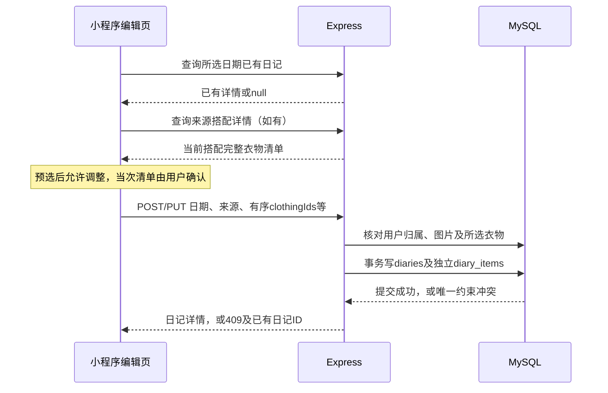

# 接口说明

P2-01契约定稿，2026-11-06。30个接口均尚未实现；以下示例不是运行服务的结果。本文件完整路径均含/api，调用方不得重复添加前缀。

### 5.1 通用协议

接口前缀`/api`，JSON使用camelCase，数据库字段用snake_case。请求JSON使用`Content-Type: application/json`；文件上传使用multipart/form-data字段`file`。除注册、登录和健康状态外均要求`Authorization: Bearer <token>`，包括图片读取。

成功统一为`{"data": ...}`，列表的data含items及分页信息。创建返回201，其他成功返回200，删除返回`{"data":{"deletedId":数字}}`，退出返回`{"data":{"loggedOut":true}}`。失败使用相应HTTP状态和`{"error":{"code":"...","message":"...","details":{...}}}`；details只在有可操作的字段或冲突详情时返回。不把异常当200返回，也不向客户端暴露SQL、文件系统绝对路径或密码派生值。

分页参数page为正整数，默认1；pageSize为1～50，默认12。列表返回items、page、pageSize、total。默认按id降序；关联衣物按sort_order升序；日记历史按wearDate降序；每种排序均在接口中固定，不直接拼接客户端排序表达式。名称查询keyword最长40字符，按字面子串匹配，处理SQL LIKE中的百分号和下划线转义，查询值使用参数绑定。

归档状态query使用`archived=active|archived|all`，默认active，适用于衣物、搭配和各自筛选选项。多条件同时传入时按AND过滤。无匹配结果返回正常空列表和total=0。

### 5.2 返回对象约定

| 对象 | 返回字段 |
| --- | --- |
| User | id、username、nickname、avatarPath、avatarUrl；不返回passwordHash、authTokenHash |
| ClothingSummary | id、name、categoryId、color、season、imagePath、imageUrl、isArchived |
| ClothingDetail | ClothingSummary字段 + note、createdAt、updatedAt、wearCount、lastWornDate；无记录时次数0、日期null |
| OutfitSummary | id、name、occasion、isArchived、clothingCount、previewItems（前4个ClothingSummary） |
| OutfitDetail | id、name、occasion、note、isArchived、items（完整有序ClothingSummary数组）、createdAt、updatedAt |
| DiarySummary | id、wearDate、occasion、mood、clothingCount、photoUrl、previewItems（前3个单品） |
| DiaryDetail | id、wearDate、occasion、mood、note、photoPath、photoUrl、sourceOutfitId、sourceOutfitName、items、createdAt、updatedAt |
| UploadResult | imagePath、imageUrl、mimeType、size；imagePath为稳定用户相对路径，imageUrl为需要鉴权的读取地址 |

无头像/日记照片时对应path和url均为null。imageUrl由当前后端地址与文件读取路由生成，不写入数据库；重启或端口配置变更不要求修改业务记录。previewItems只供列表展示，编辑页必须读取详情完整清单。sourceOutfitName为来源搭配当前名称，不宣称是历史名称快照。

### 5.3 账号、分类和文件接口

| ID | 方法与路径 | 请求 | 成功data | 主要失败 |
| --- | --- | --- | --- | --- |
| A01 | POST `/api/auth/register` | username、password、nickname | User；201，注册后仍须登录 | INVALID_INPUT、USERNAME_TAKEN |
| A02 | POST `/api/auth/login` | username、password | token、expiresAt、user(User) | INVALID_INPUT、INVALID_CREDENTIALS |
| A03 | POST `/api/auth/logout` | 无业务body；需登录 | loggedOut=true；清除该用户令牌摘要与到期时间 | UNAUTHENTICATED |
| A04 | GET `/api/me` | 无 | User | UNAUTHENTICATED |
| A05 | PUT `/api/me` | nickname、avatarPath（可为null） | 更新后的User | INVALID_INPUT、INVALID_IMAGE_REF |
| A06 | GET `/api/categories` | 无 | items：7个id、name、sortOrder | UNAUTHENTICATED |
| A07 | POST `/api/uploads` | file：单张JPEG/PNG，最大5MiB | UploadResult；201 | IMAGE_REQUIRED、FILE_TOO_LARGE、UNSUPPORTED_IMAGE |
| A08 | GET `/api/media/:filename` | 文件名，需登录 | 图片二进制及正确Content-Type，不套JSON | UNAUTHENTICATED、NOT_FOUND |
| A09 | GET `/api/health` | 无；无需登录 | status="ok"，只表示接口进程可响应 | 服务未启动时无响应；不把此接口当数据库验证 |

上传接口先认证，再解析有大小限制的单文件请求；核对内容类型后写入当前用户目录。Multer只挂在上传路由，不注册为全局文件处理器。[Multer官方文档](https://expressjs.com/en/resources/middleware/multer/)。

### 5.4 衣橱接口

| ID | 方法与路径 | 请求 | 成功data | 页面 / 主要失败 |
| --- | --- | --- | --- | --- |
| C01 | GET `/api/clothes` | keyword?、categoryId?、color?、season?、archived?、page?、pageSize?；season筛选取春夏秋冬单季 | 分页ClothingSummary | P01、选择器；INVALID_INPUT |
| C02 | GET `/api/clothes/facets` | archived? | colors：当前用户该归档范围的去重颜色，按文字排序；季节选项固定在前端 | P01；不随当前keyword收窄选项 |
| C03 | GET `/api/clothes/:id` | 当前用户衣物ID | ClothingDetail | P02/P03；NOT_FOUND |
| C04 | POST `/api/clothes` | name、categoryId、imagePath、color、season、note | ClothingDetail；201 | P03；INVALID_INPUT、INVALID_IMAGE_REF |
| C05 | PUT `/api/clothes/:id` | 完整衣物表单，同C04；不改userId和归档标记 | ClothingDetail | P03；NOT_FOUND、INVALID_INPUT、INVALID_IMAGE_REF |
| C06 | PATCH `/api/clothes/:id/archive` | isArchived：boolean | ClothingDetail | P02；NOT_FOUND、INVALID_INPUT |
| C07 | GET `/api/clothes/:id/outfits` | page?、pageSize? | 当前用户相关OutfitSummary分页；含归档并标记 | P02；NOT_FOUND |
| C08 | GET `/api/clothes/:id/diaries` | page?、pageSize? | 当前用户相关DiarySummary分页 | P02；NOT_FOUND |

筛选season=秋时，服务端固定映射为`season IN ('秋','春秋','秋冬','四季')`；其他季节同理。该映射是业务规则，不由客户端传SQL。列表中颜色值按完整文字精确比较。

### 5.5 搭配接口

| ID | 方法与路径 | 请求 | 成功data | 页面 / 主要失败 |
| --- | --- | --- | --- | --- |
| O01 | GET `/api/outfits` | keyword?、occasion?、archived?、page?、pageSize? | 分页OutfitSummary | P04；INVALID_INPUT |
| O02 | GET `/api/outfits/facets` | archived? | occasions：当前用户该范围的去重场景，文字排序 | P04 |
| O03 | GET `/api/outfits/:id` | ID | OutfitDetail | P05/P06/从搭配记日记；NOT_FOUND |
| O04 | POST `/api/outfits` | name、occasion、note、clothingIds | OutfitDetail；201 | P06；INVALID_INPUT、INVALID_SELECTION |
| O05 | PUT `/api/outfits/:id` | 完整搭配表单，同O04 | OutfitDetail | P06；NOT_FOUND、INVALID_INPUT、INVALID_SELECTION |
| O06 | PATCH `/api/outfits/:id/archive` | isArchived：boolean | OutfitDetail | P05；NOT_FOUND、INVALID_INPUT |

搭配保存本身不写diaries，不产生穿着次数。编辑时在一个事务内更新主表、替换该搭配明细，保持数组顺序；不修改任何diary_items。

### 5.6 日记与统计接口

| ID | 方法与路径 | 请求 | 成功data | 页面 / 主要失败 |
| --- | --- | --- | --- | --- |
| D01 | GET `/api/diaries` | month：必填YYYY-MM | month、items（该月DiarySummary数组，日期升序） | P07；INVALID_INPUT |
| D02 | GET `/api/diaries/by-date` | date：必填YYYY-MM-DD | diary：DiaryDetail或null；null表示该用户当日尚无记录 | P09进入前；INVALID_INPUT |
| D03 | GET `/api/diaries/:id` | ID | DiaryDetail | P08/P09；NOT_FOUND |
| D04 | POST `/api/diaries` | wearDate、sourceOutfitId、clothingIds、occasion、mood、photoPath、note | DiaryDetail；201 | P09；INVALID_INPUT、INVALID_SELECTION、INVALID_IMAGE_REF、DATE_OCCUPIED、NOT_FOUND |
| D05 | PUT `/api/diaries/:id` | 完整日记表单，同D04 | DiaryDetail | P09；同D04，另有目标记录NOT_FOUND |
| D06 | DELETE `/api/diaries/:id` | ID | deletedId | P08；NOT_FOUND |
| S01 | GET `/api/statistics` | month：必填YYYY-MM；notWornPage?、notWornPageSize?（默认1、12，最大50） | asOf、month、activeClothesCount、categoryDistribution、monthDiaryDays、mostWorn、notWornRecently | P10；INVALID_INPUT |

`/facets`、`/by-date`等固定路由先于`/:id`注册。D02的diary=null是查询“当日是否存在”的合法业务结果；D03按ID找不到才返回404。

S01的asOf由服务器计算，不接受客户端任意改动统计基准日。month只影响monthDiaryDays；榜单为截至asOf的累计穿着，未穿列表固定看截至asOf的最近30个自然日。统计项标题及返回字段都明确这一点。

### 5.7 失败码与页面处理

| HTTP | error.code | 含义与处理 |
| --- | --- | --- |
| 400 | INVALID_INPUT | 缺失、类型、长度、日期或枚举无效；details.fields指出可修正字段；表单保留输入 |
| 400 | INVALID_SELECTION | 衣物数组为空、重复、超限或包含不可用归属的ID；不返回其他用户的衣物信息 |
| 400 | INVALID_IMAGE_REF | 图片不是当前用户目录中的已有有效文件；不能保存外部URL或临时路径 |
| 400 | IMAGE_REQUIRED | 上传没有提供规定单文件字段 |
| 401 | INVALID_CREDENTIALS | 登录账号或密码不正确，统一提示 |
| 401 | UNAUTHENTICATED | 缺少、失效、过期或已退出的令牌；清除前端登录状态，进入登录页 |
| 404 | NOT_FOUND | 记录或当前用户文件不存在；用户不匹配时同样返回404 |
| 409 | USERNAME_TAKEN | 账号已注册，提示更换账号 |
| 409 | DATE_OCCUPIED | 当前用户目标日期已有另一篇日记；details含wearDate和existingDiaryId，提供查看入口 |
| 413 | FILE_TOO_LARGE | 图片超过5MiB，提示重新选择 |
| 415 | UNSUPPORTED_IMAGE | 非JPEG/PNG或内容类型不符，提示选择支持格式 |
| 500 | INTERNAL_ERROR | 未知服务错误，保留表单，提示稍后手动再试；服务端记录必要错误，不输出敏感数据 |

重复账号和日记日期冲突最终以数据库唯一约束为准，入口预检查不能代替约束。全局错误处理按已知约束名映射409，其他未知错误仍返回500；禁止用INSERT IGNORE等方式吞掉失败。


## 字段校验

### 3.5 表单字段与校验

字符串长度按字符计，服务端统一trim名称、账号及颜色等单行字段；密码不trim，日记文字保留换行。客户端及时提示，服务端入口作为权威校验。服务端生成ID、用户归属、时间和新记录的未归档状态，不接受客户端指定这些字段。

| 表单 | 字段 | 规则 |
| --- | --- | --- |
| 注册/登录 | username | 4～20位英文字母、数字、下划线；入口转小写后使用；注册唯一 |
| 注册/登录 | password | 8～64字符；注册后仅保存带盐派生结果；接口不返回密码数据 |
| 注册/资料 | nickname | 必填，1～20字符 |
| 资料 | avatarPath | 稳定图片路径或null；null为明确无头像状态 |
| 衣物 | name / categoryId | 名称1～40字符；分类必须是7个固定分类之一 |
| 衣物 | color | 必填1～20字符；可写“浅蓝色”“藏蓝与灰色”，筛选按完整值匹配 |
| 衣物 | season | 必填，取春、夏、秋、冬、春夏、春秋、秋冬、四季之一 |
| 衣物 | imagePath / note | 图片路径必填；备注0～500字符，空备注显式提交空字符串 |
| 搭配 | name / occasion / note | 名称1～40字符；场景1～20字符；备注0～500字符 |
| 搭配/日记 | clothingIds | 必填有序数组，1～20个正整数ID、无重复、均属于当前用户；数组顺序映射为sort_order |
| 日记 | wearDate | 真实的YYYY-MM-DD，按Asia/Shanghai的日期理解，不能晚于服务器当前本地日期 |
| 日记 | occasion / mood / note | 场景1～20字符；心情为null或1～12字符；文字0～1000字符 |
| 日记 | sourceOutfitId | 当前用户拥有的搭配ID或null；直接选衣为null，归档的来源搭配仍可引用 |
| 日记 | photoPath | 稳定图片路径或null；删除照片时提交null |
| 图片上传 | file | 每次1张JPEG或PNG，最大5MiB；前端提示选择范围，后端核对文件内容类型与大小 |

所有编辑PUT请求提交完整表单字段，可空字段明确使用null，空备注使用空字符串；字段缺失视为无效请求，不用旧值静默补齐。归档用单独PATCH，仅接受明确布尔值`isArchived`。

季节筛选举例：选择“秋”匹配秋、春秋、秋冬、四季；选择“春”匹配春、春夏、春秋、四季。“全部”不传season。颜色选项来自衣物筛选辅助接口，不通过词语猜测色系。心情快捷项使用现有轻松、专注、愉快、从容、放松、平静、满意，也允许在长度范围内填写其他心情。


## 请求与响应类型补充

所有:id为路径中的十进制正整数，范围1～4294967295；filename为单段UUID图片文件名，仅允许后端生成的jpg/png。GET参数均在query，JSON写入字段均在body，A07例外使用multipart字段file。未知身份先返回401，资源归属不符统一404，不泄露他人记录。除A01/A02/A09均登录；其他接口除表中业务错误外都可能401，未知内部故障500。

| 参数/对象 | 类型及完整性 |
| --- | --- |
| page/pageSize | query十进制整数字符串，默认1/12，page>=1，pageSize1～50；非法返回400 |
| keyword/categoryId/color/season/occasion/archived | query字符串，keyword0～40，categoryId固定7类，color/occasion1～20；archived三值默认active；season查询仅单季 |
| month/date | 必填query字符串，合法YYYY-MM/真实YYYY-MM-DD，不接受溢出归一化日期 |
| sourceOutfitId | body正整数或null；当前用户搭配，可归档，不等于实际衣物集合 |
| clothingIds | body数组，1～20去重正整数，数组顺序即保存顺序，归档衣物允许带标记选择 |
| 图片路径 | body字符串1～255或按字段允许null；仅当前用户目录的有效稳定路径，拒绝外部URL、TMP、blob、微信临时路径 |
| createdAt/updatedAt/expiresAt | 响应ISO UTC字符串，含毫秒和Z；数据库DATETIME(3)写UTC |
| wearDate/lastWornDate/asOf | 自然日字符串YYYY-MM-DD，lastWornDate可null |
| isArchived/数量 | JSON boolean / 非负整数，不返回数据库0/1或COUNT数字字符串 |
| categoryDistribution | 7项{id,name,count}，含空类0，分类sort_order顺序 |
| mostWorn | 最多5项{id,name,wearCount,lastWornDate}，不分页 |
| notWornRecently | {page,pageSize,total,items:[{id,name,lastWornDate}]} |

名称搜索忽略大小写，参数化查询LOWER后的字面子串，转义LIKE转义符、%和_；颜色/场景精确比较，排序规则utf8mb4_0900_as_cs。筛选AND组合，facets只按当前用户和archived范围；固定路由先于/:id。分页主列表id降序，相关日记wearDate降序，明细顺序升序，月历日期升序，未穿ID升序；末页外items=[]保留total。

季节查询映射：春→春/春夏/春秋/四季；夏→夏/春夏/四季；秋→秋/春秋/秋冬/四季；冬→冬/秋冬/四季。全部不传season。归档active/archived/all分别为未归档/已归档/两者；详情与已存关联不因归档不可见。

S01在同一连接只读事务内形成快照，请求开始计算Asia/Shanghai当天asOf。month只控制月度天数，累计穿着和最近日期截至asOf；Top5仅未归档且次数>0，次数降序/ID升序；最近30天未穿为[asOf-29天,asOf]内无记录，含从未穿。7分类/在用总数只计未归档。各指标直接查询日记，无计数字段，新增/改期/删除或归档后重新查询。公共API不接受asOf。

D04/D05校验日期不晚于服务器上海当天；编辑排除自身后仍以uq_diaries_user_date兜住竞争。409只针对已知唯一约束，details包含wearDate和existingDiaryId。保留父表单，跳已有日记前提示未保存内容。修改来源搭配不改diary_items，编辑日记实际清单允许与来源不同且保留来历。删除成功后重新查日历、统计、相关衣物详情；数据库不自动维护缓存计数。

账号小写规范化；scrypt参数/编码见数据库设计，原令牌有效7×24小时，新登录覆盖旧摘要，无刷新令牌。上传取消/换图/删除日记不自动删文件；图片单图JPEG/PNG、5MiB并核对可解码内容。A08使用鉴权用户目录+filename，wx.downloadFile携带头下载到临时路径显示，稳定imagePath才提交保存；imageUrl派生不持久化。A08错误仍为标准JSON及对应HTTP状态，成功为二进制。


## 前后端协作和事务

### 6.1 注册、登录与退出

注册入口校验并规范化账号，查询或约束判断唯一性，生成随机盐并用Node异步scrypt派生密码，插入用户；返回公开资料。采用16字节随机盐、64字节派生结果，编码同时记录算法与参数。参数使用Node已文档化的N=16384、r=8、p=1；验证时按已保存参数派生并恒时比较相同长度结果。以上为本地实训的约定参数，尚未执行账号创建。[Node 24 crypto官方文档](https://nodejs.org/docs/latest-v24.x/api/crypto.html#cryptoscryptpassword-salt-keylen-options-callback)。

登录校验密码后生成32字节随机令牌，向客户端返回base64url编码原令牌；数据库仅保存SHA-256摘要和UTC到期时间。新登录覆盖该用户此前的摘要。认证中间件从Authorization取得令牌，计算摘要、查询用户及到期时间，形成当前用户上下文。退出清空摘要与到期时间，前端移除本地令牌、用户资料及当前页面图片状态。

小程序storage仅保存登录令牌和必要的登录到期信息，不保存明文密码。小程序启动后通过GET /me恢复资料；401统一回登录页，不自动刷新令牌。多账号测试时分别登录并清空前一账号页面状态。

### 6.2 图片上传、引用与显示

1. 小程序选择图片，保留本次表单内的本地预览路径；用`wx.uploadFile`携带登录头上传字段file。
2. 后端认证后接收有大小上限的单图，核对JPEG/PNG内容，不信任客户端扩展名；用服务器生成的UUID和实际扩展名保存到`server/uploads/users/<当前用户ID>/`。
3. 上传成功返回稳定imagePath和鉴权imageUrl。前端将imagePath写入待提交表单；只有业务表单保存成功才写入clothes、users或diaries。
4. 保存业务表单时在入口核对图片路径属于当前用户目录、文件存在且路径合法；拒绝外部网址、其他用户路径和微信临时路径。文件读取路由只接受合法文件名，根目录始终由认证用户推导，不接收用户指定绝对目录。
5. 读取页面数据后，使用带Authorization头的`wx.downloadFile`下载图片，检查HTTP statusCode=200后用返回tempFilePath作为image组件显示源。图片失败单独显示状态；返回401则统一处理登录。临时路径不回写数据库。
6. 演示导入图片也复制进演示账号目录，走相同鉴权读取流程；不公开挂载整个uploads目录。

官方微信API类型定义确认downloadFile支持header并返回statusCode及tempFilePath；开发者文档页本次未能直接读取，因此能力核对采用微信官方维护的类型仓库，阶段3仍须在开发者工具中验证实际调用。[微信官方API类型定义](https://github.com/wechat-miniprogram/api-typings/blob/master/types/wx/lib.wx.api.d.ts)。

本版不新增图片数据库表：归属来自用户目录，引用路径来自现有业务表。上传后取消表单、替换旧图或删除日记都不立即删除文件，文件可被其他同用户记录引用；不建设自动清理、去重、云存储或缩略图服务。页面只持有当前显示所需临时路径，不增加自建持久图片缓存。

### 6.3 衣物管理与归档

新增/编辑衣物由P03调用C04/C05，后端校验表单及图片，带当前user_id写入或更新单行。详情与列表重新查询数据库；客户端不以此前对象覆盖接口返回。归档和恢复通过C06修改标记，原有outfit_items、diary_items均不变。

列表与选择器默认未归档，用户可切换含已归档。归档项仍可打开详情、编辑或加入需要补记的历史日记；UI明确标记，不自动恢复。衣物与搭配无物理删除按钮，因此已有关系无需自动替补衣物。

### 6.4 保存或编辑搭配

P06提交名称、场景、备注和有序clothingIds。请求入口校验格式及去重，服务端一次按当前用户和所选ID查询，确认返回数量等于提交数量。编辑先取得当前用户的搭配，不允许变更归属。

同一数据库连接开启事务：创建/更新outfits → 编辑时删除该搭配原outfit_items → 按数组顺序插入明细 → 提交。任一步失败回滚本次主表及明细修改，再向统一错误处理器传播错误。查询返回完整详情，前端成功后再返回详情页。

此流程不会读取或更新diary_items。上传文件与数据库不共同纳入事务，不能把数据库回滚描述为磁盘文件也已回滚。

### 6.5 从搭配或直接选衣记录日记



新建时，从搭配入口只预填，不提交记录；直接从日历进入则sourceOutfitId=null。两种入口都显式提交最终clothingIds。来源搭配属于当前用户即可，最终衣物允许与来源不同；来源字段说明起点，不强制维持两份清单永远相等。

日记事务：校验并查询目标/来源的用户归属 → 写入或更新diaries → 编辑时替换该日记明细 → 按提交顺序写diary_items → 提交。数据库UNIQUE(user_id,wear_date)处理重复日期；编辑同篇日记保持原日期不算冲突，改到另一已有日期才冲突。失败回滚并保留前端表单。

以后编辑搭配，不联动日记；以后编辑衣物名称或图片，日记显示新的衣物属性，但仍保留原来那组ID及顺序。用户主动编辑日记时才修改当次衣物清单和对应统计。

### 6.6 日记查询、修改、删除

月查询使用`user_id=? AND wear_date>=月首 AND wear_date<下月月首`，不从衣物最近穿着日期推算日历。点选日期直接使用当天日记ID，详情读取diaries和该日记的diary_items。

删除前UI确认，接口在事务内确认当前用户归属并删除diaries，由外键级联删除diary_items；不删除来源搭配、衣物或磁盘图片。前端收到成功响应后刷新所选月份；统计页下一次进入重新查询，衣物详情相关计数同样从日记重新查询。

### 6.7 事务、异常和查询边界汇总

| 操作 | 原子范围 / 归属检查 |
| --- | --- |
| 衣物保存、归档、资料更新 | 单行业务写入；入口确认当前用户及图片归属；按ID与user_id更新 |
| 登录/退出 | 单用户令牌字段同时写入/清空 |
| 搭配保存 | outfits及其全部outfit_items同一事务 |
| 日记保存 | diaries及其全部diary_items同一事务，唯一约束保护日期 |
| 日记删除 | 当前用户日记和级联明细同一事务 |
| 文件上传 | 单独文件操作；与后续数据库表单保存分开 |
| 统计读取 | 同一连接的只读事务内计算各统计项，形成同一查询快照，不存计数缓存 |

事务边界负责失败回滚与连接释放，不吞业务异常。未知异常交给全局错误处理；只对已知的唯一约束冲突、上传错误等作明确转换。SQL使用参数化查询；mysql2提供Promise接口和execute参数占位能力。[MySQL2官方说明](https://sidorares.github.io/node-mysql2/docs)。


## JSON与数据库映射

见数据库设计字段映射；正式ID为整数，分类ID保持字符串；DEMO/CLO/OUT/DIA仅导入逻辑键。不得由TMP编号或blob生成正式持久字段。

## E01～E08代表性JSON示例

仅契约示意，ID假设按源顺序对应；文件及令牌虚构。不是HTTP实测或导入结果。E01～E04独立，E05承接E04，E06/E07使用未新增样例，不累积写入。示例的method/path/status是阅读说明，实际body仅发送request对象。

### E01

```json
{
  "id": "E01",
  "method": "POST",
  "path": "/api/clothes",
  "request": {
    "name": "奶油色校园针织",
    "categoryId": "tops",
    "imagePath": "users/1/00000000-0000-4000-8000-000000000025.jpg",
    "color": "奶油色",
    "season": "春秋",
    "note": ""
  },
  "status": 201,
  "response": {
    "data": {
      "id": 25,
      "name": "奶油色校园针织",
      "categoryId": "tops",
      "imagePath": "users/1/00000000-0000-4000-8000-000000000025.jpg",
      "color": "奶油色",
      "season": "春秋",
      "note": "",
      "imageUrl": "http://127.0.0.1:3000/api/media/00000000-0000-4000-8000-000000000025.jpg",
      "isArchived": false,
      "createdAt": "2026-11-06T00:00:00.000Z",
      "updatedAt": "2026-11-06T00:00:00.000Z",
      "wearCount": 0,
      "lastWornDate": null
    }
  }
}
```

### E02

```json
{
  "id": "E02",
  "method": "POST",
  "path": "/api/outfits",
  "request": {
    "name": "校园叠穿",
    "occasion": "校园",
    "note": "",
    "clothingIds": [
      3,
      1,
      2
    ]
  },
  "status": 201,
  "response": {
    "data": {
      "id": 9,
      "name": "校园叠穿",
      "occasion": "校园",
      "note": "",
      "isArchived": false,
      "items": [
        {
          "id": 3,
          "name": "棕色菱格针织上衣",
          "categoryId": "tops",
          "color": "棕色",
          "season": "秋冬",
          "imagePath": "users/1/00000000-0000-4000-8000-000000000003.jpg",
          "imageUrl": "http://127.0.0.1:3000/api/media/00000000-0000-4000-8000-000000000003.jpg",
          "isArchived": false
        },
        {
          "id": 1,
          "name": "粉色绞花针织两件套",
          "categoryId": "tops",
          "color": "浅粉色",
          "season": "春秋",
          "imagePath": "users/1/00000000-0000-4000-8000-000000000001.jpg",
          "imageUrl": "http://127.0.0.1:3000/api/media/00000000-0000-4000-8000-000000000001.jpg",
          "isArchived": false
        },
        {
          "id": 2,
          "name": "灰米色撞领针织上衣",
          "categoryId": "tops",
          "color": "灰米色",
          "season": "春秋",
          "imagePath": "users/1/00000000-0000-4000-8000-000000000002.jpg",
          "imageUrl": "http://127.0.0.1:3000/api/media/00000000-0000-4000-8000-000000000002.jpg",
          "isArchived": false
        }
      ],
      "createdAt": "2026-11-06T00:00:00.000Z",
      "updatedAt": "2026-11-06T00:00:00.000Z"
    }
  }
}
```

### E03

```json
{
  "id": "E03",
  "method": "POST",
  "path": "/api/diaries",
  "request": {
    "wearDate": "2026-11-06",
    "sourceOutfitId": 1,
    "clothingIds": [
      3,
      1
    ],
    "occasion": "校园",
    "mood": "轻松",
    "photoPath": null,
    "note": "当天调整实际单品。"
  },
  "status": 201,
  "response": {
    "data": {
      "id": 13,
      "wearDate": "2026-11-06",
      "sourceOutfitId": 1,
      "sourceOutfitName": "粉蓝校园日常",
      "occasion": "校园",
      "mood": "轻松",
      "photoPath": null,
      "photoUrl": null,
      "note": "当天调整实际单品。",
      "items": [
        {
          "id": 3,
          "name": "棕色菱格针织上衣",
          "categoryId": "tops",
          "color": "棕色",
          "season": "秋冬",
          "imagePath": "users/1/00000000-0000-4000-8000-000000000003.jpg",
          "imageUrl": "http://127.0.0.1:3000/api/media/00000000-0000-4000-8000-000000000003.jpg",
          "isArchived": false
        },
        {
          "id": 1,
          "name": "粉色绞花针织两件套",
          "categoryId": "tops",
          "color": "浅粉色",
          "season": "春秋",
          "imagePath": "users/1/00000000-0000-4000-8000-000000000001.jpg",
          "imageUrl": "http://127.0.0.1:3000/api/media/00000000-0000-4000-8000-000000000001.jpg",
          "isArchived": false
        }
      ],
      "createdAt": "2026-11-06T00:00:00.000Z",
      "updatedAt": "2026-11-06T00:00:00.000Z"
    }
  }
}
```

### E04

```json
{
  "id": "E04",
  "method": "POST",
  "path": "/api/diaries",
  "request": {
    "wearDate": "2026-11-04",
    "sourceOutfitId": null,
    "clothingIds": [
      1
    ],
    "occasion": "休闲",
    "mood": null,
    "photoPath": null,
    "note": ""
  },
  "status": 201,
  "response": {
    "data": {
      "id": 14,
      "wearDate": "2026-11-04",
      "sourceOutfitId": null,
      "sourceOutfitName": null,
      "occasion": "休闲",
      "mood": null,
      "photoPath": null,
      "photoUrl": null,
      "note": "",
      "items": [
        {
          "id": 1,
          "name": "粉色绞花针织两件套",
          "categoryId": "tops",
          "color": "浅粉色",
          "season": "春秋",
          "imagePath": "users/1/00000000-0000-4000-8000-000000000001.jpg",
          "imageUrl": "http://127.0.0.1:3000/api/media/00000000-0000-4000-8000-000000000001.jpg",
          "isArchived": false
        }
      ],
      "createdAt": "2026-11-06T00:00:00.000Z",
      "updatedAt": "2026-11-06T00:00:00.000Z"
    }
  }
}
```

### E05

```json
{
  "id": "E05",
  "method": "PUT",
  "path": "/api/diaries/14",
  "request": {
    "wearDate": "2026-11-05",
    "sourceOutfitId": null,
    "clothingIds": [
      1
    ],
    "occasion": "休闲",
    "mood": null,
    "photoPath": null,
    "note": ""
  },
  "status": 409,
  "response": {
    "error": {
      "code": "DATE_OCCUPIED",
      "message": "该日期已有日记",
      "details": {
        "wearDate": "2026-11-05",
        "existingDiaryId": 12
      }
    }
  },
  "sameDateEdit": {
    "request": {
      "wearDate": "2026-11-04",
      "sourceOutfitId": null,
      "clothingIds": [
        1
      ],
      "occasion": "休闲",
      "mood": null,
      "photoPath": null,
      "note": ""
    },
    "status": 200,
    "response": {
      "data": {
        "id": 14,
        "wearDate": "2026-11-04",
        "sourceOutfitId": null,
        "sourceOutfitName": null,
        "occasion": "休闲",
        "mood": null,
        "photoPath": null,
        "photoUrl": null,
        "note": "",
        "items": [
          {
            "id": 1,
            "name": "粉色绞花针织两件套",
            "categoryId": "tops",
            "color": "浅粉色",
            "season": "春秋",
            "imagePath": "users/1/00000000-0000-4000-8000-000000000001.jpg",
            "imageUrl": "http://127.0.0.1:3000/api/media/00000000-0000-4000-8000-000000000001.jpg",
            "isArchived": false
          }
        ],
        "createdAt": "2026-11-06T00:00:00.000Z",
        "updatedAt": "2026-11-06T00:00:00.000Z"
      }
    }
  }
}
```

### E06

```json
{
  "id": "E06",
  "method": "GET",
  "path": "/api/statistics?month=2026-11",
  "status": 200,
  "response": {
    "data": {
      "asOf": "2026-11-06",
      "month": "2026-11",
      "activeClothesCount": 24,
      "categoryDistribution": [
        {
          "id": "tops",
          "name": "上装",
          "count": 7
        },
        {
          "id": "outerwear",
          "name": "外套",
          "count": 3
        },
        {
          "id": "dresses",
          "name": "连衣裙",
          "count": 1
        },
        {
          "id": "bottoms",
          "name": "下装",
          "count": 6
        },
        {
          "id": "shoes",
          "name": "鞋履",
          "count": 2
        },
        {
          "id": "bags",
          "name": "包袋",
          "count": 2
        },
        {
          "id": "accessories",
          "name": "配饰",
          "count": 3
        }
      ],
      "monthDiaryDays": 3,
      "mostWorn": [
        {
          "id": 18,
          "name": "白色休闲运动鞋",
          "wearCount": 6,
          "lastWornDate": "2026-11-05"
        },
        {
          "id": 20,
          "name": "深棕色褶皱软肩包",
          "wearCount": 6,
          "lastWornDate": "2026-11-03"
        },
        {
          "id": 19,
          "name": "黑色玛丽珍平底鞋",
          "wearCount": 5,
          "lastWornDate": "2026-11-03"
        },
        {
          "id": 21,
          "name": "浅蓝色手提包",
          "wearCount": 5,
          "lastWornDate": "2026-11-05"
        },
        {
          "id": 1,
          "name": "粉色绞花针织两件套",
          "wearCount": 3,
          "lastWornDate": "2026-10-24"
        }
      ],
      "notWornRecently": {
        "page": 1,
        "pageSize": 12,
        "total": 4,
        "items": [
          {
            "id": 7,
            "name": "奶油色绒感短针织",
            "lastWornDate": null
          },
          {
            "id": 10,
            "name": "黑色圆领短外套",
            "lastWornDate": null
          },
          {
            "id": 11,
            "name": "黑色系带吊带连衣裙",
            "lastWornDate": null
          },
          {
            "id": 17,
            "name": "米白色小花半裙",
            "lastWornDate": null
          }
        ]
      }
    }
  }
}
```

### E07

```json
{
  "id": "E07",
  "method": "GET",
  "path": "/api/diaries/by-date?date=2026-11-04",
  "status": 200,
  "response": {
    "data": {
      "diary": null
    }
  },
  "emptyList": {
    "data": {
      "items": [],
      "page": 1,
      "pageSize": 12,
      "total": 0
    }
  },
  "missingId": {
    "status": 404,
    "error": {
      "code": "NOT_FOUND",
      "message": "记录不存在"
    }
  }
}
```

### E08

```json
{
  "id": "E08",
  "upload": {
    "method": "POST",
    "path": "/api/uploads",
    "multipartField": "file",
    "mimeType": "image/jpeg",
    "size": 1024,
    "status": 201,
    "response": {
      "data": {
        "imagePath": "users/1/00000000-0000-4000-8000-000000000099.jpg",
        "imageUrl": "http://127.0.0.1:3000/api/media/00000000-0000-4000-8000-000000000099.jpg",
        "mimeType": "image/jpeg",
        "size": 1024
      }
    }
  },
  "login": {
    "data": {
      "token": "EXAMPLE_TOKEN_NOT_A_CREDENTIAL",
      "expiresAt": "2026-11-13T00:00:00.000Z",
      "user": {
        "id": 1,
        "username": "demo_user",
        "nickname": "小夏的演示衣橱",
        "avatarPath": null,
        "avatarUrl": null
      }
    }
  },
  "errors": [
    {
      "status": 400,
      "error": {
        "code": "INVALID_INPUT",
        "message": "示意错误",
        "details": {
          "fields": {
            "name": "请填写名称"
          }
        }
      }
    },
    {
      "status": 401,
      "error": {
        "code": "UNAUTHENTICATED",
        "message": "示意错误"
      }
    },
    {
      "status": 409,
      "error": {
        "code": "USERNAME_TAKEN",
        "message": "示意错误"
      }
    },
    {
      "status": 413,
      "error": {
        "code": "FILE_TOO_LARGE",
        "message": "示意错误"
      }
    },
    {
      "status": 415,
      "error": {
        "code": "UNSUPPORTED_IMAGE",
        "message": "示意错误"
      }
    },
    {
      "status": 500,
      "error": {
        "code": "INTERNAL_ERROR",
        "message": "示意错误"
      }
    }
  ],
  "media": {
    "successContentType": "image/jpeg",
    "successBody": "图片二进制，非JSON"
  }
}
```

补充：month查询可查看未来空月份，by-date读取未来日期可返回null；仅写入日记禁止未来日期。数据库/接口字段均遵循数据库设计映射，图片路径长度上限255。
