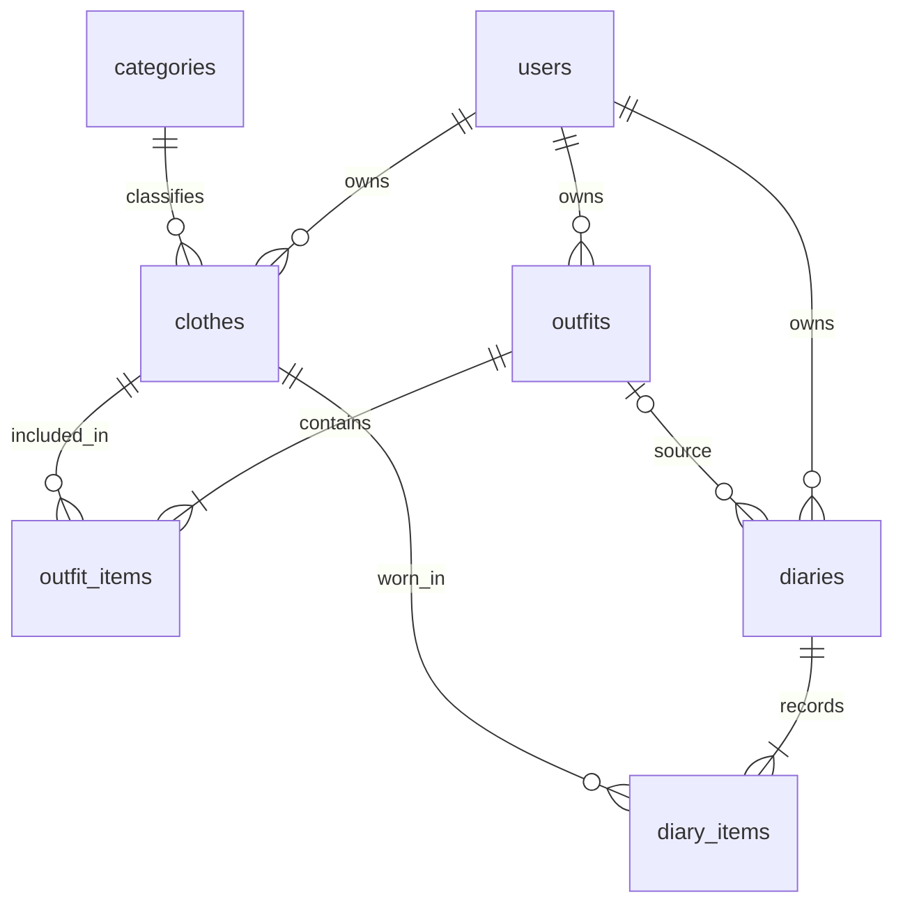

# 数据与页面约定

本文件是首版设计基线。当前只有演示JSON数据，尚未创建数据库表或业务接口。演示数据的字符串编号是稳定样例键，不要求未来MySQL主键使用同一格式。

## 页面范围

底部入口为衣橱、搭配、日记、我的。至少实现以下10个与数据库交互的功能页面：

| 页面 | 主要操作 |
| --- | --- |
| 衣橱列表 | 名称检索，分类、颜色、季节筛选 |
| 衣物详情 | 查看属性、相关搭配和穿着历史 |
| 衣物新增与编辑 | 图片上传及资料维护 |
| 搭配列表 | 查询、按名称或场景筛选 |
| 搭配详情 | 查看组合，进入编辑或记录穿着 |
| 搭配新增与编辑 | 从衣橱多选，保存组合 |
| 穿搭日历 | 按月查看有记录的日期 |
| 日记详情 | 查看实际衣物、照片、文字和心情 |
| 日记新增与编辑 | 补记或修改当天记录，允许删除 |
| 衣橱统计 | 类别分布、月度记录天数、常穿及近期未穿 |

注册、登录、我的和个人资料编辑另行提供，不用于凑上述10页。

## 数据表

| 表 | 主要字段与关系 |
| --- | --- |
| users | 登录账号、密码哈希、昵称、头像 |
| categories | 固定分类名称与排序 |
| clothes | 所属用户、分类、名称、图片、颜色、季节、备注、是否归档 |
| outfits | 所属用户、名称、场景、备注、是否归档 |
| outfit_items | 搭配、衣物、展示顺序 |
| diaries | 所属用户、穿着日期、来源搭配可空、场景、心情、照片可空、文字 |
| diary_items | 日记、实际衣物、展示顺序 |

## 关键业务规则

每人每天一篇日记，允许补记和修改。数据库对用户及穿着日期设置唯一约束。同一件衣物在一套搭配或一篇日记中只关联一次。

创建日记时复制当次所选衣物的关联，不以搭配ID代替日记的衣物清单。修改搭配后，旧日记的衣物集合不改变；用户主动编辑日记则按新内容统计。首版不对衣物名称和图片等属性建立历史版本。

衣物和搭配先提供归档，避免它们从当前列表移除后旧日记无法展示。日记允许删除，统计直接查询剩余记录。暂不建设回收站或自动清理任务。

衣物数量按未归档衣物计算。月度记录天数为该月日记数量；衣物穿着次数为包含该衣物的日记数；最近穿着日期为其日记日期最大值。近期未穿为最近30天没有关联日记的未归档衣物，也包含从未记录过的衣物。未独立存储穿着计数，避免日记编辑后计数不同步。

图片路径以项目根目录为基准；未来接入后端时统一映射为上传文件路径。微信临时文件路径不得用作持久图片地址。演示JSON中的imagePath和photoPath目前都指向已有本地文件。

所有业务数据按当前登录用户隔离。请求入口统一校验，内部沿用校验后的参数；搭配与衣物关联、日记与衣物关联分别在一个事务中保存。

## 演示JSON与表的映射

data/demo-data.json中的categories、clothes、outfits、diaries分别对应分类、衣物、搭配、日记。outfits[].clothingIds导入时拆为outfit_items；diaries[].clothingIds拆为diary_items。demoProfile只是逻辑账号描述，不含可登录密码。

sourceOutfitId为空表示直接选择衣物记录。photoPath为空是合法业务状态；界面展示所选衣物，不能把空值理解为图片加载失败，也不自动补一张与当次穿搭无关的真人照片。

该数据集既支持日历跨月演示，也支持常穿、未穿和重复穿同一套的查询核对。数据统计基准见data/demo-summary.json。
