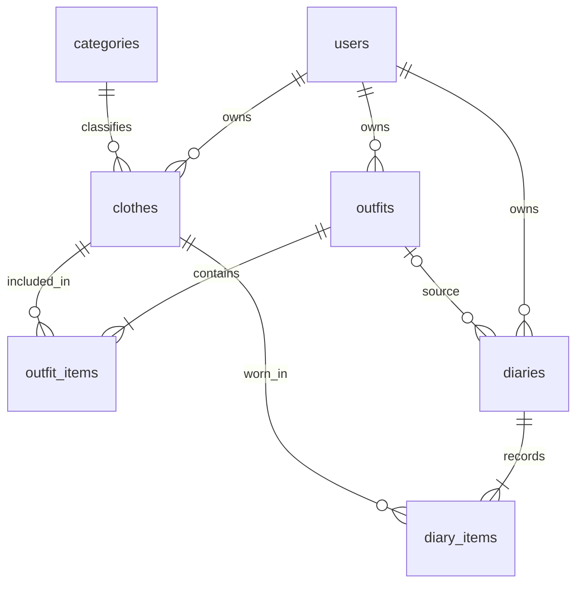

# 数据库设计

P2-01设计定稿，2026-11-06。结构尚未创建；本机只读核对结果见P2-01执行与核对记录。仅users/clothes/outfits/diaries的id为INT UNSIGNED AUTO_INCREMENT；分类字符串和两张明细复合主键均保留。

## 通用约定

1. 数据库专用名称为`wardrobe_demo`（本阶段未创建）；表引擎InnoDB、字符集utf8mb4，采用utf8mb4_0900_as_cs。所有字符串外键两侧的类型、长度、字符集和排序规则一致；整数外键两侧均为UNSIGNED，避免建表时才发现不匹配。
2. 除自增ID外，必填业务字段不设置掩盖缺失输入的默认值；`note`默认空字符串、`is_archived`默认0，可空头像/来源/心情/照片/登录态默认NULL。HTTP完整表单仍要求显式字段，数据库默认值不作为缺字段兼容。分类ID、名字和顺序由固定分类数据显式写入。
3. created_at、updated_at均NOT NULL、无数据库自动默认/ON UPDATE，由后端或导入端在写入时显式提供UTC DATETIME(3)；创建时相同，更新只改updated_at。连接时区由阶段3设置UTC。本阶段只读取现有会话时区，不修改实例或会话设置。
4. wear_date使用DATE，按Asia/Shanghai自然日解释；DATE读取为`YYYY-MM-DD`字符串，禁止先转JS Date再平移日期。接口系统时间使用带Z的ISO字符串；正式当天由服务端确定，固定2026-11-06仅为样例核验参数。
5. 账号trim后只允许4～20位ASCII字母、数字、下划线，统一小写；密码不trim，8～64字符。沿用异步scrypt：16字节随机盐、64字节结果、N=16384/r=8/p=1，编码包含算法与参数，保存字段上限255；不得把密码或派生串放进公开样例。
6. 登录返回32字节随机令牌的base64url编码，数据库只保存SHA-256十六进制摘要和UTC到期时间；摘要/到期时间同时为NULL或同时非NULL。新登录覆盖旧值，退出同时清空，不另设会话表。
7. 正式主实体ID和所有数量在JSON中是整数，不是CLO字符串或数字字符串；INT UNSIGNED范围可由JS安全表示。分类ID仍是固定字符串，API中的categoryId不能统一改成整数。
8. 单行文本trim，备注保留换行；字段长度按Unicode字符计，与数据库字符长度语义对齐。空备注为`""`，可选心情为空转为null，无来源/无照片为null，不使用`"null"`、空数组代替或虚构图片。

登录态有效期固定7×24小时，不自动续期。


### 4.2 users：账号与资料

| 字段 | 类型 | 可空 | 默认/生成 | 语义 |
| --- | --- | --- | --- | --- |
| id | INT UNSIGNED | 否 | AUTO_INCREMENT | 自增主键 |
| username | VARCHAR(20) | 否 | 无默认值 | 入口规范化为小写；唯一 |
| password_hash | VARCHAR(255) | 否 | 无默认值 | 包含scrypt参数、盐和派生结果的编码字符串 |
| nickname | VARCHAR(20) | 否 | 无默认值 | 昵称 |
| avatar_path | VARCHAR(255) | 是 | NULL | 当前用户图片相对路径 |
| auth_token_hash | CHAR(64) | 是 | NULL | 登录令牌SHA-256十六进制摘要；唯一，退出时置NULL |
| auth_expires_at | DATETIME(3) | 是 | NULL | 令牌UTC到期时间，与摘要同时设置或清除 |
| created_at | DATETIME(3) | 否 | 无默认值 | 自动时间 |
| updated_at | DATETIME(3) | 否 | 无默认值 | 自动时间 |

索引：PRIMARY(id)、UNIQUE(username)、UNIQUE(auth_token_hash)。令牌摘要允许NULL；登录认证按摘要查找后校验有效期。未登录新账号的摘要、到期时间均为NULL。

### 4.3 categories：固定分类

| 字段 | 类型 | 可空 | 默认/生成 | 语义 |
| --- | --- | --- | --- | --- |
| id | VARCHAR(16) | 否 | 无默认值 | 主键：tops、outerwear、dresses、bottoms、shoes、bags、accessories |
| name | VARCHAR(20) | 否 | 无默认值 | 上装、外套、连衣裙、下装、鞋履、包袋、配饰；唯一 |
| sort_order | SMALLINT UNSIGNED | 否 | 无默认值 | 固定1～7排序，不通过用户界面维护 |

索引：PRIMARY(id)、UNIQUE(name)。分类全局共享且只读，不含user_id，不增加分类管理页。

### 4.4 clothes：衣物

| 字段 | 类型 | 可空 | 默认/生成 | 语义 |
| --- | --- | --- | --- | --- |
| id | INT UNSIGNED | 否 | AUTO_INCREMENT | 自增主键 |
| user_id | INT UNSIGNED | 否 | 无默认值 | FK→users.id |
| category_id | VARCHAR(16) | 否 | 无默认值 | FK→categories.id |
| name | VARCHAR(40) | 否 | 无默认值 | 衣物名称 |
| image_path | VARCHAR(255) | 否 | 无默认值 | 例如users/1/某UUID.jpg，不存主机地址或微信临时路径 |
| color | VARCHAR(20) | 否 | 无默认值 | 描述颜色 |
| season | VARCHAR(8) | 否 | 无默认值 | 春、夏、秋、冬、春夏、春秋、秋冬、四季 |
| note | VARCHAR(500) | 否 | '' | 允许空字符串 |
| is_archived | TINYINT UNSIGNED | 否 | 0 | 新建为0；只允许0、1 |
| created_at | DATETIME(3) | 否 | 无默认值 | 自动时间 |
| updated_at | DATETIME(3) | 否 | 无默认值 | 自动时间 |

索引：PRIMARY(id)、idx_clothes_user_archived_id(user_id,is_archived,id)、idx_clothes_category(category_id)。前者支持用户默认列表与归档筛选，后者支持分类外键。首版不为颜色、模糊名称额外建设索引。CHECK限制is_archived范围及season约定值。

### 4.5 outfits与outfit_items：搭配及衣物清单

| 字段 | 类型 | 可空 | 默认/生成 | 语义 |
| --- | --- | --- | --- | --- |
| id | INT UNSIGNED | 否 | AUTO_INCREMENT | 自增主键 |
| user_id | INT UNSIGNED | 否 | 无默认值 | FK→users.id |
| name | VARCHAR(40) | 否 | 无默认值 | 搭配名称 |
| occasion | VARCHAR(20) | 否 | 无默认值 | 校园、休闲、出游等用户文字 |
| note | VARCHAR(500) | 否 | '' | 允许空字符串 |
| is_archived | TINYINT UNSIGNED | 否 | 0 | 新建0，CHECK IN(0,1) |
| created_at | DATETIME(3) | 否 | 无默认值 | 自动时间 |
| updated_at | DATETIME(3) | 否 | 无默认值 | 自动时间 |

outfits索引：PRIMARY(id)、idx_outfits_user_archived_id(user_id,is_archived,id)。

| 字段 | 类型 | 可空 | 默认/生成 | 语义 |
| --- | --- | --- | --- | --- |
| outfit_id | INT UNSIGNED | 否 | 无默认值 | FK→outfits.id |
| clothing_id | INT UNSIGNED | 否 | 无默认值 | FK→clothes.id |
| sort_order | SMALLINT UNSIGNED | 否 | 无默认值 | 从1开始，对应用户选定顺序 |

outfit_items约束：PRIMARY(outfit_id,clothing_id)防止重复衣物；UNIQUE(outfit_id,sort_order)防止重复位置；CHECK(sort_order>=1)。索引idx_outfit_items_clothing(clothing_id,outfit_id)支持衣物的相关搭配查询及衣物外键。该表不再设置无业务意义的自增ID。

### 4.6 diaries与diary_items：穿着记录及独立清单

| 字段 | 类型 | 可空 | 默认/生成 | 语义 |
| --- | --- | --- | --- | --- |
| id | INT UNSIGNED | 否 | AUTO_INCREMENT | 自增主键 |
| user_id | INT UNSIGNED | 否 | 无默认值 | FK→users.id |
| wear_date | DATE | 否 | 无默认值 | 上海本地穿着日期 |
| source_outfit_id | INT UNSIGNED | 是 | NULL | FK→outfits.id，只用于来源追溯 |
| occasion | VARCHAR(20) | 否 | 无默认值 | 当次场景，独立保存 |
| mood | VARCHAR(12) | 是 | NULL | 当次心情 |
| photo_path | VARCHAR(255) | 是 | NULL | 当次照片稳定相对路径 |
| note | VARCHAR(1000) | 否 | '' | 日记文字，可为空字符串 |
| created_at | DATETIME(3) | 否 | 无默认值 | 自动时间 |
| updated_at | DATETIME(3) | 否 | 无默认值 | 自动时间 |

diaries索引：PRIMARY(id)、UNIQUE(user_id,wear_date)、idx_diaries_source_outfit(source_outfit_id)。日期唯一索引也支持用户月度日历查询，不重复增加同列普通索引。

| 字段 | 类型 | 可空 | 默认/生成 | 语义 |
| --- | --- | --- | --- | --- |
| diary_id | INT UNSIGNED | 否 | 无默认值 | FK→diaries.id；ON DELETE CASCADE |
| clothing_id | INT UNSIGNED | 否 | 无默认值 | FK→clothes.id |
| sort_order | SMALLINT UNSIGNED | 否 | 无默认值 | 从1开始的当次衣物顺序 |

diary_items约束：PRIMARY(diary_id,clothing_id)、UNIQUE(diary_id,sort_order)、CHECK(sort_order>=1)。索引idx_diary_items_clothing(clothing_id,diary_id)支持穿着历史和统计。名称、图片等衣物属性仍从clothes读取，首版不建立属性历史版本。

### 4.7 关系、删除与用户隔离



除diary_items随日记删除外，外键删除动作使用RESTRICT；首版没有衣物、搭配、账号、分类的物理删除接口。衣物与搭配归档修改标志，不删除关联；日记删除由事务删除日记及其明细，不删除衣物、搭配或图片。

外键保证引用存在，不自动保证引用属于同一用户。业务入口取得当前用户后，查询父记录必须带user_id；保存关系时，一次查询所选clothes并校验全部归属，再在同一连接的事务中保存。不能仅按全局ID更新，也不接受请求body中的userId。

### 4.8 演示数据导入设计

1. 在项目专用空库建7张表，插入7个固定分类。已有业务数据时停止导入并说明，不自动清空数据库。
2. 使用实施时明确提供的演示账号及密码创建用户，复用密码派生函数；DEMO001只作为源数据映射键。密码不写入仓库，也不存入演示JSON。
3. 按源顺序插入衣物，记录CLO001等源ID到数据库ID的映射；将24张主图复制到该用户uploads子目录，写入稳定路径。参考图、预览板不作为衣物导入。
4. 插入8套搭配，并用映射生成37条outfit_items，sort_order按数组顺序从1开始。
5. 插入12篇日记及53条diary_items，来源搭配独立映射；有附图的日记复制1张参考图到用户目录并记录路径，空照片保持NULL。
6. 导入数据库写入使用一个事务；写库前确认源图片存在。文件复制与数据库不是同一事务，失败时数据库回滚，已复制文件保留给人工核对，不引入自动清理任务。
7. 生成不含密码的导入结果摘要和源ID映射，核对表行数、月份数量、榜单及未穿衣物。样例不向其他新注册用户自动复制，另建空账号用于用户隔离验收。

数据关系与文件路径在导入前作为跨边界输入统一校验一次，不改写现有原始JSON。样例编号与真实数据库主键不强制相同，本文接口数字ID仅用于示意。


### 4.3 约束、索引及关系核对

所有外键、唯一约束及CHECK使用下文固定名称，错误处理按约束身份映射，不能仅凭“任何重复键错误”认定日记日期冲突。

| 规则 | 数据库职责 | 业务入口/事务职责 |
| --- | --- | --- |
| 账号唯一 | username唯一索引 | 先规范化；已知唯一冲突映射USERNAME_TAKEN |
| 登录态成对 | 摘要唯一且可空；CHECK保证摘要和到期时间同时空/非空 | 安全生成、过期判断、覆盖及退出；不返回摘要 |
| 每人每天一篇 | UNIQUE(user_id,wear_date) | 日期真实且不晚于上海当天；编辑排除自身；冲突409并保留草稿 |
| 衣物去重/位置唯一 | 两张明细的复合PK与父ID+sort_order唯一；CHECK顺序>=1 | 1～20件、数组去重、顺序连续1～n；事务替换，不用触发器统计子行数 |
| 基本值域 | CHECK归档0/1、季节8个约定值、分类/明细正序 | 格式、长度、分类合法性及页面可选范围在请求边界一次校验 |
| 引用与用户归属 | FK只保证记录存在 | 当前身份来自认证；父记录查询带user_id；一次校验所选衣物均归当前用户，不接受body.userId |
| 归档保留/历史独立 | 衣物、搭配不物理删；日记独立关联衣物 | 修改搭配只写outfit_items，不改diary_items；当前名称图片不做快照 |
| 图片与未来日期 | 仅使用持久路径字段；不以CHECK验证磁盘或以当前日期函数限制日期 | 图片目录归属、存在性和实际格式；服务端日历日期校验 |

必要索引沿用总方案：

- clothes：`idx_clothes_user_archived_id(user_id,is_archived,id)`、`idx_clothes_category(category_id)`。
- outfits：`idx_outfits_user_archived_id(user_id,is_archived,id)`。
- outfit_items：`idx_outfit_items_clothing(clothing_id,outfit_id)`；diary_items：`idx_diary_items_clothing(clothing_id,diary_id)`。
- diaries：用户日期唯一索引兼顾月查询；`idx_diaries_source_outfit(source_outfit_id)`。users和categories采用前述唯一索引。

最终索引表列出名称、列顺序、唯一性和用途，检查外键需要的索引已由PK/UNIQUE/上述索引覆盖，不额外建立重复前缀索引或为模糊搜索提前优化。

所有FK的ON UPDATE保持RESTRICT；ON DELETE仅`diary_items.diary_id → diaries.id`使用CASCADE，其余RESTRICT。日记删除不删图片、衣物、来源搭配；不新增软删除日记或账号删除接口。

事务说明至少覆盖：搭配主表+明细一起新增/替换；日记主表+独立明细一起新增/替换；删除日记及级联明细。图片写磁盘不属于数据库事务，用户隔离也不是靠FK自动完成。


## 固定约束名与建表顺序

建表顺序：users → categories → clothes → outfits → outfit_items → diaries → diary_items；所有FK ON UPDATE RESTRICT，删除动作见下表。约束名在P2-02直接沿用，不使用隐式生成名。

| 表 | 约束/索引名 | 列或条件 | 删除 |
| --- | --- | --- | --- |
| users | PRIMARY / uq_users_username / uq_users_auth_token_hash | id / username / auth_token_hash | — |
| users | ck_users_auth_pair | (auth_token_hash IS NULL AND auth_expires_at IS NULL) OR (auth_token_hash IS NOT NULL AND auth_expires_at IS NOT NULL) | — |
| categories | PRIMARY / uq_categories_name / ck_categories_sort | id / name / sort_order BETWEEN 1 AND 7 | — |
| clothes | PRIMARY / fk_clothes_user / fk_clothes_category | id / user_id→users.id / category_id→categories.id | RESTRICT |
| clothes | ck_clothes_archived / ck_clothes_season | is_archived IN (0,1) / season IN ('春','夏','秋','冬','春夏','春秋','秋冬','四季') | — |
| outfits | PRIMARY / fk_outfits_user / ck_outfits_archived | id / user_id→users.id / is_archived IN (0,1) | RESTRICT |
| outfit_items | PRIMARY / uq_outfit_items_order / ck_outfit_items_sort | (outfit_id,clothing_id) / (outfit_id,sort_order) / sort_order>=1 | — |
| outfit_items | fk_outfit_items_outfit / fk_outfit_items_clothing | outfit_id→outfits.id / clothing_id→clothes.id | RESTRICT |
| diaries | PRIMARY / uq_diaries_user_date | id / (user_id,wear_date) | — |
| diaries | fk_diaries_user / fk_diaries_source | user_id→users.id / source_outfit_id→outfits.id | RESTRICT |
| diary_items | PRIMARY / uq_diary_items_order / ck_diary_items_sort | (diary_id,clothing_id) / (diary_id,sort_order) / sort_order>=1 | — |
| diary_items | fk_diary_items_diary | diary_id→diaries.id | CASCADE |
| diary_items | fk_diary_items_clothing | clothing_id→clothes.id | RESTRICT |

所有CHECK在P2-02创建为ENFORCED。PRIMARY是每表本地主键名；其余命名明确并避免CHECK跨表重名。普通索引名/列序按上一节。UNIQUE只约束非NULL令牌摘要，允许多个未登录账号。

## 10业务页覆盖

| 页面 | 接口 | 表 |
| --- | --- | --- |
| P01衣橱列表 | C01/C02/A06 | clothes/categories |
| P02衣物详情 | C03/C06/C07/C08 | clothes/outfits/outfit_items/diaries/diary_items |
| P03衣物表单 | C03/C04/C05/A07 | clothes/categories |
| P04搭配列表 | O01/O02 | outfits/outfit_items/clothes |
| P05搭配详情 | O03/O06 | outfits/outfit_items/clothes |
| P06搭配表单 | C01/O03/O04/O05 | outfits/outfit_items/clothes |
| P07日历 | D01/D02 | diaries/diary_items/clothes |
| P08日记详情 | D03/D06 | diaries/diary_items/outfits/clothes |
| P09日记表单 | D02/D03/D04/D05/C01/O03/A07 | diaries/diary_items/clothes/outfits |
| P10统计 | S01 | categories/clothes/diaries/diary_items |

认证资料A01～A05关联users，图片A07/A08使用用户目录及现有路径字段，不增加表；A09不验证数据库。

## 字段映射与写入归属

snake_case列转camelCase API字段：category_id→categoryId，image_path→imagePath，is_archived→isArchived，wear_date→wearDate，source_outfit_id→sourceOutfitId，photo_path→photoPath，created_at→createdAt，updated_at→updatedAt。user_id由认证上下文生成，不允许body指定；password_hash/auth_token_hash仅内部使用，不映射到公开响应。明细sort_order由clothingIds数组下标+1生成，详情返回有序items，不接受客户端任意位置编号。imageUrl、sourceOutfitName、wearCount、lastWornDate均为派生值，不存列。

## P2-02准入及未验证行为

本机已实际TCP认证：MySQL8.0.28、InnoDB DEFAULT、utf8mb4_0900_as_cs存在、foreign_key_checks=1；当前root@localhost无激活角色，SHOW GRANTS直接授权覆盖CREATE/REFERENCES/SELECT/INSERT/UPDATE/DELETE及结构检查。wardrobe_demo在具有SHOW DATABASES权限下查询不存在，未创建。

P2-02必须先复查目标库，明确创建wardrobe_demo，显式指定引擎/字符集/排序规则，不能依赖实例默认ai_ci。P2-02验证真实7表、ENFORCED元数据、唯一/FK/CHECK非法写入及事务回滚。P2-03才导入。当前无建表、DML或HTTP运行证据；不能将设计一致性通过称为数据库行为通过。

官方依据：[CHECK](https://dev.mysql.com/doc/refman/8.0/en/create-table-check-constraints.html)、[SHOW GRANTS](https://dev.mysql.com/doc/refman/8.0/en/show-grants.html)。

## 7. 统计口径与查询设计

### 7.1 统一定义

| 指标 | 口径 |
| --- | --- |
| 统计用户 | 认证得到的当前用户，所有父表查询带user_id；聚合关联同时限定该用户日记与衣物 |
| asOf | 请求开始时计算的Asia/Shanghai当前自然日，本次统计内复用 |
| 未归档衣物总数 | 当前用户clothes中is_archived=0的数量 |
| 分类分布 | 当前用户未归档衣物按7个分类统计；没有衣物的分类也返回0，按sort_order排序 |
| 月度记录天数 | 目标月内diaries行数；唯一约束保证一天一篇；不根据衣物数累加，不排除归档衣物参与过的日记 |
| 单件累计穿着次数 | 截至asOf，包含该衣物的日记篇数；同日同衣物最多1次；衣物详情可包含归档衣物 |
| 最近穿着日期 | 截至asOf，该衣物关联日记wear_date的最大值；无记录为null |
| 常穿Top5 | 未归档衣物中累计次数>0者，次数降序、id升序，取5件；不是只看所选月份 |
| 最近30天未穿 | 未归档衣物在[asOf-29天,asOf]内没有日记关联；包含从未穿；按id升序分页，并返回累计最近穿着日期 |

基准日2026-11-06时，30天区间为2026-10-08至2026-11-06，包含首尾。2026-10-08的记录算近期穿过，2026-10-07的单独记录不算。month=2026-10时只改变月度天数为9，累计榜单和最近30天窗口不跟着回到10月。

### 7.2 查询形态

以下只说明聚合逻辑，不是已执行SQL。先限定当前用户及截至asOf的日记，再将diary_items与衣物关联，按衣物ID计算COUNT和MAX；未穿使用NOT EXISTS判断区间内关联。关联表唯一约束保证同篇日记无重复衣物，避免统计倍增；不要同时把outfit_items加入统计JOIN。

```sql
-- 设计示例：最近30天未穿衣物的条件；日期边界由服务端计算并绑定。
SELECT c.id, c.name
FROM clothes c
WHERE c.user_id = ? AND c.is_archived = 0
  AND NOT EXISTS (
    SELECT 1
    FROM diary_items di
    JOIN diaries d ON d.id = di.diary_id
    WHERE di.clothing_id = c.id
      AND d.user_id = c.user_id
      AND d.wear_date >= ? AND d.wear_date <= ?
  )
ORDER BY c.id;
```

COUNT月度日记和按衣物聚合分别查询，不把同一日记的多件衣物误算成多天。关联衣物数量越多也只影响该件衣物的穿着计数，不改变天数。客户端不维护wearCount加减或lastWornAt覆盖值。

### 7.3 样例基线与动态日期

按原始导入数据、无归档、asOf=2026-11-06：总衣物24；分类7/3/1/6/2/2/3；10月日记9、11月3；常穿Top5为CLO018(6)、CLO020(6)、CLO019(5)、CLO021(5)、CLO001(3)；从未穿及当时最近30天未穿均为CLO007、CLO010、CLO011、CLO017。

真实运行时asOf跟随当天，历史样例不自动平移日期。随着日期变化，“最近30天未穿”结果会自然变化；验收用内部测试传入固定基准日复核，不向公共接口开放任意asOf，也不把旧JSON统计当成实时数据库返回。


## 7. 样例映射与后续交接

### 7.1 逻辑键与字段映射

本节为P2-03映射契约，未产生真实数据库ID或复制文件。

| 源数据 | 未来目标 | 映射规则 |
| --- | --- | --- |
| demoProfile.id=DEMO001 | users.id | 导入时创建一名真实演示账号，记录逻辑键→数据库自增ID；现有nickname沿用，账号与密码届时在本机提供 |
| categories[].id | categories.id、clothes.category_id | 7个固定字符串原样映射，不生成分类整数ID；sortOrder→sort_order |
| CLO001～CLO024及userId/categoryId | clothes.id/user_id/category_id | 按源顺序导入并保存实际返回ID，不假定自增从1开始、不按后缀计算 |
| OUT001～OUT008、clothingIds | outfits及outfit_items | 映射用户和衣物ID，数组位置+1成为sort_order，共37条 |
| DIA001～DIA012、sourceOutfitId、clothingIds | diaries及diary_items | 来源可空，实际清单单独按数组导入，共53条；不能读取来源搭配替代日记清单 |
| imagePath/photoPath | image_path/photo_path | 源相对路径只用于定位现有文件；P2-03复制后写用户目录的稳定新路径 |
| isArchived | is_archived | boolean映射0/1，原样例均未归档 |
| schemaVersion/datasetVersion/origin等 | 导入摘要 | 属于准备元数据，不为它们增加数据库列；created/updated由导入端生成 |

固定分类依次为tops上装、outerwear外套、dresses连衣裙、bottoms下装、shoes鞋履、bags包袋、accessories配饰，sort_order为1～7，对应衣物数7/3/1/6/2/2/3。

P2-03输出不含密码的源ID映射文件，覆盖用户、衣物、搭配、日记4种实体；分类是字符串恒等映射。API示例假设ID与这个实际映射分开，榜单并列项按实际整数ID排序；按源顺序导入应保持既有逻辑键顺序，不依赖数字恰好等于源后缀。

### 7.2 图片、空值与导入约定

导入只准备24张衣物主图和1张DIA004照片，共25个业务图片引用；搭配预览板、来源网页、风格参考不导入。P2-03映射为`users/<实际用户ID>/<服务器生成文件名>`，物理根为未来`server/uploads/`，不改原assets文件或其清单。目录准备不等于Express工程创建，鉴权HTTP访问留阶段3。

sourceOutfitId=null表示直接补记；photoPath=null合法且无文件复制。空心情按null、空文字按空字符串；现样例未出现这两类空值，P2-03/正式测试以独立验证输入覆盖，不改写原始样例凑用例。原始用户ID、TMP和blob值不能成为数据库外键或持久路径。

沿用“项目专用空库、已有业务数据则停止”的导入前置条件，不清空、不覆盖、不用INSERT IGNORE吞掉差异。数据库导入一个事务，源文件先核对存在；图片复制不随数据库事务回滚，失败后的文件供人工核对，不引入自动删除任务。P2-01只交接这些条件，实际脚本到P2-03编写。

### 7.3 可核对的固定样例基线

| 项目 | 固定基准日2026-11-06的预期 |
| --- | --- |
| 行数 | users演示账号1，categories 7，clothes 24，outfits 8，outfit_items 37，diaries 12，diary_items 53；后续隔离测试账号另计 |
| 日期 | 2026-10-07～2026-11-05；10月9天，11月3天 |
| Top5 | CLO018(6)、CLO020(6)、CLO019(5)、CLO021(5)、CLO001(3)，实际核对时通过映射找数据库ID |
| 从未穿/30天未穿 | 均为CLO007、CLO010、CLO011、CLO017；未归档总数24 |
| 30天边界 | 窗口[2026-10-08,2026-11-06]；10月7日不在、10月8日在窗口内，不能使用减30天并同时含首尾 |

P2-03核对脚本将允许内部指定上述基准日，不把固定日做成正式API默认当天，不平移样例。正式运行采用服务端Asia/Shanghai日期，历史数据不变时近期未穿会随今天自然变化。

交接还必须列出待真实验证的归档关联、搭配修改不改日记、日记增改删后次数/最近日期/月天数重算；这些本轮只能作规则检查，不能引用静态验收宣称数据库已验证。
