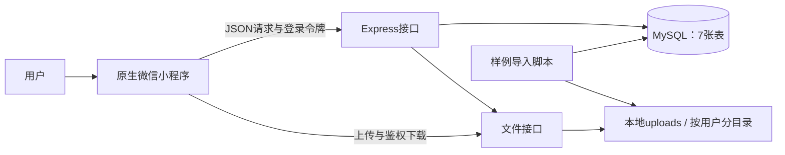
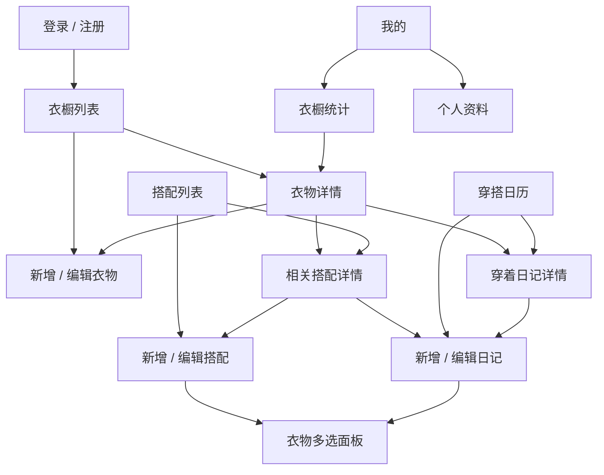
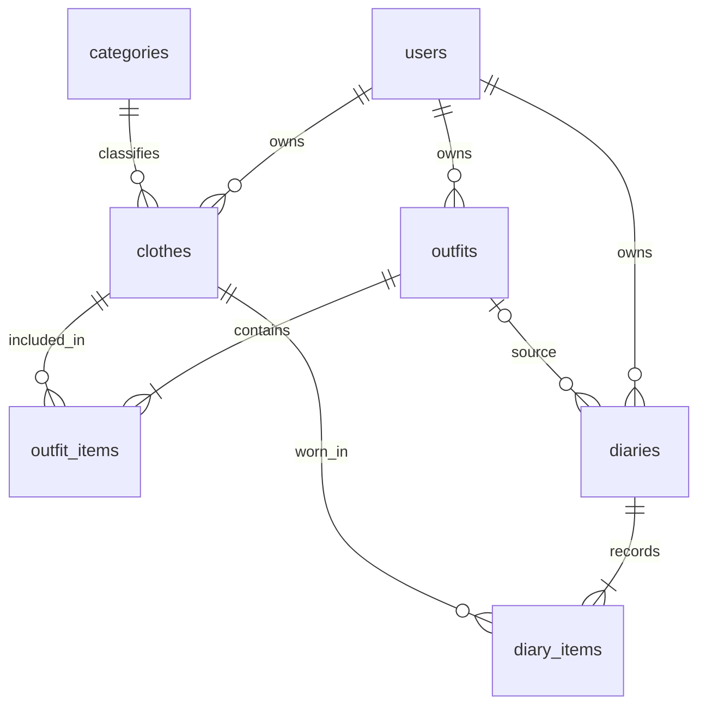
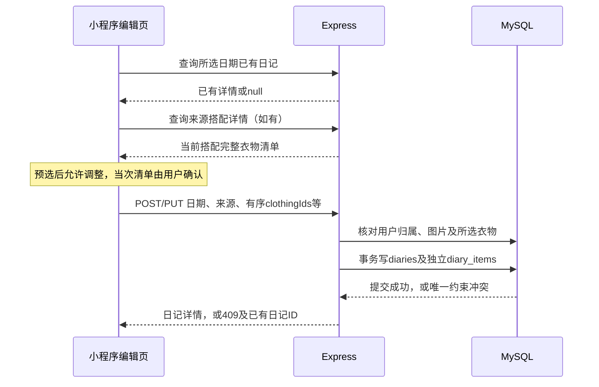

# 个人衣橱与穿搭日记：详细设计与实施方案

版本：1.0；编制日期：2026年11月6日；项目目录：`Z:\outfit\personal-wardrobe`。

实施进度更新：P1-01及P1-02已完成。P1-02新增30项与迁移回归20项通过，预览为http://127.0.0.1:4173/prototype/。第1.2节及第12.2节保留方案编制时状态；最新进度以《执行计划》和《P1-02执行与验收记录》为准。下一阶段P1-03尚未开始；小程序业务、后端及数据库仍未开始。

本文件交付页面、数据、接口、流程和实施设计。本轮没有创建小程序、后端业务代码或数据库表。本文的接口示例、表字段和目录树均为拟实施设计，不代表已经运行。

## 1. 依据、范围与当前状态

### 1.1 设计依据

按项目中的《执行计划》《数据与页面约定》《前序准备说明》和README确定范围；以`data/demo-data.json`、`data/demo-summary.json`及素材清单核对样例。六个参考项目只提供设计参考，其功能不自动纳入首版。

目标是使用原生微信小程序、JavaScript、Node.js Express和MySQL，完成微信开发者工具中的本地演示。业务围绕衣物管理、手动搭配、穿搭日记及衣橱统计。底部入口为衣橱、搭配、日记、我的；10个数据库业务页面按第3节实现，注册、登录、我的和资料编辑另计。

视觉基线为韩系日常女装：短针织、叠穿、牛仔和彩色配饰。现有素材直接进入原型；校园甜美风在原型完成后按实际缺口补充4～6件以内，不作为前置任务。AI推荐、自动抠图、虚拟试衣、商城、天气、公网部署不在本版范围。

### 1.2 已完成与待验证

| 状态 | 内容 |
| --- | --- |
| 已完成 | 六个参考项目阅读、范围及执行计划、24张完整单品主图、1张日记参考图、来源记录、8套搭配及12篇虚构日记 |
| 已核对 | 样例中7个分类；37条搭配衣物关联；53条日记衣物关联；2026年10月9篇、11月3篇日记；4件从未穿着衣物 |
| 既有检查记录 | 图片文件校验、编号关系与日期唯一性检查通过；2026年11月5日观察到Node.js v24.16.0、MySQL客户端8.0.28、运行中的MySQL服务及微信开发者工具 |
| 本轮完成 | 本设计文档及设计一致性核对 |
| 尚未实施或验证 | 可点击原型、MySQL服务端版本与账号登录、建表导入、AppID配置、小程序编译、接口联调与业务验收 |

素材主图为22张CHERRYKOKO商品图和2张Pexels鞋包图。品牌图按本地实训参考登记，未获单独再分发授权；准确使用记录保留在`assets/SOURCES.md`和清单中。日记文字、日期均为虚构，唯一附图为同款针织穿着参考，不表示真实用户自拍。

### 1.3 本方案明确的设计选择

| 事项 | 本版决定 | 理由与影响 |
| --- | --- | --- |
| 登录 | 表单注册登录；随机令牌；同一账号同时保留一个有效登录态，7天到期 | 在users中保存令牌摘要及到期时间，保持7张核心表；重新登录使旧令牌失效，退出可立即撤销 |
| 归档 | 归档只改变默认展示；详情和已有关系继续有效；选择器有“包含已归档”开关 | 方便整理与补记，不增加复杂的归档阻断规则；归档项始终显示标记 |
| 日记衣物 | 请求显式提交用户最终选定的衣物ID数组；来源搭配仅记录来历 | 从搭配进入时预选其衣物，用户可调整；后续修改搭配不会改变该日记 |
| 记录日期 | 支持今天和过去的真实日期，编辑可改日期；不填写未来穿着日记 | 穿搭计划通过保存搭配表示，统计以实际记录为准；这是本版的日期边界 |
| 季节 | 单字段保存约定中文值，按春、夏、秋、冬筛选时包含组合季节及“四季” | 沿用演示数据的春秋、秋冬等表达，不增加表或位运算 |
| 颜色 | 保存描述性颜色文字；筛选选项来自当前用户已录入的颜色，使用精确匹配 | 保留“灰米色”“藏蓝与灰色”等现有数据，不擅自重命名成固定色系 |
| 统计 | 按日记即时查询，衣物榜单限未归档衣物；历史日历保留全部日记 | 编辑、删除后无需维护额外计数；归档前后的历史记录天数不变 |
| 图片 | 本地后端按用户保存和鉴权读取，客户端用带登录头的下载请求取得临时显示路径 | 满足用户文件隔离；数据库保存稳定相对路径，临时显示路径不入库 |

这些是本轮可直接采用的设计选择。连接凭据和AppID留到实施阶段核对；当前没有阻塞设计的待确认项。

## 2. 系统结构与职责



小程序负责页面、表单提示、选择状态和调用接口；Express负责身份识别、入口校验、用户归属、事务及统一错误；MySQL保存业务关系；本地文件目录保存图片。演示JSON只供原型和导入使用，正式联调后业务读写通过接口进入MySQL，不在小程序storage中另存一份衣橱作为数据源。

前端输入提示用于让用户及时修正，服务端入口校验用于保证请求有效。参数格式在入口校验一次，内部沿用有效参数；数据库归属和关联存在性检查属于业务查询，不在多层重复判断。事务只在需要原子修改的流程中使用。

后端拟使用Express 5、`mysql2/promise`及Multer；Node内置crypto处理密码和令牌。具体依赖版本在安装阶段选择受支持版本并由锁文件固定。本轮不安装依赖。Express 5对返回Promise的异步路由错误可交给错误处理中间件，避免逐个路由包裹大范围try/catch。[Express官方错误处理](https://expressjs.com/en/guide/error-handling/)。

## 3. 页面与交互设计

### 3.1 页面地图



衣橱、搭配、日记、我的为四个tab页；详情和编辑页使用普通页面跳转。统计从“我的”进入。衣物多选为搭配/日记编辑页复用的选择面板，不单独计入10个业务页面。底部tab切换保留各页筛选及当前月份；新增或修改后返回相应页面重新查询最新数据。

### 3.2 视觉与布局约定

视觉主张：暖白底色、柔和玫瑰色操作强调、清晰留白和完整单品图，呈现易整理、易记录的日常衣橱。

内容层级：当前页面名称与主要操作 → 衣物或日历主体 → 必要属性与记录。每屏只突出一个主要任务；衣橱首屏直接展示衣物，避免占据主体空间的装饰横幅和无关数字块。

交互主张：选择衣物时用勾选状态和底部数量栏反馈；筛选面板和操作抽屉采用约160～200ms的轻量过渡；保存过程显示明确进度，完成后返回并刷新。动效只用于解释状态变化。

| 设计项 | 约定 |
| --- | --- |
| 背景与表面 | 页面`#FAF8F5`；表面白色；分隔线`#E8E2E3`；避免每块内容都套带阴影的卡片 |
| 文字 | 主文字`#2F2D32`，次级文字`#6D6670`；系统中文字体，优先系统默认，不依赖网络字体 |
| 强调色 | 主按钮/选中态`#A34F69`，浅选中底`#F6E7ED`；颜色来源于服装图片，界面保持克制 |
| 字号 | 页标题40～44rpx，分区标题32rpx，正文28～30rpx，辅助文字24rpx；名称最多两行 |
| 间距 | 页面左右28rpx；衣物列间20rpx；分区间32～40rpx；表单控件间24rpx |
| 衣物列表 | 两列，图片容器宽高比约4:5；等比完整展示，浅底衬图，不裁断裙摆、袖子和配饰 |
| 详情图片 | 首图4:5或按可用高度完整展示；支持点击放大；保留原图背景及文字，不假装透明底 |
| 搭配预览 | 使用实际衣物缩略图构成2×2预览，超过4件显示数量；详情完整列出全部单品；顺序以所选列表为准 |
| 日记照片 | 有照片时完整展示并可放大；无照片时显示当次衣物缩略图；不补无关真人照 |
| 触控区域 | 主要按钮高度88rpx；小图标用周围留白形成至少约88rpx的点击区域；底部按钮避开安全区 |

图片展示位置只处理布局和等比显示。当前单品图已有完整轮廓，不额外制作抠图结果。原型在约375px及430px宽度下检查长名称、长颜色文字、键盘和底部按钮遮挡。

### 3.3 十个数据库业务页面

下表中的编号P01～P10用于任务、接口和测试追踪。新增与编辑各共用一套页面，通过有无ID区分模式。

| 编号 / 路由 | 目的与展示 | 操作与跳转 | 请求与返回行为 |
| --- | --- | --- | --- |
| P01 `/pages/wardrobe/index` 衣橱列表 | 搜索栏、分类切换、颜色/季节筛选、衣物两列网格、当前数量 | 新增→P03；点衣物→P02；筛选抽屉可重置；状态切换可查看已归档 | 查询衣物列表与筛选选项；初次12条，触底加载下一页；变更筛选回到第1页 |
| P02 `/pages/clothes/detail` 衣物详情 | 完整图片、名称、分类、颜色、季节、备注、归档标记、穿着次数/最近日期；相关搭配与穿着记录 | 编辑→P03；归档/恢复；点相关搭配→P05；点日记→P08 | 读取衣物详情及关联列表；归档后保留详情，返回列表时按原筛选更新 |
| P03 `/pages/clothes/edit` 新增/编辑衣物 | 图片选择、预览及上传状态；名称、分类、颜色、季节、备注 | 选本地图片后上传；校验通过保存；成功→P02；编辑模式预填原值；取消不改原记录 | 新建POST、编辑PUT；没有新图时沿用原稳定路径；保存失败保留表单内容 |
| P04 `/pages/outfits/index` 搭配列表 | 名称搜索、场景筛选、归档状态、缩略组合和衣物数量 | 新增→P06；点搭配→P05；切换已归档 | 查询列表及当前用户场景选项；分页规则同P01；尚无搭配时引导创建 |
| P05 `/pages/outfits/detail` 搭配详情 | 名称、场景、备注、归档状态、按顺序排列的衣物及各衣物归档标记 | 编辑→P06；归档/恢复；点衣物→P02；“记录穿着”→P09 | 从搭配进入P09预选其衣物及场景，不立即创建日记、不立即增加统计 |
| P06 `/pages/outfits/edit` 新增/编辑搭配 | 名称、场景、备注；已选单品、数量与顺序 | 打开衣物多选；移除单品；用上移/下移调整顺序；保存→P05 | POST/PUT一次提交基本信息和完整衣物ID数组；不拆成多个保存请求 |
| P07 `/pages/diary/index` 穿搭日历 | 月份标题、上/下月、今天入口、按周一到周日排列的日期、记录标记、选中日期摘要 | 选有记录日期→摘要及P08；选无记录日期→“记一笔”到P09；可切换月份查看旧记录 | 按整月请求摘要；默认当前月；重返页面保留选定月份；未来日期不显示新增入口 |
| P08 `/pages/diaries/detail` 日记详情 | 日期、心情、场景、文字、可选照片、实际衣物集合、来源搭配链接 | 编辑→P09；删除需明确确认；点衣物→P02；来源搭配可查看 | 详情按diary_items显示；来源搭配已修改时仍显示日记自己的衣物；删除成功返回P07并刷新 |
| P09 `/pages/diaries/edit` 新增/编辑日记 | 日期、实际衣物、场景、心情、文字、可选照片；来源说明 | 从搭配预选或直接选衣；修改清单及顺序；上传/移除照片；保存→P08 | 提交完整衣物数组；日期冲突提示进入已有日记，保留当前输入，不覆盖；编辑也校验目标日期唯一 |
| P10 `/pages/statistics/index` 衣橱统计 | 未归档衣物总数、分类分布、所选月份记录天数、常穿Top5、最近30天未穿列表、统计基准日 | 切月份只改变月度记录天数；点衣物→P02；未穿列表可分页 | 统计请求返回明确口径；常穿和未穿范围见第7节；归档不改变历史记录天数 |

P02的相关搭配和穿着记录分别分页，避免把全部历史塞进一个详情请求。P07整月最多31条日记摘要，不使用分页。

### 3.4 辅助页面与复用面板

| 页面 / 面板 | 内容与操作 | 校验或状态 |
| --- | --- | --- |
| 登录 `/pages/auth/login` | 账号、密码、登录、前往注册；完成后进入衣橱 | 登录失败统一提示账号或密码不正确；登录中禁用重复提交；令牌失效返回此页 |
| 注册 `/pages/auth/register` | 账号、密码、确认密码、昵称；注册成功返回登录并带回账号 | 确认密码只在前端比较，不写入请求；账号重复在字段下提示 |
| 我的 `/pages/me/index` | 昵称、头像；衣橱统计、个人资料、归档查看入口、退出登录 | 头像为空显示昵称首字占位；不添加不在范围中的积分、会员等功能 |
| 个人资料 `/pages/profile/edit` | 修改昵称和可选头像；保存返回我的 | 不包含密码找回、账号注销或复杂资料字段；头像按统一上传接口处理 |
| 衣物选择面板 | 两列图、分类/名称筛选、勾选、底部已选数量与确定；开关“包含已归档” | 取消不改变父表单；确定回传完整ID数组；同一ID只能选一次；归档项有文字标记，原有已选项保持可见 |

选择器通过当前页面状态保存选择，不把页面参数中的衣物信息当作最新数据库事实。返回表单后维持未提交内容；正式保存时后端核对衣物属于当前用户。

### 3.5 表单字段与校验

字符串长度按字符计，服务端统一trim名称、账号及颜色等单行字段；密码不trim，日记文字保留换行。客户端及时提示，服务端入口作为权威校验。服务端生成ID、用户归属、时间和新记录的未归档状态，不接受客户端指定这些字段。

| 表单 | 字段 | 规则 |
| --- | --- | --- |
| 注册/登录 | username | 4～20位英文字母、数字、下划线；入口转小写后使用；注册唯一 |
| 注册/登录 | password | 8～64字符；注册后仅保存带盐派生结果；接口不返回密码数据 |
| 注册/资料 | nickname | 必填，1～20字符 |
| 资料 | avatarPath | 稳定图片路径或null；null为明确无头像状态 |
| 衣物 | name / categoryId | 名称1～40字符；分类必须是7个固定分类之一 |
| 衣物 | color | 必填1～20字符；可写“浅蓝色”“藏蓝与灰色”，筛选按完整值匹配 |
| 衣物 | season | 必填，取春、夏、秋、冬、春夏、春秋、秋冬、四季之一 |
| 衣物 | imagePath / note | 图片路径必填；备注0～500字符，空备注显式提交空字符串 |
| 搭配 | name / occasion / note | 名称1～40字符；场景1～20字符；备注0～500字符 |
| 搭配/日记 | clothingIds | 必填有序数组，1～20个正整数ID、无重复、均属于当前用户；数组顺序映射为sort_order |
| 日记 | wearDate | 真实的YYYY-MM-DD，按Asia/Shanghai的日期理解，不能晚于服务器当前本地日期 |
| 日记 | occasion / mood / note | 场景1～20字符；心情为null或1～12字符；文字0～1000字符 |
| 日记 | sourceOutfitId | 当前用户拥有的搭配ID或null；直接选衣为null，归档的来源搭配仍可引用 |
| 日记 | photoPath | 稳定图片路径或null；删除照片时提交null |
| 图片上传 | file | 每次1张JPEG或PNG，最大5MiB；前端提示选择范围，后端核对文件内容类型与大小 |

所有编辑PUT请求提交完整表单字段，可空字段明确使用null，空备注使用空字符串；字段缺失视为无效请求，不用旧值静默补齐。归档用单独PATCH，仅接受明确布尔值`isArchived`。

季节筛选举例：选择“秋”匹配秋、春秋、秋冬、四季；选择“春”匹配春、春夏、春秋、四季。“全部”不传season。颜色选项来自衣物筛选辅助接口，不通过词语猜测色系。心情快捷项使用现有轻松、专注、愉快、从容、放松、平静、满意，也允许在长度范围内填写其他心情。

### 3.6 实际页面状态

- 列表首次加载：保留标题和操作区，图片区显示简洁加载占位；追加页加载只影响底部，不清空已有内容。
- 衣橱真正为空：显示“添加第一件衣物”；筛选无结果：保留条件并提供“清除筛选”，不能把两种空状态混为一谈。
- 月份无日记：正常显示日历和所选日期，提供“记一笔”；统计无日记时天数为0、榜单为空、全部未归档衣物属于未穿。
- 表单上传中/保存中：显示进度或状态文字，阻止重复点击保存；失败保留输入，用户可主动再次提交。
- 网络或服务错误：页面就地提示并提供手动重新加载；图片单独失败时保留名称与容器，显示图片读取失败，不替换为无关图片。
- 日期冲突：提示已有日记日期并提供查看/编辑入口；退出当前未保存表单时提示是否放弃修改。
- 详情不存在或无访问权限：统一显示记录不存在，提供返回；不会泄露另一用户记录是否存在。

## 4. 数据库设计

### 4.1 通用约定

项目专用数据库拟命名`wardrobe_demo`，7张表使用InnoDB与utf8mb4。目标MySQL服务端为8.0.16及以上；本机目前只确认了客户端版本，实施时执行服务端版本查询后再建表。CHECK约束从MySQL 8.0.16起得到执行，不能把旧版本解析成功当作约束生效。[MySQL官方CHECK说明](https://dev.mysql.com/doc/refman/8.0/en/create-table-check-constraints.html)。

除categories外，主键采用`INT UNSIGNED AUTO_INCREMENT`，接口返回JSON整数。categories.id沿用tops等固定字符串。系统时间created_at/updated_at及令牌到期时间以UTC写入DATETIME(3)，接口输出带Z的ISO时间；wear_date用DATE保存上海本地自然日，不经过JS时区转换。数据库连接按UTC设置，mysql2对DATE按字符串读取。

下列字段标注“必填”即NOT NULL。“自动时间”表示服务端写入，更新时只更新updated_at。业务备注空字符串是约定的合法状态，可空图片和来源用SQL NULL。各表CHECK约束只保障基本存储不变量，HTTP格式与长度仍统一在请求入口校验。

### 4.2 users：账号与资料

| 字段 | 类型 / 可空 | 说明 |
| --- | --- | --- |
| id | INT UNSIGNED，必填 | 自增主键 |
| username | VARCHAR(20)，必填 | 入口规范化为小写；唯一 |
| password_hash | VARCHAR(255)，必填 | 包含scrypt参数、盐和派生结果的编码字符串 |
| nickname | VARCHAR(20)，必填 | 昵称 |
| avatar_path | VARCHAR(255)，可空 | 当前用户图片相对路径 |
| auth_token_hash | CHAR(64)，可空 | 登录令牌SHA-256十六进制摘要；唯一，退出时置NULL |
| auth_expires_at | DATETIME(3)，可空 | 令牌UTC到期时间，与摘要同时设置或清除 |
| created_at / updated_at | DATETIME(3)，必填 | 自动时间 |

索引：PRIMARY(id)、UNIQUE(username)、UNIQUE(auth_token_hash)。令牌摘要允许NULL；登录认证按摘要查找后校验有效期。未登录新账号的摘要、到期时间均为NULL。

### 4.3 categories：固定分类

| 字段 | 类型 / 可空 | 说明 |
| --- | --- | --- |
| id | VARCHAR(16)，必填 | 主键：tops、outerwear、dresses、bottoms、shoes、bags、accessories |
| name | VARCHAR(20)，必填 | 上装、外套、连衣裙、下装、鞋履、包袋、配饰；唯一 |
| sort_order | SMALLINT UNSIGNED，必填 | 固定1～7排序，不通过用户界面维护 |

索引：PRIMARY(id)、UNIQUE(name)。分类全局共享且只读，不含user_id，不增加分类管理页。

### 4.4 clothes：衣物

| 字段 | 类型 / 可空 | 说明 |
| --- | --- | --- |
| id | INT UNSIGNED，必填 | 自增主键 |
| user_id | INT UNSIGNED，必填 | FK→users.id |
| category_id | VARCHAR(16)，必填 | FK→categories.id |
| name | VARCHAR(40)，必填 | 衣物名称 |
| image_path | VARCHAR(255)，必填 | 例如users/1/某UUID.jpg，不存主机地址或微信临时路径 |
| color | VARCHAR(20)，必填 | 描述颜色 |
| season | VARCHAR(8)，必填 | 第3.5节约定值 |
| note | VARCHAR(500)，必填 | 允许空字符串 |
| is_archived | TINYINT UNSIGNED，必填 | 新建为0；只允许0、1 |
| created_at / updated_at | DATETIME(3)，必填 | 自动时间 |

索引：PRIMARY(id)、idx_clothes_user_archived_id(user_id,is_archived,id)、idx_clothes_category(category_id)。前者支持用户默认列表与归档筛选，后者支持分类外键。首版不为颜色、模糊名称额外建设索引。CHECK限制is_archived范围及season约定值。

### 4.5 outfits与outfit_items：搭配及衣物清单

| outfits字段 | 类型 / 可空 | 说明 |
| --- | --- | --- |
| id | INT UNSIGNED，必填 | 自增主键 |
| user_id | INT UNSIGNED，必填 | FK→users.id |
| name | VARCHAR(40)，必填 | 搭配名称 |
| occasion | VARCHAR(20)，必填 | 校园、休闲、出游等用户文字 |
| note | VARCHAR(500)，必填 | 允许空字符串 |
| is_archived | TINYINT UNSIGNED，必填 | 新建0，CHECK IN(0,1) |
| created_at / updated_at | DATETIME(3)，必填 | 自动时间 |

outfits索引：PRIMARY(id)、idx_outfits_user_archived_id(user_id,is_archived,id)。

| outfit_items字段 | 类型 / 可空 | 说明 |
| --- | --- | --- |
| outfit_id | INT UNSIGNED，必填 | FK→outfits.id |
| clothing_id | INT UNSIGNED，必填 | FK→clothes.id |
| sort_order | SMALLINT UNSIGNED，必填 | 从1开始，对应用户选定顺序 |

outfit_items约束：PRIMARY(outfit_id,clothing_id)防止重复衣物；UNIQUE(outfit_id,sort_order)防止重复位置；CHECK(sort_order>=1)。索引idx_outfit_items_clothing(clothing_id,outfit_id)支持衣物的相关搭配查询及衣物外键。该表不再设置无业务意义的自增ID。

### 4.6 diaries与diary_items：穿着记录及独立清单

| diaries字段 | 类型 / 可空 | 说明 |
| --- | --- | --- |
| id | INT UNSIGNED，必填 | 自增主键 |
| user_id | INT UNSIGNED，必填 | FK→users.id |
| wear_date | DATE，必填 | 上海本地穿着日期 |
| source_outfit_id | INT UNSIGNED，可空 | FK→outfits.id，只用于来源追溯 |
| occasion | VARCHAR(20)，必填 | 当次场景，独立保存 |
| mood | VARCHAR(12)，可空 | 当次心情 |
| photo_path | VARCHAR(255)，可空 | 当次照片稳定相对路径 |
| note | VARCHAR(1000)，必填 | 日记文字，可为空字符串 |
| created_at / updated_at | DATETIME(3)，必填 | 自动时间 |

diaries索引：PRIMARY(id)、UNIQUE(user_id,wear_date)、idx_diaries_source_outfit(source_outfit_id)。日期唯一索引也支持用户月度日历查询，不重复增加同列普通索引。

| diary_items字段 | 类型 / 可空 | 说明 |
| --- | --- | --- |
| diary_id | INT UNSIGNED，必填 | FK→diaries.id；ON DELETE CASCADE |
| clothing_id | INT UNSIGNED，必填 | FK→clothes.id |
| sort_order | SMALLINT UNSIGNED，必填 | 从1开始的当次衣物顺序 |

diary_items约束：PRIMARY(diary_id,clothing_id)、UNIQUE(diary_id,sort_order)、CHECK(sort_order>=1)。索引idx_diary_items_clothing(clothing_id,diary_id)支持穿着历史和统计。名称、图片等衣物属性仍从clothes读取，首版不建立属性历史版本。

### 4.7 关系、删除与用户隔离



除diary_items随日记删除外，外键删除动作使用RESTRICT；首版没有衣物、搭配、账号、分类的物理删除接口。衣物与搭配归档修改标志，不删除关联；日记删除由事务删除日记及其明细，不删除衣物、搭配或图片。

外键保证引用存在，不自动保证引用属于同一用户。业务入口取得当前用户后，查询父记录必须带user_id；保存关系时，一次查询所选clothes并校验全部归属，再在同一连接的事务中保存。不能仅按全局ID更新，也不接受请求body中的userId。

### 4.8 演示数据导入设计

1. 在项目专用空库建7张表，插入7个固定分类。已有业务数据时停止导入并说明，不自动清空数据库。
2. 使用实施时明确提供的演示账号及密码创建用户，复用密码派生函数；DEMO001只作为源数据映射键。密码不写入仓库，也不存入演示JSON。
3. 按源顺序插入衣物，记录CLO001等源ID到数据库ID的映射；将24张主图复制到该用户uploads子目录，写入稳定路径。参考图、预览板不作为衣物导入。
4. 插入8套搭配，并用映射生成37条outfit_items，sort_order按数组顺序从1开始。
5. 插入12篇日记及53条diary_items，来源搭配独立映射；有附图的日记复制1张参考图到用户目录并记录路径，空照片保持NULL。
6. 导入数据库写入使用一个事务；写库前确认源图片存在。文件复制与数据库不是同一事务，失败时数据库回滚，已复制文件保留给人工核对，不引入自动清理任务。
7. 生成不含密码的导入结果摘要和源ID映射，核对表行数、月份数量、榜单及未穿衣物。样例不向其他新注册用户自动复制，另建空账号用于用户隔离验收。

数据关系与文件路径在导入前作为跨边界输入统一校验一次，不改写现有原始JSON。样例编号与真实数据库主键不强制相同，本文接口数字ID仅用于示意。

## 5. 接口设计

### 5.1 通用协议

接口前缀`/api`，JSON使用camelCase，数据库字段用snake_case。请求JSON使用`Content-Type: application/json`；文件上传使用multipart/form-data字段`file`。除注册、登录和健康状态外均要求`Authorization: Bearer <token>`，包括图片读取。

成功统一为`{"data": ...}`，列表的data含items及分页信息。创建返回201，其他成功返回200，删除返回`{"data":{"deletedId":数字}}`，退出返回`{"data":{"loggedOut":true}}`。失败使用相应HTTP状态和`{"error":{"code":"...","message":"...","details":{...}}}`；details只在有可操作的字段或冲突详情时返回。不把异常当200返回，也不向客户端暴露SQL、文件系统绝对路径或密码派生值。

分页参数page为正整数，默认1；pageSize为1～50，默认12。列表返回items、page、pageSize、total。默认按id降序；关联衣物按sort_order升序；日记历史按wearDate降序；每种排序均在接口中固定，不直接拼接客户端排序表达式。名称查询keyword最长40字符，按字面子串匹配，处理SQL LIKE中的百分号和下划线转义，查询值使用参数绑定。

归档状态query使用`archived=active|archived|all`，默认active，适用于衣物、搭配和各自筛选选项。多条件同时传入时按AND过滤。无匹配结果返回正常空列表和total=0。

### 5.2 返回对象约定

| 对象 | 返回字段 |
| --- | --- |
| User | id、username、nickname、avatarPath、avatarUrl；不返回passwordHash、authTokenHash |
| ClothingSummary | id、name、categoryId、color、season、imagePath、imageUrl、isArchived |
| ClothingDetail | ClothingSummary字段 + note、createdAt、updatedAt、wearCount、lastWornDate；无记录时次数0、日期null |
| OutfitSummary | id、name、occasion、isArchived、clothingCount、previewItems（前4个ClothingSummary） |
| OutfitDetail | id、name、occasion、note、isArchived、items（完整有序ClothingSummary数组）、createdAt、updatedAt |
| DiarySummary | id、wearDate、occasion、mood、clothingCount、photoUrl、previewItems（前3个单品） |
| DiaryDetail | id、wearDate、occasion、mood、note、photoPath、photoUrl、sourceOutfitId、sourceOutfitName、items、createdAt、updatedAt |
| UploadResult | imagePath、imageUrl、mimeType、size；imagePath为稳定用户相对路径，imageUrl为需要鉴权的读取地址 |

无头像/日记照片时对应path和url均为null。imageUrl由当前后端地址与文件读取路由生成，不写入数据库；重启或端口配置变更不要求修改业务记录。previewItems只供列表展示，编辑页必须读取详情完整清单。sourceOutfitName为来源搭配当前名称，不宣称是历史名称快照。

### 5.3 账号、分类和文件接口

| ID | 方法与路径 | 请求 | 成功data | 主要失败 |
| --- | --- | --- | --- | --- |
| A01 | POST `/auth/register` | username、password、nickname | User；201，注册后仍须登录 | INVALID_INPUT、USERNAME_TAKEN |
| A02 | POST `/auth/login` | username、password | token、expiresAt、user(User) | INVALID_INPUT、INVALID_CREDENTIALS |
| A03 | POST `/auth/logout` | 无业务body；需登录 | loggedOut=true；清除该用户令牌摘要与到期时间 | UNAUTHENTICATED |
| A04 | GET `/me` | 无 | User | UNAUTHENTICATED |
| A05 | PUT `/me` | nickname、avatarPath（可为null） | 更新后的User | INVALID_INPUT、INVALID_IMAGE_REF |
| A06 | GET `/categories` | 无 | items：7个id、name、sortOrder | UNAUTHENTICATED |
| A07 | POST `/uploads` | file：单张JPEG/PNG，最大5MiB | UploadResult；201 | IMAGE_REQUIRED、FILE_TOO_LARGE、UNSUPPORTED_IMAGE |
| A08 | GET `/media/:filename` | 文件名，需登录 | 图片二进制及正确Content-Type，不套JSON | UNAUTHENTICATED、NOT_FOUND |
| A09 | GET `/health` | 无；无需登录 | status="ok"，只表示接口进程可响应 | 服务未启动时无响应；不把此接口当数据库验证 |

上传接口先认证，再解析有大小限制的单文件请求；核对内容类型后写入当前用户目录。Multer只挂在上传路由，不注册为全局文件处理器。[Multer官方文档](https://expressjs.com/en/resources/middleware/multer/)。

### 5.4 衣橱接口

| ID | 方法与路径 | 请求 | 成功data | 页面 / 主要失败 |
| --- | --- | --- | --- | --- |
| C01 | GET `/clothes` | keyword?、categoryId?、color?、season?、archived?、page?、pageSize?；season筛选取春夏秋冬单季 | 分页ClothingSummary | P01、选择器；INVALID_INPUT |
| C02 | GET `/clothes/facets` | archived? | colors：当前用户该归档范围的去重颜色，按文字排序；季节选项固定在前端 | P01；不随当前keyword收窄选项 |
| C03 | GET `/clothes/:id` | 当前用户衣物ID | ClothingDetail | P02/P03；NOT_FOUND |
| C04 | POST `/clothes` | name、categoryId、imagePath、color、season、note | ClothingDetail；201 | P03；INVALID_INPUT、INVALID_IMAGE_REF |
| C05 | PUT `/clothes/:id` | 完整衣物表单，同C04；不改userId和归档标记 | ClothingDetail | P03；NOT_FOUND、INVALID_INPUT、INVALID_IMAGE_REF |
| C06 | PATCH `/clothes/:id/archive` | isArchived：boolean | ClothingDetail | P02；NOT_FOUND、INVALID_INPUT |
| C07 | GET `/clothes/:id/outfits` | page?、pageSize? | 当前用户相关OutfitSummary分页；含归档并标记 | P02；NOT_FOUND |
| C08 | GET `/clothes/:id/diaries` | page?、pageSize? | 当前用户相关DiarySummary分页 | P02；NOT_FOUND |

筛选season=秋时，服务端固定映射为`season IN ('秋','春秋','秋冬','四季')`；其他季节同理。该映射是业务规则，不由客户端传SQL。列表中颜色值按完整文字精确比较。

### 5.5 搭配接口

| ID | 方法与路径 | 请求 | 成功data | 页面 / 主要失败 |
| --- | --- | --- | --- | --- |
| O01 | GET `/outfits` | keyword?、occasion?、archived?、page?、pageSize? | 分页OutfitSummary | P04；INVALID_INPUT |
| O02 | GET `/outfits/facets` | archived? | occasions：当前用户该范围的去重场景，文字排序 | P04 |
| O03 | GET `/outfits/:id` | ID | OutfitDetail | P05/P06/从搭配记日记；NOT_FOUND |
| O04 | POST `/outfits` | name、occasion、note、clothingIds | OutfitDetail；201 | P06；INVALID_INPUT、INVALID_SELECTION |
| O05 | PUT `/outfits/:id` | 完整搭配表单，同O04 | OutfitDetail | P06；NOT_FOUND、INVALID_INPUT、INVALID_SELECTION |
| O06 | PATCH `/outfits/:id/archive` | isArchived：boolean | OutfitDetail | P05；NOT_FOUND、INVALID_INPUT |

搭配保存本身不写diaries，不产生穿着次数。编辑时在一个事务内更新主表、替换该搭配明细，保持数组顺序；不修改任何diary_items。

### 5.6 日记与统计接口

| ID | 方法与路径 | 请求 | 成功data | 页面 / 主要失败 |
| --- | --- | --- | --- | --- |
| D01 | GET `/diaries` | month：必填YYYY-MM | month、items（该月DiarySummary数组，日期升序） | P07；INVALID_INPUT |
| D02 | GET `/diaries/by-date` | date：必填YYYY-MM-DD | diary：DiaryDetail或null；null表示该用户当日尚无记录 | P09进入前；INVALID_INPUT |
| D03 | GET `/diaries/:id` | ID | DiaryDetail | P08/P09；NOT_FOUND |
| D04 | POST `/diaries` | wearDate、sourceOutfitId、clothingIds、occasion、mood、photoPath、note | DiaryDetail；201 | P09；INVALID_INPUT、INVALID_SELECTION、INVALID_IMAGE_REF、DATE_OCCUPIED、NOT_FOUND |
| D05 | PUT `/diaries/:id` | 完整日记表单，同D04 | DiaryDetail | P09；同D04，另有目标记录NOT_FOUND |
| D06 | DELETE `/diaries/:id` | ID | deletedId | P08；NOT_FOUND |
| S01 | GET `/statistics` | month：必填YYYY-MM；notWornPage?、notWornPageSize?（默认1、12，最大50） | asOf、month、activeClothesCount、categoryDistribution、monthDiaryDays、mostWorn、notWornRecently | P10；INVALID_INPUT |

`/facets`、`/by-date`等固定路由先于`/:id`注册。D02的diary=null是查询“当日是否存在”的合法业务结果；D03按ID找不到才返回404。

S01的asOf由服务器计算，不接受客户端任意改动统计基准日。month只影响monthDiaryDays；榜单为截至asOf的累计穿着，未穿列表固定看截至asOf的最近30个自然日。统计项标题及返回字段都明确这一点。

### 5.7 失败码与页面处理

| HTTP | error.code | 含义与处理 |
| --- | --- | --- |
| 400 | INVALID_INPUT | 缺失、类型、长度、日期或枚举无效；details.fields指出可修正字段；表单保留输入 |
| 400 | INVALID_SELECTION | 衣物数组为空、重复、超限或包含不可用归属的ID；不返回其他用户的衣物信息 |
| 400 | INVALID_IMAGE_REF | 图片不是当前用户目录中的已有有效文件；不能保存外部URL或临时路径 |
| 400 | IMAGE_REQUIRED | 上传没有提供规定单文件字段 |
| 401 | INVALID_CREDENTIALS | 登录账号或密码不正确，统一提示 |
| 401 | UNAUTHENTICATED | 缺少、失效、过期或已退出的令牌；清除前端登录状态，进入登录页 |
| 404 | NOT_FOUND | 记录或当前用户文件不存在；用户不匹配时同样返回404 |
| 409 | USERNAME_TAKEN | 账号已注册，提示更换账号 |
| 409 | DATE_OCCUPIED | 当前用户目标日期已有另一篇日记；details含wearDate和existingDiaryId，提供查看入口 |
| 413 | FILE_TOO_LARGE | 图片超过5MiB，提示重新选择 |
| 415 | UNSUPPORTED_IMAGE | 非JPEG/PNG或内容类型不符，提示选择支持格式 |
| 500 | INTERNAL_ERROR | 未知服务错误，保留表单，提示稍后手动再试；服务端记录必要错误，不输出敏感数据 |

重复账号和日记日期冲突最终以数据库唯一约束为准，入口预检查不能代替约束。全局错误处理按已知约束名映射409，其他未知错误仍返回500；禁止用INSERT IGNORE等方式吞掉失败。

### 5.8 四类代表性请求与响应

以下为独立的接口契约示例，不是实际请求结果。数字ID假定对应样例映射；统计示例使用未新增记录的原始12篇日记，不受其他示例影响。

#### 示例一：新增衣物

先经A07上传成功取得imagePath，再调用`POST /api/clothes`，携带登录头。上传例中UUID文件名仅作示意。

```json
{
  "name": "浅蓝色短针织",
  "categoryId": "tops",
  "imagePath": "users/1/83a65f71-c58c-4bb5-b46a-5262680dc910.jpg",
  "color": "浅蓝色",
  "season": "春秋",
  "note": "适合搭配直筒牛仔裤。"
}
```

201响应：

```json
{
  "data": {
    "id": 25,
    "name": "浅蓝色短针织",
    "categoryId": "tops",
    "imagePath": "users/1/83a65f71-c58c-4bb5-b46a-5262680dc910.jpg",
    "imageUrl": "http://127.0.0.1:3000/api/media/83a65f71-c58c-4bb5-b46a-5262680dc910.jpg",
    "color": "浅蓝色",
    "season": "春秋",
    "note": "适合搭配直筒牛仔裤。",
    "isArchived": false,
    "wearCount": 0,
    "lastWornDate": null,
    "createdAt": "2026-11-06T02:00:00.000Z",
    "updatedAt": "2026-11-06T02:00:00.000Z"
  }
}
```

#### 示例二：保存搭配

`POST /api/outfits`，创建蓝白叠穿组合；请求数组顺序就是详情展示顺序。

```json
{
  "name": "蓝白针织叠穿",
  "occasion": "休闲",
  "note": "衬衫叠浅蓝开衫，搭奶油色长裙。",
  "clothingIds": [5, 8, 15, 19, 20]
}
```

201响应为OutfitDetail。以下展示其主要字段，实际items必须返回第5.2节定义的完整ClothingSummary，而不是只有ID：

```json
{
  "data": {
    "id": 9,
    "name": "蓝白针织叠穿",
    "occasion": "休闲",
    "note": "衬衫叠浅蓝开衫，搭奶油色长裙。",
    "isArchived": false,
    "items": [
      {"id": 5, "name": "白色荷叶领衬衫"},
      {"id": 8, "name": "浅蓝色罗纹短开衫"},
      {"id": 15, "name": "奶油色层叠长半裙"},
      {"id": 19, "name": "黑色玛丽珍平底鞋"},
      {"id": 20, "name": "深棕色褶皱软肩包"}
    ],
    "createdAt": "2026-11-06T02:10:00.000Z",
    "updatedAt": "2026-11-06T02:10:00.000Z"
  }
}
```

#### 示例三：创建日记及日期冲突

`POST /api/diaries`：从来源搭配4预选后，用户确认最终衣物。photoPath=null是本次没有附图，不触发图片补全。

```json
{
  "wearDate": "2026-11-06",
  "sourceOutfitId": 4,
  "clothingIds": [5, 8, 15, 19, 20],
  "occasion": "校园",
  "mood": "轻松",
  "photoPath": null,
  "note": "今天试了蓝白叠穿。"
}
```

201响应为DiaryDetail，包含新id=13、以上业务字段对应信息、sourceOutfitName、完整items、photoUrl=null和系统时间。下例是主要字段节选：

```json
{
  "data": {
    "id": 13,
    "wearDate": "2026-11-06",
    "sourceOutfitId": 4,
    "sourceOutfitName": "蓝白针织叠穿",
    "occasion": "校园",
    "mood": "轻松",
    "note": "今天试了蓝白叠穿。",
    "photoPath": null,
    "photoUrl": null,
    "items": [{"id": 5}, {"id": 8}, {"id": 15}, {"id": 19}, {"id": 20}]
  }
}
```

同一用户再次创建该日记日期，409响应：

```json
{
  "error": {
    "code": "DATE_OCCUPIED",
    "message": "这一天已有穿搭日记，可进入编辑。",
    "details": {"wearDate": "2026-11-06", "existingDiaryId": 13}
  }
}
```

直接选衣创建时sourceOutfitId=null，其他字段规则相同。编辑已存在日记使用PUT，不能用POST冲突后自动覆盖。

#### 示例四：查询统计

`GET /api/statistics?month=2026-11&notWornPage=1&notWornPageSize=12`。假定服务器基准日为2026年11月6日，且只导入原始样例。下例展示业务统计；衣物条目的imageUrl等展示字段按ClothingSummary补齐。

```json
{
  "data": {
    "asOf": "2026-11-06",
    "month": "2026-11",
    "activeClothesCount": 24,
    "monthDiaryDays": 3,
    "categoryDistribution": [
      {"categoryId": "tops", "name": "上装", "count": 7},
      {"categoryId": "outerwear", "name": "外套", "count": 3},
      {"categoryId": "dresses", "name": "连衣裙", "count": 1},
      {"categoryId": "bottoms", "name": "下装", "count": 6},
      {"categoryId": "shoes", "name": "鞋履", "count": 2},
      {"categoryId": "bags", "name": "包袋", "count": 2},
      {"categoryId": "accessories", "name": "配饰", "count": 3}
    ],
    "mostWorn": [
      {"id": 18, "name": "白色休闲运动鞋", "wearCount": 6, "lastWornDate": "2026-11-05"},
      {"id": 20, "name": "深棕色褶皱软肩包", "wearCount": 6, "lastWornDate": "2026-11-03"},
      {"id": 19, "name": "黑色玛丽珍平底鞋", "wearCount": 5, "lastWornDate": "2026-11-03"},
      {"id": 21, "name": "浅蓝色手提包", "wearCount": 5, "lastWornDate": "2026-11-05"},
      {"id": 1, "name": "粉色绞花针织两件套", "wearCount": 3, "lastWornDate": "2026-10-24"}
    ],
    "notWornRecently": {
      "page": 1,
      "pageSize": 12,
      "total": 4,
      "items": [
        {"id": 7, "name": "奶油色绒感短针织", "lastWornDate": null},
        {"id": 10, "name": "黑色圆领短外套", "lastWornDate": null},
        {"id": 11, "name": "黑色系带吊带连衣裙", "lastWornDate": null},
        {"id": 17, "name": "米白色小花半裙", "lastWornDate": null}
      ]
    }
  }
}
```

## 6. 核心业务与前后端协作

### 6.1 注册、登录与退出

注册入口校验并规范化账号，查询或约束判断唯一性，生成随机盐并用Node异步scrypt派生密码，插入用户；返回公开资料。拟采用16字节随机盐、64字节派生结果，编码同时记录算法与参数。参数使用Node已文档化的N=16384、r=8、p=1；验证时按已保存参数派生并恒时比较相同长度结果。以上为本地实训的拟用参数，尚未执行账号创建。[Node 24 crypto官方文档](https://nodejs.org/docs/latest-v24.x/api/crypto.html#cryptoscryptpassword-salt-keylen-options-callback)。

登录校验密码后生成32字节随机令牌，向客户端返回base64url编码原令牌；数据库仅保存SHA-256摘要和UTC到期时间。新登录覆盖该用户此前的摘要。认证中间件从Authorization取得令牌，计算摘要、查询用户及到期时间，形成当前用户上下文。退出清空摘要与到期时间，前端移除本地令牌、用户资料及当前页面图片状态。

小程序storage仅保存登录令牌和必要的登录到期信息，不保存明文密码。小程序启动后通过GET /me恢复资料；401统一回登录页，不自动刷新令牌。多账号测试时分别登录并清空前一账号页面状态。

### 6.2 图片上传、引用与显示

1. 小程序选择图片，保留本次表单内的本地预览路径；用`wx.uploadFile`携带登录头上传字段file。
2. 后端认证后接收有大小上限的单图，核对JPEG/PNG内容，不信任客户端扩展名；用服务器生成的UUID和实际扩展名保存到`server/uploads/users/<当前用户ID>/`。
3. 上传成功返回稳定imagePath和鉴权imageUrl。前端将imagePath写入待提交表单；只有业务表单保存成功才写入clothes、users或diaries。
4. 保存业务表单时在入口核对图片路径属于当前用户目录、文件存在且路径合法；拒绝外部网址、其他用户路径和微信临时路径。文件读取路由只接受合法文件名，根目录始终由认证用户推导，不接收用户指定绝对目录。
5. 读取页面数据后，使用带Authorization头的`wx.downloadFile`下载图片，检查HTTP statusCode=200后用返回tempFilePath作为image组件显示源。图片失败单独显示状态；返回401则统一处理登录。临时路径不回写数据库。
6. 演示导入图片也复制进演示账号目录，走相同鉴权读取流程；不公开挂载整个uploads目录。

官方微信API类型定义确认downloadFile支持header并返回statusCode及tempFilePath；开发者文档页本次未能直接读取，因此能力核对采用微信官方维护的类型仓库，阶段3仍须在开发者工具中验证实际调用。[微信官方API类型定义](https://github.com/wechat-miniprogram/api-typings/blob/master/types/wx/lib.wx.api.d.ts)。

本版不新增图片数据库表：归属来自用户目录，引用路径来自现有业务表。上传后取消表单、替换旧图或删除日记都不立即删除文件，文件可被其他同用户记录引用；不建设自动清理、去重、云存储或缩略图服务。页面只持有当前显示所需临时路径，不增加自建持久图片缓存。

### 6.3 衣物管理与归档

新增/编辑衣物由P03调用C04/C05，后端校验表单及图片，带当前user_id写入或更新单行。详情与列表重新查询数据库；客户端不以此前对象覆盖接口返回。归档和恢复通过C06修改标记，原有outfit_items、diary_items均不变。

列表与选择器默认未归档，用户可切换含已归档。归档项仍可打开详情、编辑或加入需要补记的历史日记；UI明确标记，不自动恢复。衣物与搭配无物理删除按钮，因此已有关系无需自动替补衣物。

### 6.4 保存或编辑搭配

P06提交名称、场景、备注和有序clothingIds。请求入口校验格式及去重，服务端一次按当前用户和所选ID查询，确认返回数量等于提交数量。编辑先取得当前用户的搭配，不允许变更归属。

同一数据库连接开启事务：创建/更新outfits → 编辑时删除该搭配原outfit_items → 按数组顺序插入明细 → 提交。任一步失败回滚本次主表及明细修改，再向统一错误处理器传播错误。查询返回完整详情，前端成功后再返回详情页。

此流程不会读取或更新diary_items。上传文件与数据库不共同纳入事务，不能把数据库回滚描述为磁盘文件也已回滚。

### 6.5 从搭配或直接选衣记录日记



新建时，从搭配入口只预填，不提交记录；直接从日历进入则sourceOutfitId=null。两种入口都显式提交最终clothingIds。来源搭配属于当前用户即可，最终衣物允许与来源不同；来源字段说明起点，不强制维持两份清单永远相等。

日记事务：校验并查询目标/来源的用户归属 → 写入或更新diaries → 编辑时替换该日记明细 → 按提交顺序写diary_items → 提交。数据库UNIQUE(user_id,wear_date)处理重复日期；编辑同篇日记保持原日期不算冲突，改到另一已有日期才冲突。失败回滚并保留前端表单。

以后编辑搭配，不联动日记；以后编辑衣物名称或图片，日记显示新的衣物属性，但仍保留原来那组ID及顺序。用户主动编辑日记时才修改当次衣物清单和对应统计。

### 6.6 日记查询、修改、删除

月查询使用`user_id=? AND wear_date>=月首 AND wear_date<下月月首`，不从衣物最近穿着日期推算日历。点选日期直接使用当天日记ID，详情读取diaries和该日记的diary_items。

删除前UI确认，接口在事务内确认当前用户归属并删除diaries，由外键级联删除diary_items；不删除来源搭配、衣物或磁盘图片。前端收到成功响应后刷新所选月份；统计页下一次进入重新查询，衣物详情相关计数同样从日记重新查询。

### 6.7 事务、异常和查询边界汇总

| 操作 | 原子范围 / 归属检查 |
| --- | --- |
| 衣物保存、归档、资料更新 | 单行业务写入；入口确认当前用户及图片归属；按ID与user_id更新 |
| 登录/退出 | 单用户令牌字段同时写入/清空 |
| 搭配保存 | outfits及其全部outfit_items同一事务 |
| 日记保存 | diaries及其全部diary_items同一事务，唯一约束保护日期 |
| 日记删除 | 当前用户日记和级联明细同一事务 |
| 文件上传 | 单独文件操作；与后续数据库表单保存分开 |
| 统计读取 | 同一连接的只读事务内计算各统计项，形成同一查询快照，不存计数缓存 |

事务边界负责失败回滚与连接释放，不吞业务异常。未知异常交给全局错误处理；只对已知的唯一约束冲突、上传错误等作明确转换。SQL使用参数化查询；mysql2提供Promise接口和execute参数占位能力。[MySQL2官方说明](https://sidorares.github.io/node-mysql2/docs)。

## 7. 统计口径与查询设计

### 7.1 统一定义

| 指标 | 口径 |
| --- | --- |
| 统计用户 | 认证得到的当前用户，所有父表查询带user_id；聚合关联同时限定该用户日记与衣物 |
| asOf | 请求开始时计算的Asia/Shanghai当前自然日，本次统计内复用 |
| 未归档衣物总数 | 当前用户clothes中is_archived=0的数量 |
| 分类分布 | 当前用户未归档衣物按7个分类统计；没有衣物的分类也返回0，按sort_order排序 |
| 月度记录天数 | 目标月内diaries行数；唯一约束保证一天一篇；不根据衣物数累加，不排除归档衣物参与过的日记 |
| 单件累计穿着次数 | 截至asOf，包含该衣物的日记篇数；同日同衣物最多1次；衣物详情可包含归档衣物 |
| 最近穿着日期 | 截至asOf，该衣物关联日记wear_date的最大值；无记录为null |
| 常穿Top5 | 未归档衣物中累计次数>0者，次数降序、id升序，取5件；不是只看所选月份 |
| 最近30天未穿 | 未归档衣物在[asOf-29天,asOf]内没有日记关联；包含从未穿；按id升序分页，并返回累计最近穿着日期 |

基准日2026-11-06时，30天区间为2026-10-08至2026-11-06，包含首尾。2026-10-08的记录算近期穿过，2026-10-07的单独记录不算。month=2026-10时只改变月度天数为9，累计榜单和最近30天窗口不跟着回到10月。

### 7.2 查询形态

以下只说明聚合逻辑，不是已执行SQL。先限定当前用户及截至asOf的日记，再将diary_items与衣物关联，按衣物ID计算COUNT和MAX；未穿使用NOT EXISTS判断区间内关联。关联表唯一约束保证同篇日记无重复衣物，避免统计倍增；不要同时把outfit_items加入统计JOIN。

```sql
-- 设计示例：最近30天未穿衣物的条件；日期边界由服务端计算并绑定。
SELECT c.id, c.name
FROM clothes c
WHERE c.user_id = ? AND c.is_archived = 0
  AND NOT EXISTS (
    SELECT 1
    FROM diary_items di
    JOIN diaries d ON d.id = di.diary_id
    WHERE di.clothing_id = c.id
      AND d.user_id = c.user_id
      AND d.wear_date >= ? AND d.wear_date <= ?
  )
ORDER BY c.id;
```

COUNT月度日记和按衣物聚合分别查询，不把同一日记的多件衣物误算成多天。关联衣物数量越多也只影响该件衣物的穿着计数，不改变天数。客户端不维护wearCount加减或lastWornAt覆盖值。

### 7.3 样例基线与动态日期

按原始导入数据、无归档、asOf=2026-11-06：总衣物24；分类7/3/1/6/2/2/3；10月日记9、11月3；常穿Top5为CLO018(6)、CLO020(6)、CLO019(5)、CLO021(5)、CLO001(3)；从未穿及当时最近30天未穿均为CLO007、CLO010、CLO011、CLO017。

真实运行时asOf跟随当天，历史样例不自动平移日期。随着日期变化，“最近30天未穿”结果会自然变化；验收用内部测试传入固定基准日复核，不向公共接口开放任意asOf，也不把旧JSON统计当成实时数据库返回。

## 8. 工程组织与配置

### 8.1 拟建目录

下列prototype、miniprogram、server、database及测试文件为后续产出；当前只有assets、data、docs、tools及README等准备文件，不因列入目录树就视为已完成。

```text
personal-wardrobe/
  README.md
  assets/                         # 已有素材、来源、预览、风格参考
  data/                           # 已有演示JSON、统计基线与准备核对结果
  prototype/                      # 阶段1：静态可点击原型
    index.html
    styles.css
    app.js
  miniprogram/                    # 阶段3起：原生小程序
    app.js
    app.json
    app.wxss
    config.js                     # API地址等客户端非敏感设置
    pages/
      auth/                       # 登录、注册
      wardrobe/                   # P01
      clothes/                    # P02、P03
      outfits/                    # P04～P06
      diary/                      # P07
      diaries/                    # P08、P09
      statistics/                 # P10
      me/
      profile/
    components/
      clothing-tile/              # 图片、名称及选择/归档标记
      clothing-picker/            # 有序多选面板
      page-state/                 # 加载、空态及错误提示
    utils/
      request.js                  # 令牌、HTTP状态与统一响应处理
      media.js                    # 统一鉴权上传/下载，返回临时显示路径
      date.js                     # 自然日格式、月份边界
    assets/                       # 少量导航图标；不包含整套原图
  server/
    package.json
    package-lock.json
    .env.example                  # 配置键与说明，不含真实凭据
    src/
      app.js                      # 路由和错误处理装配
      index.js                    # 环境校验、连接与启动
      db.js                       # mysql2连接池
      routes/                     # auth、me、categories、media、clothes、outfits、diaries、statistics
      middleware/                 # auth、入口校验、统一错误处理
      services/                   # 按模块组织事务及组合查询
      utils/                      # password、date、业务错误类型
    uploads/users/                # 用户图片，加入忽略规则
    test/                         # 原生node:test的业务集成测试
  database/
    schema.sql                    # 阶段2：7张表、约束与索引
    seed-demo.mjs                 # 演示账号、数据、图片导入
    verify-demo.mjs               # 数据库样例结果核对
  tools/
    verify-preparation.mjs        # 已有：只核对准备数据，不连接数据库
  docs/
    执行计划.md
    数据与页面约定.md
    前序准备说明.md
    详细设计与实施方案.md
    页面原型与样式约定.md           # 阶段1
    数据库设计.md                  # 阶段2
    接口说明.md                    # 阶段2起随实现同步
    本地启动与演示说明.md           # 联调时完善
    需求分析.md
    功能与编码说明.md
    测试报告.md
```

模块划分按业务含义，不给每条SQL额外建立一层repository，不为只调用一次的线性操作强行拆很多私有函数。公共请求、图片处理、日期处理和衣物选择属于真实复用点；事务在服务层保持完整，入口校验与鉴权在边界完成。

### 8.2 环境配置及启动约定

| 配置 | 计划值 / 用途 | 实施核对 |
| --- | --- | --- |
| PORT | 默认计划3000 | 启动前确认未占用；记录实际值 |
| PUBLIC_BASE_URL | 本地计划http://127.0.0.1:3000 | 用于返回图片读取地址，保持与小程序API地址一致 |
| DB_HOST / DB_PORT | 本机MySQL连接地址与端口 | 目前观察到3306监听，不代表认证已成功 |
| DB_NAME | wardrobe_demo | 仅此项目的专用库 |
| DB_USER / DB_PASSWORD | 实际数据库账号与密码 | 环境文件或进程配置提供，不能写入文档、日志和仓库 |
| UPLOAD_ROOT | server/uploads对应的绝对路径 | 后端启动时解析，文件读取始终限定于该根目录及当前用户目录 |
| 小程序AppID / 基础库 | 在开发者工具项目配置中设置 | 阶段3核对可用配置及实际基础库，记录编译结果 |

后端启动时一次校验必需环境变量，缺少配置明确报错，不默认尝试root或空密码。小程序config.js只含接口地址等非敏感内容；数据库凭据不会进入客户端。单个Node后端使用mysql2常规连接池处理接口，不额外建设线程池、重试、缓存或降级机制。

本地演示联调时核对开发者工具的接口、上传和下载访问设置；只有实际在该工具中验证通过才记录为已完成。正式手机访问、公网合法域名和HTTPS部署不作为本版验收。原型阶段只使用静态演示数据及已有图片，不需要数据库或AppID。

## 9. 七阶段实施任务

任务按依赖执行，不设固定工期。每阶段结束更新《执行计划》的实际进度，同时记录真实验证结果；设计文档完成不等于阶段1原型已经完成。

### 阶段1：页面原型

| 任务 | 依赖 | 可审查产出 | 完成标准 |
| --- | --- | --- | --- |
| P1-01 四入口原型骨架 | 本方案、现有素材与JSON | prototype/index.html、styles.css、app.js，四个入口使用真实图片和样例内容 | 可切换衣橱、搭配、日记、我的；两种手机宽度布局无明显溢出；醒目标注原型为演示数据 |
| P1-02 衣物与搭配流程 | P1-01 | 衣物详情/表单、搭配详情/表单及复用多选面板 | 从衣橱添加演示项、选衣保存搭配、调整顺序和重新打开详情均可操作；衣物与搭配相关6个业务视图完成，日记与统计视图由P1-03补齐 |
| P1-03 日记与统计原型 | P1-02 | 月历、日记详情/表单、统计视图、资料及登录入口示意 | 能从搭配记日记、直接选衣补记、处理同日冲突、跨月查看；无照片日记显示衣物 |
| P1-04 原型核对与视觉定稿 | P1-03 | 页面原型与样式约定.md、问题修正记录 | 图片完整、关键按钮明确、长文字不遮挡；若确有款式缺口，再补4～6件以内校园甜美风并同步清单 |

原型中的保存、日历标记和统计只在演示状态中生效，重新打开可回到样例，不宣称已经持久写库。阶段1不连接数据库、不创建真实账号。实现原生小程序时复用页面与交互设计，不把HTML网页包装为正式小程序。

### 阶段2：数据库与接口契约

| 任务 | 依赖 | 产出 | 完成标准 |
| --- | --- | --- | --- |
| P2-01 确认设计与本机连接 | 阶段1结果 | 数据库设计.md、接口说明.md的可实施版本；记录服务端版本与专用库连接方式 | 7表和10页一致；确认服务端支持约束；凭据不进入公开记录 |
| P2-02 编写并运行建表 | P2-01 | database/schema.sql、实际建表结果 | 专用库存在7张表；主外键、唯一约束和必要索引通过SHOW CREATE TABLE核对 |
| P2-03 样例导入与数据库核对 | P2-02 | seed-demo.mjs、verify-demo.mjs、不含密码的ID映射及核对摘要 | 24衣物、8搭配、12日记、37/53关联及分类数量正确；图片复制并有稳定路径；固定日期统计匹配基线 |

阶段2的导入脚本通过数据库连接独立运行，不依赖尚未创建的HTTP接口；密码处理可作为实际复用工具供后续后端使用。

### 阶段3：前后端基础

| 任务 | 依赖 | 产出 | 完成标准 |
| --- | --- | --- | --- |
| P3-01 创建工程与配置 | 阶段2、原型 | 原生小程序工程、Express工程、环境示例和依赖锁文件 | 后端可启动，小程序在开发者工具中编译；启动说明写明实际地址和配置 |
| P3-02 登录、身份与资料 | P3-01 | A01～A05、登录注册资料页、统一request工具 | 注册登录退出可操作；新登录/退出后的旧令牌失效；返回值不含密码或令牌摘要 |
| P3-03 文件与错误处理 | P3-02 | A06～A09、统一media工具及错误显示 | 上传后重启服务仍可读取；带头下载能显示图片；另一账号读取该文件失败；错误符合协议 |

此阶段先验证真实接口、数据库与图片调用链，页面业务仍按后续模块逐步接入，不能用演示JSON假装接口已连通。

### 阶段4：衣橱模块

| 任务 | 依赖 | 产出 | 完成标准 |
| --- | --- | --- | --- |
| P4-01 列表与筛选 | 阶段3 | P01、C01/C02/A06 | 名称、分类、颜色、季节及归档范围组合生效；分页、空态和手动重载可用 |
| P4-02 详情与维护 | P4-01 | P02/P03、C03～C06、完整图片上传流程 | 新增、编辑、归档和恢复写入数据库；重新进入保持结果；引用非法图片被拒绝 |
| P4-03 历史区域接入 | P4-02 | C07/C08及P02关联区域 | 能显示样例相关搭配和穿着历史；对应跳转在后续详情页实现后完成联调 |

P4-03阶段可先核对接口及列表，搭配/日记详情跳转随阶段5、6联通，不提前标记整个跨模块流程已验收。

### 阶段5：搭配模块

| 任务 | 依赖 | 产出 | 完成标准 |
| --- | --- | --- | --- |
| P5-01 列表与详情 | 阶段4 | P04/P05、O01～O03/O06 | 查询、场景筛选、详情顺序、归档恢复及衣物跳转正确 |
| P5-02 组合编辑 | P5-01 | P06、O04/O05、复用衣物选择面板 | 多选去重、排序、移除和完整事务保存正确；失败不会只改主表或留下半套组合 |
| P5-03 日记入口准备 | P5-02 | 搭配详情“记录穿着”携带来源ID的入口 | 正确传入来源ID，实际新建日记在阶段6接通；保存搭配不增加统计 |

### 阶段6：日记与统计

| 任务 | 依赖 | 产出 | 完成标准 |
| --- | --- | --- | --- |
| P6-01 日历与详情 | 阶段5 | P07/P08、D01～D03 | 10月和11月均可查看，日期和详情匹配，归档衣物的旧记录仍能展示 |
| P6-02 日记维护 | P6-01 | P09、D04～D06、可选图片 | 两种创建入口、补记、改日期、删除和冲突处理均可用；保存独立衣物关系 |
| P6-03 统计 | P6-02 | P10、S01 | 样例基线、边界日期、无日记、归档、改记及删记后的结果正确 |
| P6-04 全链路串联 | P6-03 | 衣物→搭配→日记→统计的完整流程 | 10个业务页均真实读写MySQL；来源搭配修改不影响旧日记衣物集合 |

### 阶段7：联调、材料与交付

| 任务 | 依赖 | 产出 | 完成标准 |
| --- | --- | --- | --- |
| P7-01 关键业务验收 | 阶段6 | 实际测试记录及问题修复 | 第10节关键场景通过；没有将未执行测试记为通过 |
| P7-02 本地启动复核 | P7-01 | 本地启动与演示说明.md、依赖和环境配置说明 | 按说明从依赖安装、数据库准备到启动小程序可完成演示；私有配置不打包 |
| P7-03 实训文档 | P7-02 | 需求、数据库、功能与编码、测试等材料 | 文档字段、接口、截图与最终实现一致；补齐任务书要求的成员信息和格式 |
| P7-04 整理交付 | P7-03 | 源代码、SQL、数据、素材记录、演示步骤及版本说明 | 清单完整，样例与个人数据分清，已知限制明确记录；没有额外上线动作 |

## 10. 验证与验收设计

### 10.1 验证方式

后端优先使用Node内置node:test编写核心接口与MySQL业务集成测试，使用项目专用测试数据库和测试账号。固定基准日作为内部统计函数的测试输入；生产接口不暴露测试开关。前端按实际操作流程在微信开发者工具手动验证布局、文件选择、导航和输入状态。

覆盖真实业务不变量，不给简单样式或转发代码写重复实现的测试。接口测试需要真实MySQL约束，不能仅靠模拟返回值宣布唯一约束、事务或关联统计已经通过。

### 10.2 必须通过的验收场景

| ID | 场景与操作 | 预期结果 | 阶段 |
| --- | --- | --- | --- |
| T01 | 导入样例后查询7表及文件 | 7分类、1演示用户、24衣物、8搭配、37搭配明细、12日记、53日记明细；24主图及1附图路径有效 | 2 |
| T02 | 注册A、B两账号；相同账号重复注册 | 独立用户可登录；重复账号409；数据库只有派生密码，不保存明文 | 3 |
| T03 | A登录后再次登录，再用旧令牌请求；退出后再请求 | 旧令牌和退出令牌401；有效令牌可读取本人资料 | 3 |
| T04 | A上传JPEG/PNG并保存衣物；重启后端后读取 | 图片稳定存在、鉴权下载成功、衣物关联正确；微信临时路径未入库 | 3～4 |
| T05 | 上传不支持格式、超5MiB文件；提交他人或临时图片路径 | 分别415、413及400；表单保留输入，业务记录不产生非法引用 | 3～4 |
| T06 | B获取/编辑A衣物、搭配、日记；读取A上传文件 | 记录或文件404；B列表与统计不混入A的数据 | 3～6 |
| T07 | B保存组合时夹带A的衣物ID | 400 INVALID_SELECTION，不插入跨用户关联，不泄露A的衣物详情 | 5～6 |
| T08 | 搜索名称，同时选择分类、颜色、秋季和归档范围 | AND条件正确；秋季包含春秋/秋冬/四季；清除筛选恢复正确数量 | 4 |
| T09 | 编辑衣物名称与图片，返回列表、详情及旧日记 | 衣物字段更新；旧日记仍关联同一衣物ID并显示新属性，符合无属性版本规则 | 4、6 |
| T10 | 保存并编辑搭配，调整衣物顺序、移除一件 | 主表和明细一致，详情按新顺序显示；不存在重复衣物；未创建穿着记录 | 5 |
| T11 | 提交重复clothingIds或无效关联，验证保存失败 | 请求失败，已有组合与明细不发生部分更新；事务回滚测试在专用测试库进行 | 5～6 |
| T12 | 从搭配创建日记后编辑来源搭配，再打开旧日记 | diary_items集合和顺序保持创建时提交值；来源搭配当前详情可不同 | 6 |
| T13 | 不引用搭配，直接选衣补记过去日期 | sourceOutfitId=NULL；日历出现记录；统计按所选衣物更新 | 6 |
| T14 | 同用户同日重复POST；再用第二账号记录同一天 | 首次成功、重复409并返回本人已有ID；另一用户可正常记录 | 6 |
| T15 | 修改日记衣物、心情及日期；改到已有日期 | 合法修改原子成功；日期冲突409且原日记及明细保持不变 | 6 |
| T16 | 一篇有参考图、一篇无图；无图日记再添加和移除照片 | 有图显示对应文件，无图显示实际衣物；移除后photo_path=NULL，不补无关照片 | 6 |
| T17 | 从10月切到11月、选无记录日期、跳转今天 | 基础样例分别9/3篇；无记录正常空态；未从衣物最后穿着时间推算而丢失重复记录 | 6 |
| T18 | 归档一件被日记使用的衣物和其搭配 | 默认列表隐藏；归档范围可找回并恢复；旧日记清单、日历天数和关联仍完整；衣物从活跃统计中移除 | 4～6 |
| T19 | 固定asOf=2026-11-06核对原始样例统计 | 总数24、分类7/3/1/6/2/2/3、11月3天、Top5及4件未穿与第7.3节一致 | 6 |
| T20 | 固定asOf=2026-11-06，给两件测试衣物分别记录10月7日、10月8日 | 仅10月7日穿过者属于最近30天未穿；10月8日穿过者不属于；从未穿者属于 | 6 |
| T21 | 修改一篇日记移除某衣物，再删除该日记 | 该衣物次数和最近日期重新查询后正确；月天数删除后减1；修改未改变日期时月天数不变 | 6 |
| T22 | 新账号无衣物/无日记，再添加衣物但不记日记 | 空态可操作；总数和类别按衣物正确；天数0、常穿空、已添加衣物全部在未穿列表 | 4～6 |
| T23 | 保存失败或断开后端，之后手动重试；检查375/430px宽度 | 输入不丢失，不重复保存；错误可识别；图像完整、按钮和键盘不互相遮挡 | 1、7 |
| T24 | 按最终说明重启后端、打开开发者工具并执行演示路径 | 能完成全流程；账号、数据库、图片地址及统计结果均来自本地真实服务 | 7 |

未知错误、事务回滚等测试只在专用测试环境构造；不为低概率运行情形增加产品中的额外容错、自动重试或修复流程。

### 10.3 进度记录格式

每项记录“未执行 / 通过 / 失败及原因”，附实际日期、环境、输入、观察结果和必要截图或输出。源数据核对通过只证明准备数据完整，不等于T01数据库导入或T24全流程通过。当前T01～T24均尚未执行。

## 11. 交付清单与演示路径

### 11.1 最终交付物

| 类别 | 内容 |
| --- | --- |
| 工程 | 原生小程序源码、Express源码、依赖声明与锁文件、环境配置示例 |
| 数据库 | 7表建表SQL、样例导入与核对脚本、ER图、字段和约束说明 |
| 数据与素材 | 原始演示JSON、已采用图片、来源及使用记录、样例身份和虚构日记说明 |
| 设计文档 | 详细设计、页面原型、样式及接口说明，与最终实现同步 |
| 实训材料 | 需求分析、数据库设计、功能说明、编码说明、测试报告；按任务书格式拆分或整合 |
| 使用材料 | 本地启动步骤、必要配置说明、演示账号配置方式、演示操作顺序、已知限制 |

最终打包保留.env.example，真实数据库密码和登录令牌不进入交付包。品牌素材的使用情况沿用来源记录。阶段7如需提交Word/PDF，再按最终文档模板制作；本轮交付Markdown方案。

### 11.2 建议答辩演示顺序

1. 登录演示账号，展示衣橱分类、名称/颜色/季节筛选和完整单品图。
2. 上传并新增一件衣物，再编辑备注，返回详情确认持久化。
3. 选择多件衣物组成搭配，调整顺序并保存；打开搭配详情。
4. 从搭配创建今天的日记，调整当次衣物并保存；打开日历查看。
5. 修改来源搭配，再打开刚才日记，展示独立衣物清单。
6. 展示跨月历史、重复穿同一套和一篇直接选衣补记；展示有图与无图两种日记。
7. 查看统计，编辑或删除一篇日记，再次查询观察变化。
8. 归档一件被使用的衣物，展示默认列表与旧日记的表现，再恢复。

演示当天如果已有记录，先进入编辑或选择其他过去的空日期，不绕过每天一篇约束。实时30天统计以界面asOf为准；固定样例基线用于测试说明，不强求长期保持旧结果。

## 12. 待核对项、限制与下一执行项

### 12.1 实施时核对

| 项目 | 何时处理 | 当前影响 |
| --- | --- | --- |
| MySQL服务端版本、账号、库创建权限 | P2-01 | 不影响原型和当前方案；影响实际建表、导入 |
| AppID、开发者工具基础库及本地网络设置 | P3-01/P3-03 | 不影响静态原型；影响原生小程序编译、上传和鉴权下载 |
| 任务书提交格式与小组成员信息 | P7-03 | 不影响业务实现，最终材料补齐 |

没有需要本轮先暂停设计的范围决策。登录单会话、归档选择、日期边界及统计口径已在第1.3节明确；后续若提出实质变更，同步修改设计、接口和测试，不让实现与文档长期分叉。

### 12.2 当前实际完成程度

本轮完成方案编写、读取资料与样例计算核对，没有创建prototype/miniprogram/server/database工程，没有连接MySQL，没有安装依赖，没有运行HTTP示例或微信开发者工具编译。官方技术资料的查阅只支持设计选型，不代替本机实际验证。

文档核对已检查：8个JSON示例均能解析、代码块成对、30个接口及24个验收场景有编号；统计示例的Top5次数与最近日期逐项匹配现有演示JSON。这些属于文档与样例一致性检查，T01～T24业务验收仍为未执行。

### 12.3 第一个可直接执行的任务

**执行P1-01：制作四入口静态可点击原型。**

输入：现有24件衣物、8套搭配、12篇日记及第3节页面设计。产出：prototype/index.html、styles.css、app.js，并记录页面样式。第一轮优先把衣橱列表、搭配列表、穿搭日历、我的四个入口做成能切换的视图，衣橱显示真实单品图，日历能切换2026年10月和11月。

完成检查：四入口可切换、真实图片显示完整、两种手机宽度无明显溢出、演示数据身份明确。然后执行P1-02补齐衣物维护和搭配选择，继续P1-03日记与统计流程。本轮到方案交付为止，不提前把原型任务标记为已完成。
