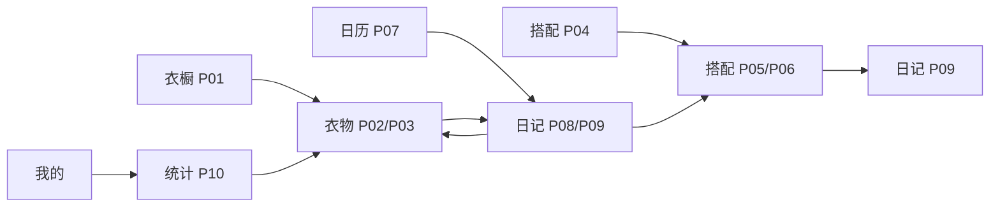

# 页面原型与样式约定

版本：P1-04；定稿日期：2026年11月6日。适用于当前HTML/CSS/JavaScript静态原型，供后续原生微信小程序实现参考。实际验收以docs/P1-04执行与验收记录.md及docs/evidence/P1-04/acceptance-results.json为准。

## 1. 当前范围与演示基线

四入口为衣橱、搭配、日记、我的。已具备衣物/搭配维护、日记新增修改删除、统计和关联浏览的10个业务视图；新增与编辑共用页面，选择器、照片预览、说明弹层及我的不计入10页。

原样例24件衣物、8套搭配、12篇日记；7类数量为7/3/1/6/2/2/3，搭配关联37条、日记关联53条。固定演示基准日2026-11-06，日历初选2026-11-05，10月9篇、11月3篇。所有修改仅本次页面内存有效，刷新恢复原样例，无TMP记录和blob引用。

保持韩系日常女装、暖白/玫瑰色、真实完整单品图和轻分隔。没有新增素材、重新配色、抠图、AI、商城、网络字体或额外框架。品牌图及参考照片仍按assets/SOURCES.md及附图来源清单记录。

## 2. 页面地图

| 编号 | 视图 | 入口及操作 |
| --- | --- | --- |
| P01 | 衣橱列表 | 衣橱tab；名称/分类及在用/归档/全部；新增→P03，单品→P02 |
| P02 | 衣物详情 | 列表、搭配、日记、统计进入；编辑→P03，相关搭配→P05，穿着历史→P08，归档/恢复 |
| P03 | 衣物新增/编辑 | 独立草稿、本地必选图片、字段、保存/取消；成功→对应P02 |
| P04 | 搭配列表 | 搭配tab；场景及归档范围；新增→P06，组合→P05 |
| P05 | 搭配详情 | 全部有序单品→P02，编辑→P06，归档/恢复；记录穿着→P09 |
| P06 | 搭配新增/编辑 | 草稿名称/场景/备注，多选、排序、移除；成功→对应P05 |
| P07 | 穿搭日历 | 日记tab；按周一至周日42格，切月/演示今天；选日摘要→P08或空日补记→P09 |
| P08 | 日记详情 | 日期/场景/心情/文字、可选照片、实际单品和来源；编辑→P09，删除→P07，衣物→P02、来源→P05 |
| P09 | 日记新增/编辑 | 从搭配预填或直接选衣；日期唯一/冲突、照片、清单与顺序；成功→对应P08 |
| P10 | 衣橱统计 | 我的进入；在用/7类/月度/累计Top5/30天未穿；点单品→P02 |
| 辅助 | 我的与3种弹层 | 我的显示在用衣物/搭配/日记数及说明；衣物选择、日记看图、资料/登录说明复用dialog |

资料和登录只有说明，不收账号密码、不修改demoProfile，不假装登录/退出成功。

## 3. 导航、草稿与返回

根tab保留自己的查询、归档范围、月份和DOM滚动。子视图使用内存stack及subview；帧只存kind/id/mode/scroll，返回时读当前工作数据，不能缓存旧日记清单或统计结果。返回根页清空隐藏子视图内容，避免残留控件。

新增保存后表单帧变为目标详情；编辑保存撤去表单回原详情，不再返回旧表单。无修改返回直接退出；有修改用原生confirm，拒绝保留草稿和位置，确认放弃不写工作记录。改回初值不再提示。浏览器刷新/关闭仅脏草稿注册beforeunload，取消离开不撤销图片。

保存日记时日历定位保存日期；跨月改期移除旧日期标记、出现新日期标记。来源为搭配时成功详情返回搭配，不强切tab；日历在后台同步。删除确认后清空子栈、切日记tab、选被删原日期显示空摘要；取消删除全部不变。

只读关联跳转和统计月份不改变根日历选日。统计月份独立，初始2026-11。日历切月选当月第一篇记录，否则月首；可浏览未来月但未来日无新增入口。“演示今天”定位11月6日。

滚动以进入视图前实际来源位置为准：点击前用户或浏览器为使按钮可见而产生的滚动属于正常操作，不能与更早的位置比较；内容变短时自然限制到合法范围。数据重绘不清掉另一入口筛选。

## 4. 当前视觉数值

| 项目 | 规则 |
| --- | --- |
| 色彩 | 背景#FAF8F5、白表面、主文字#2F2D32、次文字#6D6670、强调#A34F69、浅底#F6E7ED、分隔#E8E2E3；错误#A32C42 |
| 字体 | 系统字体；页头/详情主标题22px、分区16px、正文14px、辅助/计数/图例最低12px。统计总数40px；列表/标签等次级内容12～13px |
| 间距 | 页面左右14px、衣物列间10px、字段间22px；详情分区上26px/下12px；少阴影，不将每个数字做卡片 |
| 圆角 | 控件8px、搜索10px、图片9px、底部弹层约21px，保留角色区别 |
| 单品图 | 两列4:5，object-fit:contain；完整保留袖口/裙摆/配饰和源背景/颜色字样，不裁图来填满容器 |
| 搭配 | 列表真实2×2缩略图、显示全部件数；详情全部有序单品。超过4件不截断成4件 |
| 日记照片 | 原比例完整展示，放大图可用区contain；源参考图标明“非真实用户自拍”，本次选图标明临时预览 |
| 名称 | 列表网格最多两行，点详情读完整名称；详情标题/关联行/已选行/标签允许长中文和连续英文换行，不缩字号或篡改名称 |
| 点击区域 | 独立按钮至少44×44px；日期行48px、四周留白后按钮高44px；筛选按钮宽≥44px、高44px、间距12px，仍横向滚动 |
| 状态 | 筛选下划线/文字、选择器轮廓/勾选/数量、tab图标文字与选中线；归档为独立可见文字，日历摘要也保留 |
| 焦点/动效 | button/input/select/textarea/summary有可见主题focus-visible；仅保留约180ms弹层变化，尊重减少动效设置 |

44px为本项目约定，不声称外部认证。原图内嵌文字不按界面字号修改。单行输入框的光标水平滚动、筛选条预定的横向滚动是明确例外；主内容/关联行/选择器不得因名称溢出。

## 5. 表单、面板及反馈

| 表单 | 当前规则 |
| --- | --- |
| 衣物 | 图片必选；名称trim后1～40字符，颜色1～20；分类为7类之一，季节为现有8个选项；备注0～500 |
| 搭配 | 名称1～40、场景1～20、备注0～500；1～20件有效、去重、有序衣物 |
| 日记 | 真实YYYY-MM-DD且不晚于演示日，每用户每天一篇、编辑排除自身；场景1～20，心情选填非空1～12，文字0～1000；1～20件去重有序单品；照片/来源可空 |
| 图片 | JPEG/PNG、最大5MiB、可解码；当前只选本地预览，无网络上传。无效文件保留此前有效图 |

字符数按Array.from计，超限草稿保留并提示，不依靠maxlength静默截断。字段旁显示错误，保存时定位首错；输入只改草稿、成功校验后一次提交到工作数据。日记空心情落null，空文字为空串，移除照片为null。

选择器有自己的草稿，确认只改变父草稿，取消/Escape/遮罩不改父表单；筛选和归档开关不清已选，清筛选保留归档开关。已选0件可回表单但不能保存，达到20件后仍可反选。首项上移/末项下移禁用，顺序调整后目标行可见。

选择器标题/关闭及底部数量/确定固定，中间独立滚动；已选标签最大宽度受容器限制、长词可断行。资料/登录说明和照片预览不得残留选择器底栏。关闭语义统一“关闭”，返回原触发位置。

主保存/确定、次取消/返回/清筛选与既有样式一致。删除明确确认；归档/恢复立即改变状态；删除后空日、保存消息均是反馈，不增加假服务器进度或自动重试。

加载、JSON失败/手动重载、单张图片失败、筛选无结果、无在用项、空月/空榜单分别处理。无照片日记展示所选衣物，不误报失败，不补无关真人照。

## 6. 数据语义和原生开发交接

| 项目 | 当前与后续约定 |
| --- | --- |
| ID | CLO/OUT/DIA及TMP只是稳定演示键，临时ID按实体成功创建递增、删除不回收；建库使用整数ID并保存导入映射 |
| 来源独立 | 从搭配只复制当时清单/场景，实际日记保存自己的衣物数组和顺序；修改来源不改旧日记，主动编辑日记才改变本篇 |
| 属性 | 衣物名称/图片使用当前值，不保存属性历史；日记独立照片不跟随衣物换图 |
| 日期 | 原型固定演示日，正式服务端改按Asia/Shanghai当天；数据库需真实唯一约束保护每人每天一篇，不能靠本页查重代替 |
| 归档 | 不物理删衣物/搭配，不删除日记关系，允许带标记查看/补记，归档不改变历史月天数 |
| 统计 | 在用衣物与分类，月天数按日记篇数；次数为包含该衣物的日记数、最近日为MAX；Top5次数降序/ID升序；30天[10月8日,11月6日]含首尾、含从未穿，切月只改月度天数 |
| 图片 | 自有URL按工作衣物/工作日记/草稿/待解码引用保留，无引用才释放；取消浏览器离开不提前释放。正式上传/鉴权/重启后读取须独立实现验证 |
| 用户与事务 | 当前仅DEMO001，不代表双账号隔离、事务、权限已通过；正式接口/数据库遵循7表及既定归属和事务约定 |
| 工程 | 原生开发复用页面和语义，不将HTML包装成小程序；当前没有真实API、MySQL、小程序编译或AppID验证 |

## 7. 已明确的原型简化和待实现项

衣橱当前为名称/分类筛选，颜色/季节筛选留正式衣橱模块；搭配名称搜索留正式搭配模块。当前无分页，统计与历史全量展示；正式列表分页按总设计实施。衣物首图完整但不支持点击放大，日记照片已有放大；原生衣物预览后续补齐。登录/注册/资料写入、上传持久化、真实用户隔离与服务器日期均留正式阶段。

这些简化不删除最终需求，也不声称正式新增控件已经完成设计；对应阶段补控件和验证。P1-04不开始P2-01。

## 8. 当前截图与复查

证据根目录为docs/evidence/P1-04。两宽度的当前矩阵按以下文件查阅，375前缀另有对应430文件：

| 页面/状态 | 代表文件 |
| --- | --- |
| 衣橱、衣物详情、新增/编辑 | 375-P01-list.png、375-P02-detail.png、375-P03-new-top.png、375-P03-edit-top.png |
| 搭配列表、详情、新增/编辑 | 375-P04-list.png、375-P05-detail.png、375-P06-new-top.png、375-P06-edit-top.png |
| 日历、日记照片、日记新增/编辑 | 375-P07-calendar.png、375-P08-photo.png、375-P09-new-top.png、375-P09-edit-top.png |
| 统计与末尾、我的 | 375-P10-statistics.png、375-P10-bottom.png、375-me.png |
| 长名称 | 375-long-picker-latin.png、375-long-related-bottom.png及latin/zh名称版本 |
| 弹层 | 375-modal-photo.png、375-modal-profile.png、375-modal-login.png |
| 归档/冲突/错误 | 375-archive-summary-bottom.png、375-P09-conflict.png、375-data-error.png、375-image-error.png |
| 长内容/较矮区域 | 375-P09-max-top.png、375-P09-max-bottom.png；375-clothing-long-bottom.png、375-outfit-long-bottom.png、375-diary-long-bottom.png及对应keyboard-height版本 |
| 连续流程 | 375-flow-record-statistics.png、375-flow-delete-statistics.png及automated-results.json的flowTrace |

特殊状态375图为代表，不承诺每个特殊文件均有430副本；两宽度完整矩阵和长内容以实际索引为准。浏览器确认/日期/文件控件外观由浏览器决定。

本地地址http://127.0.0.1:4173/prototype/，必须以项目根目录提供静态服务。浏览器尺寸375×812、430×932，460px可用高度模拟键盘；不等同微信真机和手机输入法验收。完整命令和交付说明见P1-04执行与验收记录。旧轮次依据保留在P1-01～03执行记录及标签，不在本文保留已失效的“日记只读”等状态。
